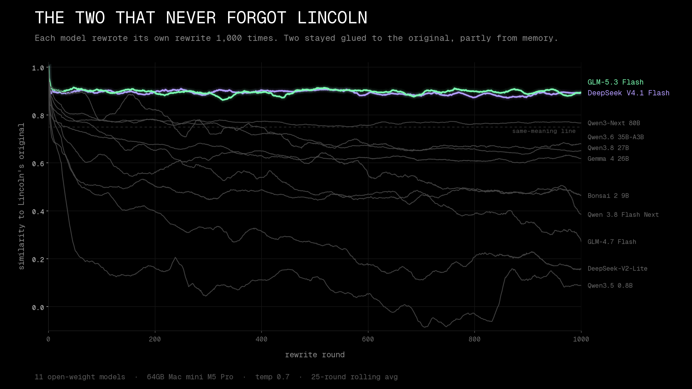
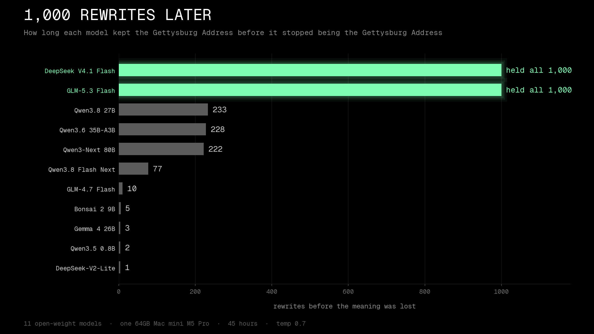

# 1,000 Rewrites Later

Date: 2026-10-23 to 2026-10-25

What happens when a model rewrites its own output over and over? I gave 11 open-weight models the Gettysburg Address and had each one rewrite its own previous rewrite 1,000 times, all running locally on my Mac mini. Then I measured how far the meaning drifted from Lincoln's original.



## The setup

Mac mini, Apple M5 Pro, 64 GB, macOS 27.0.1, with the stock GPU memory limit. Python 3.12.

- **Seed text:** the Gettysburg Address (public domain), in `scripts/rewrites/seed_gettysburg.txt`
- **Prompt, every round,** with no system prompt and no history:

  ```
  Rewrite the following text in your own words. Keep the same meaning and roughly the same length. Output only the rewritten text, with no title, no preamble and no notes.

  Text:
  {text}
  ```

  `{text}` is the previous round's output. Round 1 uses the original.
- **Sampling:** temperature 0.7, top_p 0.95, seed 42, up to 900 new tokens, thinking off. A second "hot" run at temperature 1.0 repeated 8 of the models.
- **Runtimes:** mlx-lm (MLX 0.32.x) or mlx-vlm 0.7.10 in-process for the 9 models that fit in memory. The 2 biggest models are far larger than 64 GB, so they ran on local servers that stream mixture-of-experts weights from the SSD: sushi 1.3.0 for GLM-5.3 Flash and oMLX for DeepSeek V4.1 Flash.

That's 19 runs and 19,019 rows in total. All 19,000 rewrites ended normally (none hit the token limit), with no retries.

## How I measured

- **Similarity to the original:** cosine similarity between each round and the original, using `sentence-transformers/all-MiniLM-L6-v2` embeddings.
- **The same-meaning line:** a similarity of 0.75.
- **Collapse round:** the first round of the first 3-round streak where the similarity is under 0.75, more than half the word trigrams repeat, the text shrinks below 30% of the original, or a round fails. If that never happens, the model held the meaning for all 1,000 rounds.
- **Speed:** generation tokens per second as reported by the runtime, averaged over every round. Peak memory is MLX's peak reading for the in-process runs. The two server runs have no peak memory number.

The metric and collapse code is `scripts/rewrites/analyze.py`.

## Results



| Model | Collapse round (temp 0.7) | Collapse round (temp 1.0) | Final similarity (0.7) | Mean tok/s (0.7) | Peak memory (0.7) |
| --- | --- | --- | --- | --- | --- |
| GLM-5.3 Flash (SSD-streamed) | never | not run | 0.912 | 5.8 | not measured |
| DeepSeek V4.1 Flash (SSD-streamed) | never | not run | 0.896 | 5.5 | not measured |
| Qwen3.8 27B | 233 | not run | 0.654 | 17.7 | 16.15 GB |
| Qwen3.6 35B-A3B | 228 | 140 | 0.659 | 100.2 | 20.15 GB |
| Qwen3-Next 80B | 222 | 34 | 0.776 | 71.4 | 45.48 GB |
| Qwen 3.8 Flash Next (pruned) | 77 | 2 | 0.335 | 40.3 | 46.88 GB |
| GLM-4.7 Flash | 10 | 7 | 0.205 | 83.7 | 17.30 GB |
| Bonsai 2 9B | 5 | 9 | 0.435 | 71.4 | 4.35 GB |
| Gemma 4 26B | 3 | 5 | 0.627 | 85.1 | 14.69 GB |
| Qwen3.5 0.8B | 2 | 2 | 0.094 | 349.8 | 0.97 GB |
| DeepSeek-V2-Lite | 1 | 1 | 0.225 | 136.1 | 9.35 GB |

- Every model that fit fully in 64 GB crossed the same-meaning line eventually. The best lasted about 230 rounds.
- The only two runs that held the meaning for all 1,000 rounds were the two big SSD-streamed models. They ended at 248 and 249 words against the original's 278. They ran at about 5.5 to 5.8 tok/s, and each took about 17 to 19 hours.
- A hotter temperature (1.0) made 4 of the 8 models collapse sooner. Qwen3-Next 80B went from 222 to 34 and the pruned Qwen 3.8 Flash Next from 77 to 2. Gemma 4 26B and Bonsai 2 9B collapsed slightly later, and DeepSeek-V2-Lite and Qwen3.5 0.8B didn't change.
- Small models shrink the text fast. Qwen3.5 0.8B ended at 27 words and DeepSeek-V2-Lite at 13.
- Total generation time was about 45 hours: 6.6 for the main run, 2.4 for the hot run and 35.9 for the two SSD-streamed runs.

## Caveats

- One seed text, one prompt and one sampling seed per run. These are single runs, not averages, and a different seed could move a collapse round a lot.
- The 0.75 line and the collapse rule are rules of thumb tied to one small embedding model. It measures how close the topic and meaning are, not how faithful the text is.
- Quantization differs from model to model (2-bit to 4-bit, plus one pruned model), so this compares the local builds I ran, not the base models.
- The two SSD-streamed runs were paused and resumed across sessions, so they spanned more clock time than their generation time.
- The model names are as published in their Hugging Face repos.

## Files

- Results: `results/2026-10-25-1000-rewrites.json` (one entry per run, with the final text) and `results/2026-10-25-1000-rewrites.csv`
- Script: `scripts/rewrites/analyze.py` and the seed text
- Every round's text is in the Hugging Face dataset [pratikgx/1000-rewrites-later](https://huggingface.co/datasets/pratikgx/1000-rewrites-later)
