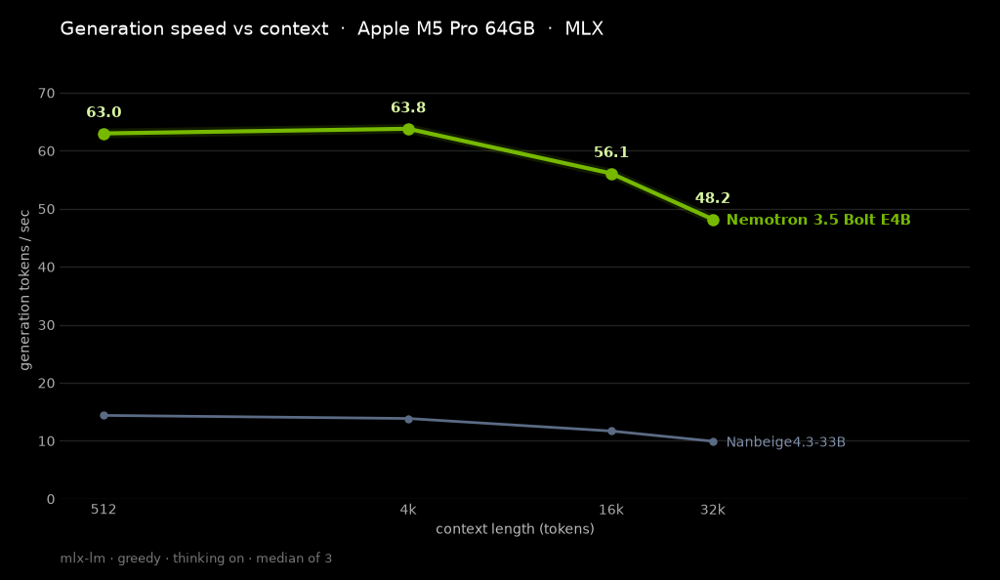

# NVIDIA Nemotron 3.5 Bolt E4B on my Mac mini

Date: 2026-10-26

[Nemotron 3.5 Bolt E4B](https://huggingface.co/mlx-community/NVIDIA-Nemotron-3.5-Bolt-E4B-OptiQ-4bit) is a small open-weight model from NVIDIA: 8B parameters in total and 4B effective. I ran the OptiQ mixed 4/8-bit MLX build on stock mlx-lm.

## The setup

Mac mini, Apple M5 Pro, 64 GB unified memory. Stock mlx-lm, temperature 0, thinking on.

## How I measured

- **Speed:** decode speed, prompt processing speed and time to first token at 512, 4K, 16K and 32K tokens of context. Each number is the median of 3 runs.
- **Memory:** MLX's own peak memory number.
- **Quality:** a fixed small suite of math, code and instruction-following prompts, plus needle-in-a-haystack retrieval at 32K and 64K.

## Results

| Context | Decode | Time to first token | Prompt processing | MLX peak memory |
| --- | --- | --- | --- | --- |
| 512 | 63.0 tok/s | 0.14 s | 3,642 tok/s | 7.28 GB |
| 4K | 63.8 tok/s | 0.93 s | 4,446 tok/s | 7.50 GB |
| 16K | 56.1 tok/s | 4.12 s | 4,007 tok/s | 8.11 GB |
| 32K | 48.2 tok/s | 9.07 s | 3,632 tok/s | 8.92 GB |

| Quality test | Result |
| --- | --- |
| Math | 20/20 |
| Code | 10/10 |
| Instruction following | 9/10 |
| Needle retrieval (32K and 64K) | 8/8 |

The chart puts it next to Nanbeige4.3-33B from the day before (`notes/2026-10-25-nanbeige4.3-33b.md`), also on MLX with thinking on.

The quality suite is small, so treat it as a sanity check, not a score.

## Files

- Results: `results/2026-10-26-nemotron-3.5-bolt-e4b.json` and `results/2026-10-26-nemotron-3.5-bolt-e4b.csv`
- Hugging Face dataset: [pratikgx/mac-mini-local-benchmarks](https://huggingface.co/datasets/pratikgx/mac-mini-local-benchmarks) (the `nemotron-3.5-bolt-e4b` tab)
