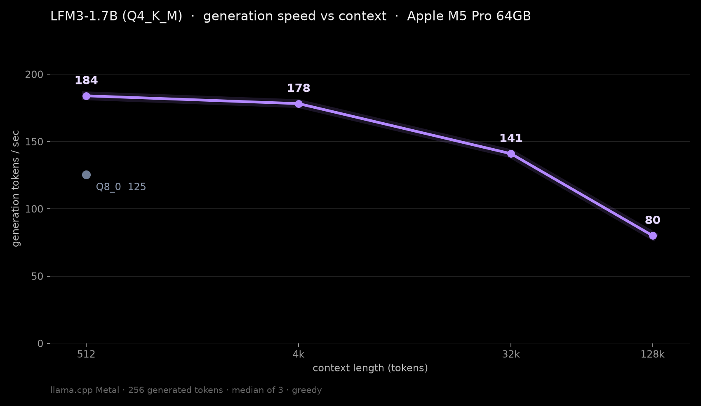

# LFM3-1.7B on my Mac mini

Date: 2026-10-27, with an update on 2026-10-29

[LFM3-1.7B](https://huggingface.co/LiquidAI/LFM3-1.7B-GGUF) is a 1.7B open-weight model from Liquid AI. I measured its speed on launch day, then went back two days later for clean runs with real prompts at 4K and 128K. All credit for the model goes to Liquid AI.



## The setup

Mac mini, Apple M5 Pro, 64 GB, macOS 27.0.1, plugged in, no thermal warnings recorded.

mlx-lm didn't support the `lfm3` architecture yet, so this ran on llama.cpp instead: built from master at commit `eb7818c`, Metal, all layers on the GPU (`-ngl 99`), flash attention on. llama.cpp's LFM3 support had been merged the same day. The files are Liquid's `LFM3-1.7B-Q4_K_M.gguf` (1.09 GB) and `LFM3-1.7B-Q8_0.gguf` (1.84 GB). These numbers don't compare directly with MLX results.

## Oct 27: launch-day speed

`llama-bench`, 256 generated tokens per run, 1 warmup and 3 timed runs, medians reported. Prompt speed at 512 and 4K. Generation speed at depths of 512, 4K, 32K and 128K. Q8_0 was only measured at 512.

| Build | Context | Prompt tok/s | Generation tok/s | Generation runs | GPU memory |
| --- | --- | --- | --- | --- | --- |
| Q4_K_M | 512 | 5,776 | 184.0 | 185.9 / 184.0 / 184.0 | not measured |
| Q4_K_M | 4K | 5,656 | 178.2 | 178.2 / 182.3 / 177.3 | 1.43 GB |
| Q4_K_M | 32K | not measured | 141.0 | 141.2 / 141.0 / 138.0 | not measured |
| Q4_K_M | 128K | not measured | 80.1 | 81.4 / 80.1 / 66.4 | 3.15 GB |
| Q8_0 | 512 | 3,577 | 125.5 | 125.4 / 125.0 / 127.5 | not measured |

GPU memory here is llama.cpp's Metal allocation (model plus context plus compute buffers). Background apps were running, and the 128K runs had about an 18% spread.

**KV cache check.** Liquid says the KV cache is 1.6 GB at 128K. With a 131,072-token context, llama.cpp allocated a 1,536 MiB (about 1.61 GB) F16 KV cache, which matches. Only 6 of the 24 layers keep a full cache. 13 are gated short convolution layers and 5 use sliding-window attention with a 256-token window. The whole allocation at 128K was 3,004 MiB: 1,040 for the model, 1,544 for the context and 419 for compute.

**Smoke test,** Q4_K_M with thinking on, 3 prompts. It got 17 × 23 right (391) and named three planets correctly after a long reasoning block. On "write is_prime in Python" it was still reasoning when it hit the 1,024-token cap. A tiny sample, not a quality eval.

## Oct 29: clean real-prompt runs

Same Mac, same llama.cpp build, same Q4_K_M file. This time the prompts were real text (chunks of the llama.cpp docs, then "Summarize the documentation above in five bullet points."), with no heavy background load. Normal desktop apps were still open.

```
llama-completion -m LFM3-1.7B-Q4_K_M.gguf -f p{4k,128k}.txt -c 133376 -n 256 --ignore-eos -ngl 99 -fa on --temp 0 --seed 42 -no-cnv
```

Mean of 2 runs after one 4K warmup. Time to first token is measured: llama.cpp's prompt eval time plus one generation step. Memory is from `/usr/bin/time -l` on the whole process.

| Prompt | Prompt tokens | Prefill tok/s | Time to first token | Generation tok/s | Max RSS | Peak footprint |
| --- | --- | --- | --- | --- | --- | --- |
| 4K | 4,196 | 5,480 | 0.77 s | 178.4 | 2.94 GB | 1.85 GB |
| 128K | 130,662 | 1,931 | 67.7 s | 81.9 | 3.22 GB | 2.13 GB |

`llama-bench`, 2 repetitions each:

| Test | Mean |
| --- | --- |
| Prefill, 4,096 tokens | 5,369 tok/s |
| Generation, 256 tokens at 4,096 depth | 176.6 tok/s |
| Prefill, 131,072 tokens | 1,962 tok/s |
| Generation, 256 tokens at 131,072 depth | 82.1 tok/s |

I also recorded one pass on screen for a video, so it's a single run with screen recording on: 4K at 5,382 tok/s prefill, 0.79 s to first token and 173.4 tok/s, and 128K at 1,878 tok/s prefill, 69.6 s to first token and 78.1 tok/s.

## Caveats

- Speed only. No quality suite was run.
- The Oct 29 numbers are means of 2 runs, so treat the decimals loosely.
- The Oct 27 and Oct 29 runs used different methods and background load, so read them as separate sets, not a before and after.

## Files

- Results: `results/2026-10-27-lfm3-1.7b.json` (both days), `results/2026-10-27-lfm3-1.7b.csv` (Oct 27) and `results/2026-10-29-lfm3-1.7b.csv` (Oct 29)
- Hugging Face dataset with the raw llama.cpp logs and prompt files: [pratikgx/lfm3-1.7b-m5-pro-mac-mini-bench](https://huggingface.co/datasets/pratikgx/lfm3-1.7b-m5-pro-mac-mini-bench)
