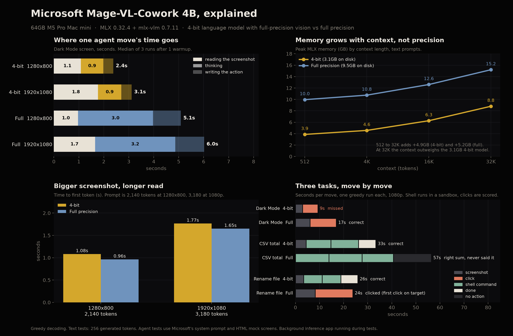
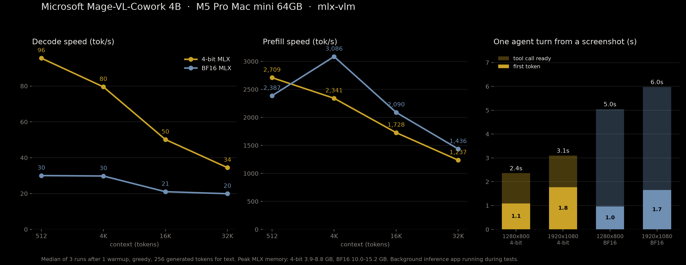

# Microsoft's Mage-VL-Cowork 4B on my Mac mini

Date: 2026-10-30

Microsoft released Mage-VL-Cowork, a 4B open-weight computer-use agent, on the morning of Oct 30. It looks at a screenshot and then either clicks like a person or types a terminal command. That evening I ran it on my Mac mini, in a 4-bit build I made myself and at full precision (BF16).

## The build

There was no MLX version yet. Microsoft's weights use a key layout that mlx-vlm 0.7.11 can't read, so I renamed the weight keys to its `mage_vl` format and copied every weight byte for byte (`scripts/mage/remap.py`). Then I converted it two ways with `mlx_vlm.convert`:

- **4-bit:** the language model quantized to 4-bit (group size 64), with the vision part that reads the screen left at full precision. That works out to 5.3 bits per weight and 3.1 GB on disk. It loads in 0.7 seconds.
- **Full precision:** BF16, nothing quantized. 9.5 GB on disk, loads in 1.2 seconds.

The 4-bit build is on Hugging Face at [pratikgx/Mage-VL-Cowork-MLX-4bit](https://huggingface.co/pratikgx/Mage-VL-Cowork-MLX-4bit). The model is Microsoft's and it's Apache 2.0.

## The setup

Mac mini, Apple M5 Pro, 64 GB, macOS 27.0.1. MLX 0.32.4 and mlx-vlm 0.7.11 on Python 3.12. Plugged in, with no thermal warnings at the start or end of either run. A background inference app was running during tests, so an idle Mac may be a little faster.

The agent tests use Microsoft's own system prompt (`scripts/mage/system_prompt.txt`).

## How I measured

- **Text speed** (`scripts/mage/mage_bench.py`): filler-text prompts at 512, 4K, 16K and 32K tokens. Greedy decoding, 256 tokens generated each time. 1 warmup, then 3 timed runs, and each number is the median of the 3.
- **Time to first token:** clocked from the moment the prompt goes in to the first token coming out.
- **Peak memory:** reset and read straight from MLX on every run.
- **One agent move** (same script): a Settings screenshot plus the instruction "Turn on Dark Mode." I logged 3 marks inside each reply: done reading the screenshot (first token), done thinking, and action written. Again 1 warmup and the median of 3 runs.

## The tasks

I built 3 fake screens in HTML (a Settings page, a spreadsheet and a file manager) and rendered them at 1280x800 and 1920x1080 (`scripts/mage/screens/`).

The demo (`scripts/mage/demo.py`) gives each task a fresh sandbox folder of dummy files and up to 6 moves:

1. Turn on Dark Mode.
2. Total the Revenue column in `sales.csv` (the answer is 66026.61).
3. Rename `report_final_v2.docx` to `Q3_report.docx`.

Shell commands really ran, but only inside that folder. A filter blocked sudo, curl, rm -rf and any path outside it. Clicks were recorded and scored against the target, not executed.

Each task ran once per build, greedy. That's a small sanity check, not a score, so don't read accuracy into it.

## What I found

1. **Reading the screen costs about the same at either precision.** On a 1080p screenshot the first token came after 1.8 s at 4-bit and 1.7 s at full precision. At 1280x800 it was 1.1 s and 1.0 s. My read: the speed gap is almost all in what comes after the model has seen the screen.

2. **Where a 1080p move's time goes.** At 4-bit: 1.8 s reading, 0.9 s thinking, 0.4 s writing the action, 3.1 s total. At full precision: 1.7 s reading, 3.2 s thinking, 1.2 s writing the action, 6.0 s total.

3. **Pixels cost tokens.** The 1080p prompt is 3,180 tokens and the 1280x800 one is 2,140. Those extra 1,040 tokens add about 0.7 s of reading to every move, in both builds.

4. **Memory grows with context, not precision.** Peak memory at 4-bit went 3.9, 4.6, 6.3 and 8.8 GB at 512, 4K, 16K and 32K. At full precision it went 10.0, 10.8, 12.6 and 15.2 GB. Going from 512 to 32K adds 4.9 GB at 4-bit and 5.2 GB at full precision. At 32K the context alone takes more memory than the whole 3.1 GB 4-bit model.

5. **Decode speed.** 4-bit wrote 95.6, 79.5, 50.2 and 34.5 tokens per second across the 4 context lengths. Full precision wrote 30.0, 29.8, 21.0 and 19.9.

6. **It reaches for the terminal.** At 4-bit it did the CSV and the rename in the shell, not by clicking. Then it checked its work: it reran the sum with exact decimal math, and it listed the folder to confirm the new file was there and the old one was gone. Microsoft's system prompt does tell it to use the shell to check things, which is likely why. Full precision tried to rename by clicking. Its first click landed on the right file, but since clicks aren't executed here, nothing was renamed.

7. **History slows it down.** The first move on the Dark Mode task took 3.0 s at 4-bit. The second, carrying both screenshots in a 5,351-token prompt, took 6.4 s. (One run each.)

8. **The one click task is the one 4-bit missed.** It clicked 42 pixels to the right of the Dark Mode toggle. Full precision hit it.

9. **Full precision found the CSV total and then never said it.** 66026.61 showed up in its shell output, but its last move had no usable action, so it never reported the answer. My read is that this is more likely a problem with the MLX port than with the model, but that's one sample.

## What broke

- **The weights didn't load.** mlx-vlm 0.7.11 knows the `mage_vl` model, but Microsoft's checkpoint uses different key names. Remapping the keys fixed it.
- **The first two demo passes had harness bugs.** One pointed at the wrong sandbox path, and the other leaked the real folder path into the model's tool output. I fixed both and reran, and only the clean runs are here.

## Files

- [results/2026-10-30-mage-vl-cowork.json](../results/2026-10-30-mage-vl-cowork.json) and [.csv](../results/2026-10-30-mage-vl-cowork.csv): every speed, memory and agent-move number, plus the demo traces. The bandwidth columns are estimates from the model's size, not measured.
- [results/2026-10-30-mage-vl-cowork/](../results/2026-10-30-mage-vl-cowork/): the raw bench and demo output for each build.
- [scripts/mage/](../scripts/mage/): the remap, bench, demo, summary and chart scripts, the system prompt and the mock screens. See its README to run it yourself.
- Hugging Face dataset with every run, log and script, including the PyTorch parity checks: [pratikgx/mage-vl-cowork-m5-pro-mac-mini-bench](https://huggingface.co/datasets/pratikgx/mage-vl-cowork-m5-pro-mac-mini-bench)
- 4-bit build: [pratikgx/Mage-VL-Cowork-MLX-4bit](https://huggingface.co/pratikgx/Mage-VL-Cowork-MLX-4bit)
- 
