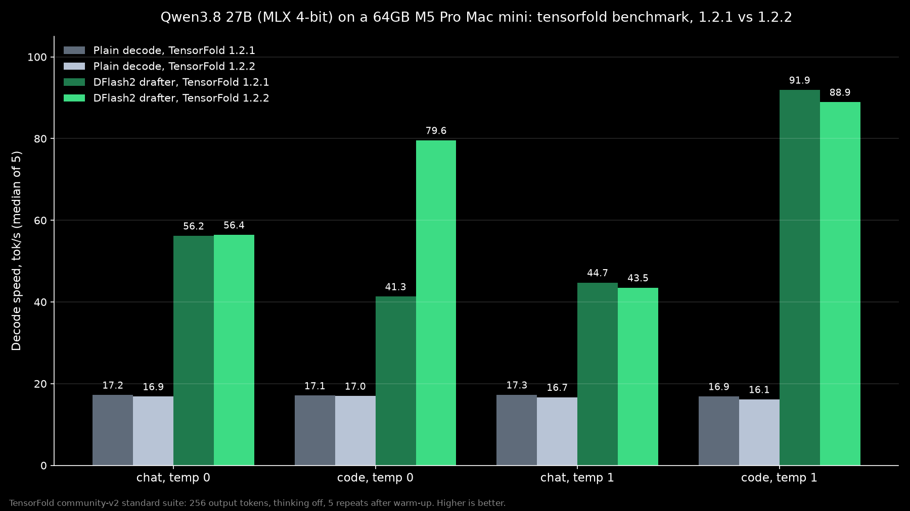
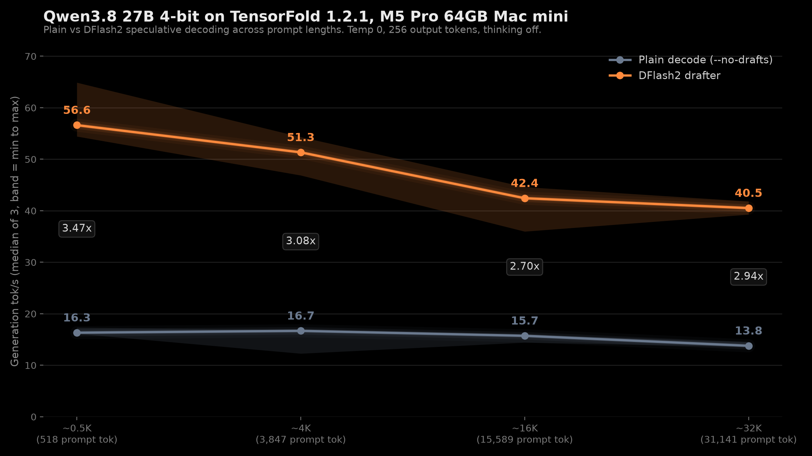

# Qwen3.8 27B on TensorFold 1.2.1 and 1.2.2

Date: 2026-11-03

I ran Qwen3.8 27B on TensorFold on my Mac mini, plain and with the DFlash2 drafter, then again after TensorFold 1.2.2 came out the same afternoon.

## The setup

Mac mini, Apple M5 Pro, 64 GB. Model TensorFold/Qwen3.8-27B-MLX-4bit, drafter z-lab/Qwen3.8-27B-DFlash2. Standard `tensorfold benchmark`, 256 tokens, thinking off, median of 5 after warmup. The headline cell is chat at temp 0. A background inference app was running during the tests.

## Results (tok/s)

| cell | plain 1.2.1 | plain 1.2.2 | drafter 1.2.1 | drafter 1.2.2 |
| --- | --- | --- | --- | --- |
| chat T0 (headline) | 17.23 | 16.85 | 56.19 | 56.43 |
| code T0 | 17.08 | 16.97 | 41.33* | 79.57 |
| chat T1 | 17.27 | 16.69 | 44.74 | 43.49 |
| code T1 | 16.88 | 16.15 | 91.90 | 88.93 |

The drafter made chat at temp 0 3.26x faster on 1.2.1 and 3.35x on 1.2.2. At temp 0 its output was token for token identical to plain.

*1.2.1 code T0 was slowed by other apps.

## Long prompts

With my own script on `tensorfold serve` (not TensorFold's own method), at a 31K-token prompt 1.2.2 did 14.66 plain and 40.68 with the drafter (1.2.1: 13.78 and 40.52). Peak memory was 26.70 GiB plain and 28.52 GiB with the drafter on both versions.

## What I learned

On this Mac, 1.2.2 isn't faster than 1.2.1. The release's speedups target other hardware. The drafter is the big win either way.

## Data

- Hugging Face: [1.2.1](https://huggingface.co/datasets/pratikgx/qwen3.8-27b-tensorfold-1.2.1-m5-pro-mac-mini-bench) and [1.2.2](https://huggingface.co/datasets/pratikgx/qwen3.8-27b-tensorfold-1.2.2-m5-pro-mac-mini-bench)
- results/2026-11-03-qwen3.8-27b-tensorfold-1.2.1.csv / .json and results/2026-11-03-qwen3.8-27b-tensorfold-1.2.2.csv / .json
