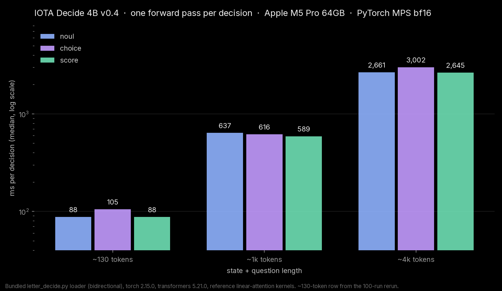

# IOTA Decide 4B v0.4

Date: 2026-11-04

Macrocosmos's IOTA Decide 4B v0.4 on my Mac mini. It doesn't chat, it decides: you hand it a state (a ticket, a policy, an agent trace) plus questions, and one forward pass returns a calibrated probability for every answer.

## The setup

Mac mini, Apple M5 Pro, 64 GB, macOS 27.0.1. A background inference app was running during the tests, so the short-state and card example numbers were rerun clean.

- IOTA Decide 4B v0.4: [macrocosm-os/iota-decide-4b-v0.4](https://huggingface.co/macrocosm-os/iota-decide-4b-v0.4) at repo revision 561f9f8a, bf16 on the Mac's GPU (PyTorch MPS), no CPU fallback needed.
- Loaded with the bundled bidirectional loader: `letter_decide.py`, `load_release_model(path, device='mps')`.
- torch 2.15.0, transformers 5.21.0, accelerate 1.15.0.

## IOTA Decide 4B results (ms per decision, median)

| state length | yes/no | choice (3 options) | score (3 levels) | runs |
| --- | --- | --- | --- | --- |
| ~130 tokens | 87.7 | 105.1 | 87.6 | 100 |
| ~1K tokens | 636.9 | 616.5 | 589.2 | 40 |
| ~4K tokens | 2,661 | 3,002 | 2,645 | 25 |

Short tickets come out to about 11 decisions a second. The card's own example (a refund asked for 45 days after purchase on a 30-day policy) answered all 3 questions in 277.2 ms: eligible 0.0224 yes (correctly not eligible), route refunds at 0.8613, urgency Low at 0.6343. Same answers on every repeat. Ten questions on a ~1K-token state took 5,779 ms, since the loader answers them one at a time. Loading took 12.77 s and the very first call took 2,659 ms while the GPU warmed up. Peak MPS memory was 10.66 GB, and the process RSS topped out at 7.50 GB.

## What I learned

A calibrated decision engine runs comfortably on a desktop Mac. The card quotes about 33 ms per decision, which is Macrocosmos's number on a dedicated GPU with optimized kernels. On Mac the linear-attention layers still run on PyTorch's generic reference kernels, so these numbers are a floor and an optimized Metal path should make it faster. Not measured here: accuracy (JevBench) and batching.

## Data

- Hugging Face benchmark data: [pratikgx/iota-decide-4b-m5-pro-mac-mini-bench](https://huggingface.co/datasets/pratikgx/iota-decide-4b-m5-pro-mac-mini-bench)
- Same day: [TwIL-8B note](2026-11-04-twil-8b.md)
- results/2026-11-04-iota-decide-4b.csv / .json
