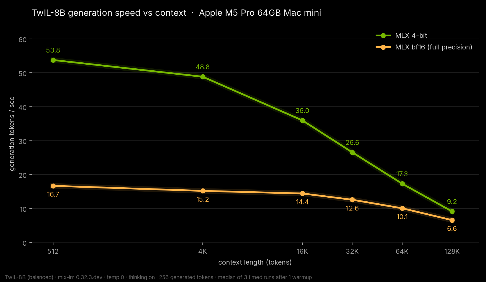
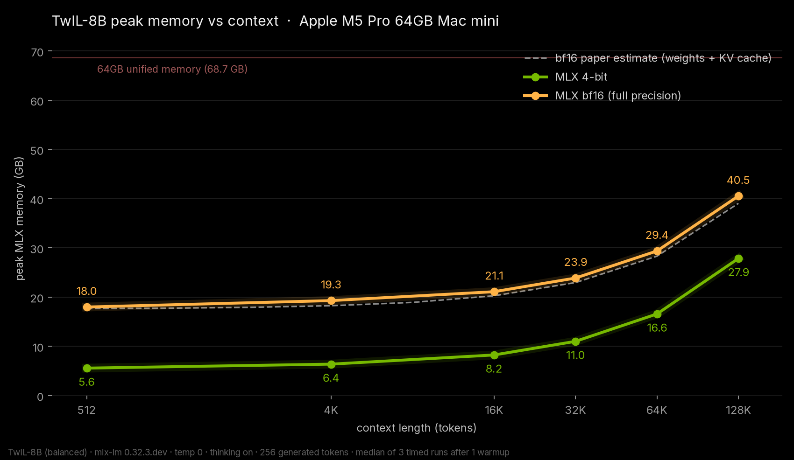
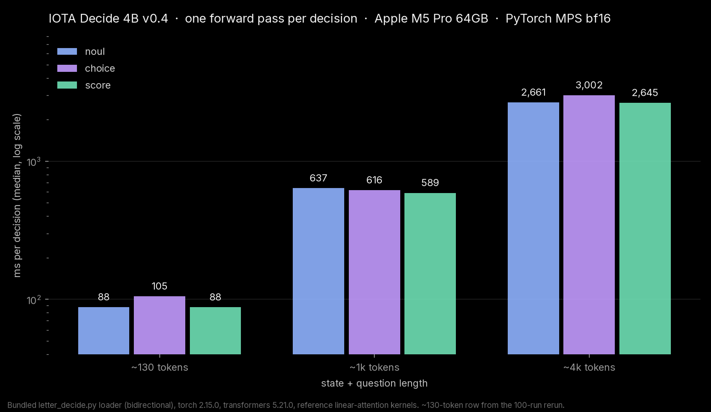

# TwIL-8B and IOTA Decide 4B v0.4

Date: 2026-11-04

Two new models on my Mac mini the same day: webAI's TwIL-8B reasoning model (my own MLX 4-bit and bf16 conversions, plus webAI's GGUF on llama.cpp) and Macrocosmos' IOTA Decide 4B v0.4, a decision model that answers questions with probabilities instead of generating text.

## The setup

Mac mini, Apple M5 Pro, 64 GB, macOS 27.0.1. A background inference app was running during the tests, so some runs were noisy and got rerun.

- TwIL-8B: mlx 0.32.4, mlx-lm 0.32.3.dev12, temp 0, thinking on, 256 generated tokens, median of 3 after 1 warmup. My MLX builds aren't published.
- IOTA Decide 4B: PyTorch 2.15.0 on MPS (Apple GPU), bf16, transformers 5.21.0, the repo's own loader. Measured in ms per decision.

## TwIL-8B results (generation tok/s)

| context | MLX 4-bit | MLX bf16 |
| --- | --- | --- |
| 512 | 53.76 | 16.69 |
| 4K | 48.84 | 15.20 |
| 16K | 35.96 | 14.44 |
| 32K | 26.57 | 12.59 |
| 64K | 17.33 | 10.08 |
| 128K | 9.16 | 6.60 |

Full bf16 with the whole 128K context fits: MLX peak was 40.55 GB. The 4-bit build peaked at 27.85 GB at 128K. webAI's GGUF Q4_K_M on llama.cpp did 49.12 tok/s (tg256). Both MLX builds passed every one of my small quality checks (math, code, instruction following, tool calling, needles up to 64K), and bf16 found the right passphrase among decoys at full 128K, 3/3.

## IOTA Decide 4B results (ms per decision, median)

| state length | yes/no | choice | score |
| --- | --- | --- | --- |
| ~130 tokens | 87.7 | 105.1 | 87.6 |
| ~1k tokens | 636.9 | 616.5 | 589.2 |
| ~4k tokens | 2,660.9 | 3,002.3 | 2,645.5 |

That's 10.9 decisions a second on short tickets. The card's 3-question example took 277.2 ms and gave the right answers (not eligible for a refund, route to refunds). Peak MPS memory was 10.66 GB. The card's ~33 ms figure is from NVIDIA hardware with fast kernels, so it isn't comparable.

## What I learned

TwIL-8B is dense, so it slows down with context faster than hybrid models, but 4-bit is a solid everyday speed and bf16 at 128K still fits with room to spare. IOTA runs fine on a Mac out of the box; it's just slower than on NVIDIA because the optimized linear-attention kernels are CUDA only.

## Data

- Hugging Face: [TwIL-8B](https://huggingface.co/datasets/pratikgx/twil-8b-m5-pro-mac-mini-bench) and [IOTA Decide 4B](https://huggingface.co/datasets/pratikgx/iota-decide-4b-m5-pro-mac-mini-bench)
- results/2026-11-04-twil-8b.csv / .json and results/2026-11-04-iota-decide-4b.csv / .json
