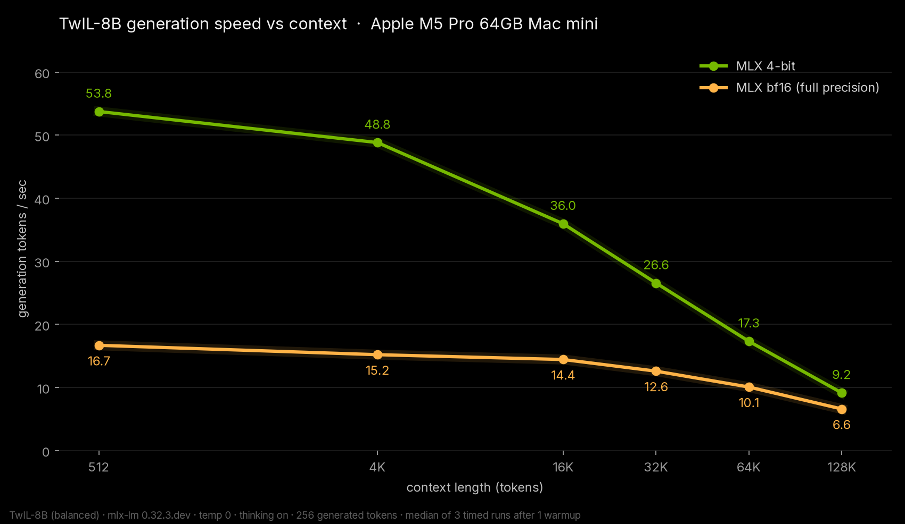
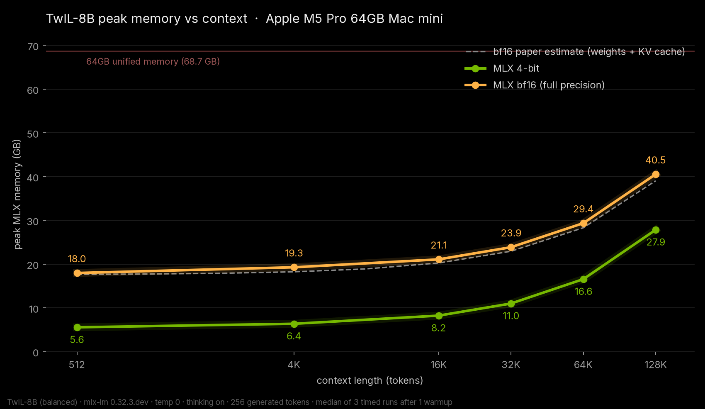

# TwIL-8B

Date: 2026-11-04

webAI's TwIL-8B reasoning model on my Mac mini: my own MLX 4-bit and bf16 conversions, plus webAI's GGUF on llama.cpp.

## The setup

Mac mini, Apple M5 Pro, 64 GB, macOS 27.0.1. A background inference app was running during the tests, so some runs were noisy and got rerun.

- TwIL-8B: mlx 0.32.4, mlx-lm 0.32.3.dev12, temp 0, thinking on, 256 generated tokens, median of 3 after 1 warmup. My 4-bit MLX build is on Hugging Face: [pratikgx/TwIL-8B-MLX-4bit](https://huggingface.co/pratikgx/TwIL-8B-MLX-4bit). The bf16 build isn't published.

## TwIL-8B results (generation tok/s)

| context | MLX 4-bit | MLX bf16 |
| --- | --- | --- |
| 512 | 53.76 | 16.69 |
| 4K | 48.84 | 15.20 |
| 16K | 35.96 | 14.44 |
| 32K | 26.57 | 12.59 |
| 64K | 17.33 | 10.08 |
| 128K | 9.16 | 6.60 |

Full bf16 with the whole 128K context fits: MLX peak was 40.55 GB. The 4-bit build peaked at 27.85 GB at 128K. webAI's GGUF Q4_K_M on llama.cpp did 49.12 tok/s (tg256). Both MLX builds passed every one of my small quality checks (math, code, instruction following, tool calling, needles up to 64K), and bf16 found the right passphrase among decoys at full 128K, 3/3.

## What I learned

TwIL-8B is dense, so it slows down with context faster than hybrid models, but 4-bit is a solid everyday speed and bf16 at 128K still fits with room to spare.

## Data

- Hugging Face benchmark data: [pratikgx/twil-8b-m5-pro-mac-mini-bench](https://huggingface.co/datasets/pratikgx/twil-8b-m5-pro-mac-mini-bench)
- MLX 4-bit model: [pratikgx/TwIL-8B-MLX-4bit](https://huggingface.co/pratikgx/TwIL-8B-MLX-4bit)
- results/2026-11-04-twil-8b.csv / .json
