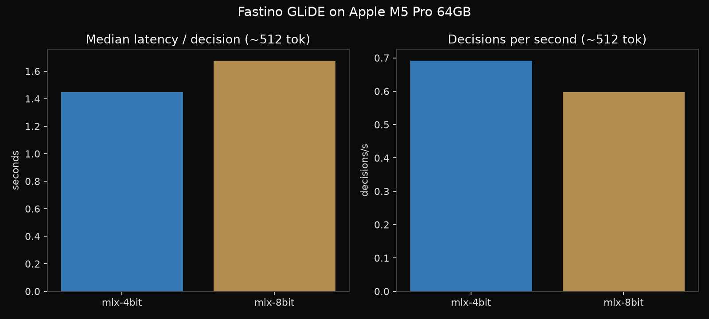

# Fastino GLiDE 27B

Date: 2026-11-05

Fastino's GLiDE on my Mac mini. GLiDE is a decision model, not a chat model: you give it a state and a typed question, and it returns a probability for every option in one forward pass. So I measured seconds per decision and decision accuracy, not tokens per second.

## The setup

Mac mini, Apple M5 Pro, 64 GB. A background inference app was running and was not paused.

- GLiDE v1.2 (27B) through the unofficial community MLX port [glide-mlx](https://github.com/internet-projects/glide-mlx) (commit 3e4e293, glide_mlx 0.1.0), mlx 0.32.4. Builds: [netprojects/GLiDE-mlx-4bit](https://huggingface.co/netprojects/GLiDE-mlx-4bit) and [netprojects/GLiDE-mlx-8bit](https://huggingface.co/netprojects/GLiDE-mlx-8bit). Official weights: [fastino/GLiDE](https://huggingface.co/fastino/GLiDE).
- 20 timed decisions per context length, median and p95.
- Also a short smoke test of [fastino/GLiDE-9B](https://huggingface.co/fastino/GLiDE-9B) on PyTorch MPS (torch 2.14.0, transformers 5.17.0).

## Latency per decision

| build | weights | context | median | p95 | peak memory |
| --- | --- | --- | --- | --- | --- |
| MLX 4-bit | 15.36 GB | ~512 | 1.45 s | 1.51 s | 15.07 GB |
| MLX 4-bit | 15.36 GB | ~2K | 5.41 s | 7.95 s | 15.66 GB |
| MLX 4-bit | 15.36 GB | ~4K | 12.22 s | 17.58 s | 16.54 GB |
| MLX 8-bit | 28.17 GB | ~512 | 1.67 s | 1.72 s | 42.30 GB |
| MLX 8-bit | 28.17 GB | ~2K | 5.81 s | 6.49 s | 42.89 GB |
| MLX 8-bit | 28.17 GB | ~4K | 17.17 s | 18.25 s | 43.77 GB |

Load took 7.58 s for 4-bit and 6.37 s for 8-bit. Sending 8 questions in one request gave 0.67 questions/s on 4-bit and 0.60 on 8-bit, because glide-mlx answers them one at a time.

## Accuracy (public JevBench, 231 items)

| build | total | easy | original | hard |
| --- | --- | --- | --- | --- |
| MLX 4-bit | 213/231 | 48/48 | 72/72 | 93/111 |
| MLX 8-bit | 215/231 | 48/48 | 72/72 | 95/111 |

NetProjects published 213/231 and 215/231 on their M5 Max 128GB. My M5 Pro scores matched theirs.

4-bit and 8-bit picked the same top answer on all 43 questions I compared, with a mean absolute probability difference of 0.001. That is MLX 4-bit against MLX 8-bit on this Mac, not against Fastino's official PyTorch bf16 model.

The 9B on PyTorch MPS took 0.68 s median per decision at about 300 tokens. I did not run the full suite on it.

## What I learned

A 27B decision model fits my Mac mini with lots of room at 4-bit, and even 8-bit fits in 64 GB. Latency grows with the length of the state you feed it, so short states are where it feels quick. The MLX port is community work, so treat these as numbers for that port, not for Fastino's official stack.

## Data

- Hugging Face benchmark data: [pratikgx/glide-27b-m5-pro-mac-mini-bench](https://huggingface.co/datasets/pratikgx/glide-27b-m5-pro-mac-mini-bench)
- results/2026-11-05-glide.csv / .json
