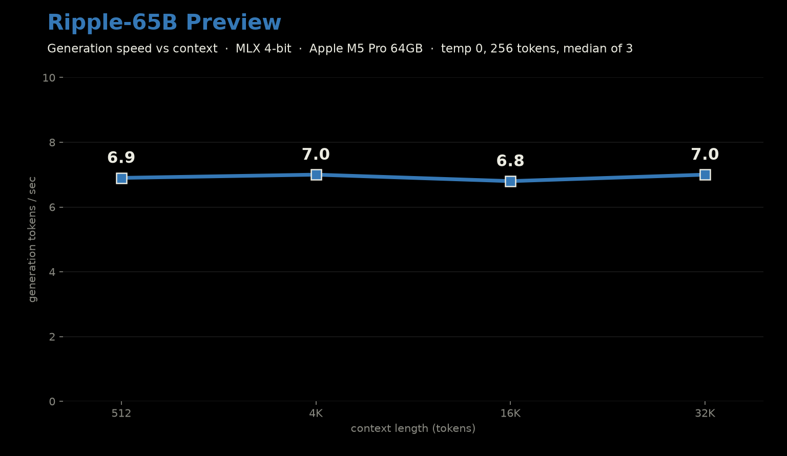
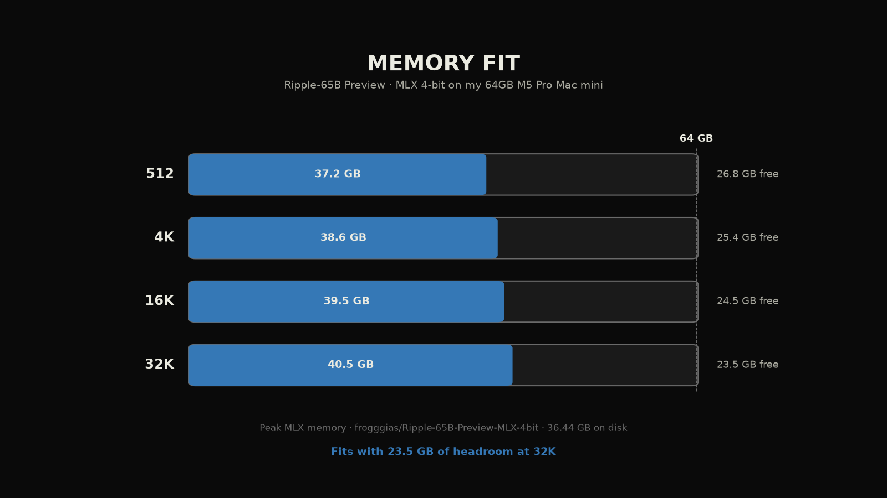
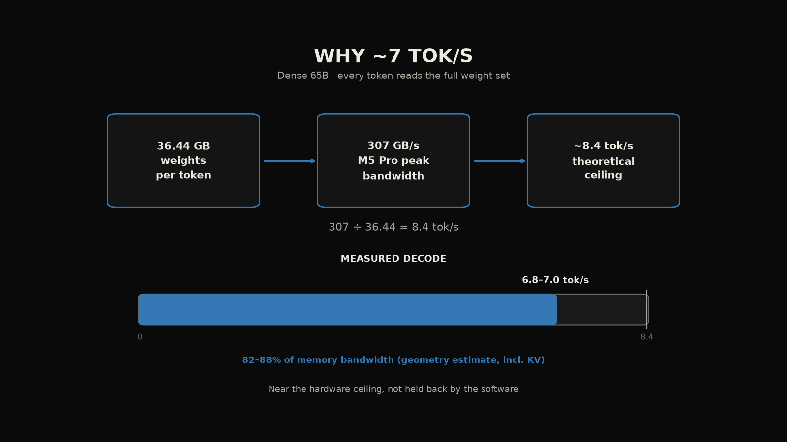
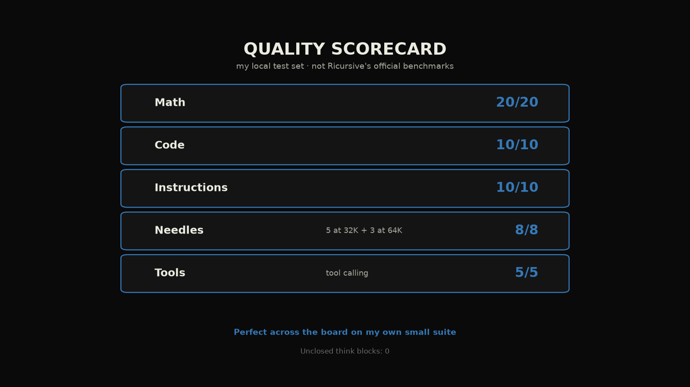
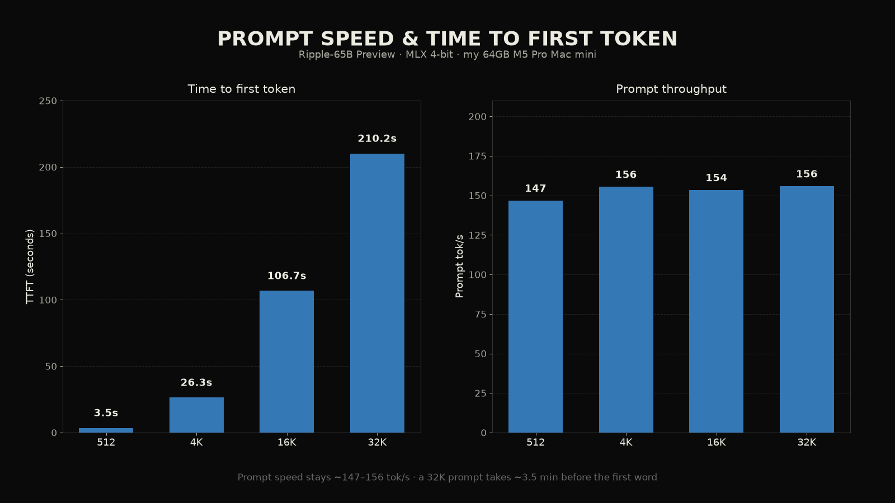

# Ripple-65B Preview

Date: 2026-11-05

Ricursive Intelligence's Ripple-65B Preview on my Mac mini: a dense 65B model trained from scratch for agentic coding, open under Apache 2.0. I ran the community MLX 4-bit build end to end.

## The setup

Mac mini, Apple M5 Pro, 64 GB, macOS 27.0.1. A background inference app was running and was not paused.

- Ripple-65B Preview: mlx 0.32.4, mlx-lm 0.32.3.dev12, temp 0, thinking on, 256 generated tokens, median of 3 after 1 warmup. Build: [frogggias/Ripple-65B-Preview-MLX-4bit](https://huggingface.co/frogggias/Ripple-65B-Preview-MLX-4bit) (36.44 GB on disk, 4.485 bpw) via `trust_remote_code` with `ricursive.py`. Official weights: [ricursiveAI/Ripple-65B-Preview](https://huggingface.co/ricursiveAI/Ripple-65B-Preview).
- TensorFold 1.2.2 and stock llama.cpp eb7818c do not support model architecture `ricursive` yet, so there is no drafter or GGUF comparison here.

## Ripple-65B Preview results (MLX 4-bit)

| context | prompt tok/s | gen tok/s | TTFT | peak memory |
| --- | --- | --- | --- | --- |
| 512 | 146.8 | 6.90 | 3.49 s | 37.21 GB |
| 4K | 155.5 | 7.02 | 26.34 s | 38.65 GB |
| 16K | 153.5 | 6.81 | 106.7 s | 39.46 GB |
| 32K | 155.9 | 6.99 | 210.2 s | 40.53 GB |

Generation stays flat at about 7 tok/s from 512 through 32K. Peak memory at 32K was 40.53 GB, so it fits my 64 GB with about 23.5 GB of headroom. Effective bandwidth (geometry estimate, not a hardware counter) was about 82 to 88% of the M5 Pro's 307 GB/s peak.

On my own local test set it went 20/20 on math, 10/10 on code, 10/10 on instruction following, 5/5 on tool calls, and 8/8 on needles (five at 32K and three at 64K). That suite is small and is not comparable to Ricursive's TerminalBench numbers.

## What I learned

A dense 65B model reads every weight for every token it writes, so about 7 tok/s is close to what this chip can physically do for this 4-bit build. Same-day MLX support for a frontier-class open model that fits a Mac mini is a great day for owning your AI.

## Data

- Hugging Face benchmark data: [pratikgx/ripple-65b-preview-m5-pro-mac-mini-bench](https://huggingface.co/datasets/pratikgx/ripple-65b-preview-m5-pro-mac-mini-bench)
- results/2026-11-05-ripple-65b-preview.csv / .json
