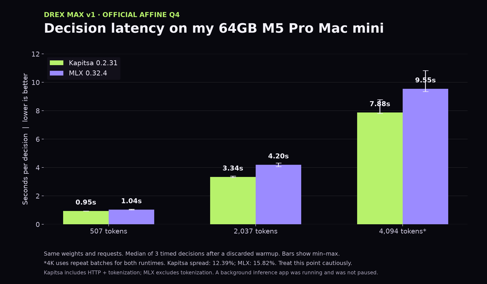
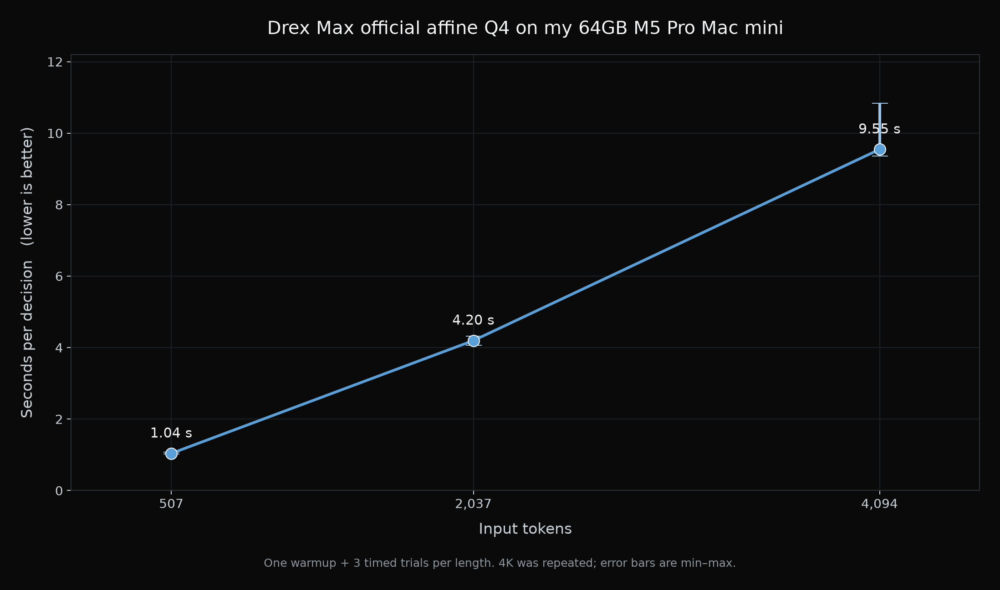

# Nace.AI Drex Max v1

Date: 2026-11-06

Measured on November 6, 2026 (America/Vancouver, PDT). Drex Max v1 is a roughly 27B decision model, not a chatbot. It returns probabilities for supplied options in one forward pass per question, without generating an answer token by token. This is a latency-only benchmark in seconds per decision. **No quality benchmark was reproduced.**

The official affine Q4 runs fully on my Mac mini. At 507 input tokens, Nace's Kapitsa runtime returned a decision in 0.945 s median. Longer states take longer to read. Kapitsa had lower median latency at all three measured lengths than the official MLX path on the same weights and byte-identical requests, with important timing and variance caveats below.

## The setup

- Mac mini, Apple M5 Pro, 64 GB unified memory, 18 CPU cores, macOS 27.0.1 (26A434), AC power.
- A background inference app was running and was not paused.
- Official weights: [nace-ai/drex-max-v1-affine-q4](https://huggingface.co/nace-ai/drex-max-v1-affine-q4), revision `23f21ac6e664d3edb32faa7b55b0c8a7fb09134a`.
- Native affine 4-bit, group 64, text-only. **Not a GGUF. Not an MLX-converted checkpoint. I did not create an MLX conversion**, run `mlx_lm.convert`, make a community requantization, or create a new MLX build.
- MLX path: unmodified official `drex_max_mlx.py` from [nace-ai/drex-decision-models](https://github.com/nace-ai/drex-decision-models/tree/d2fd26cdf211f87b9a6b1261995528629c9e1401), commit `d2fd26cdf211f87b9a6b1261995528629c9e1401`. Downloaded as a file, not a full repository checkout authored by me. Runner SHA-256: `938a01379d0eb416beb24c896681b1caa89cdba749a4d79acdb129783ab53ea9`.
- MLX 0.32.4, mlx-lm 0.32.2, transformers 5.22.0, huggingface-hub 2.3.0. Installing the official requirements changed the shared environment from mlx-lm `0.32.3.dev12+g4cfc64784` and transformers `5.21.0`; the prior environment is saved in `environment-before.txt`.
- Kapitsa path: official `kapitsa-systemone` 0.2.31 from `nace-ai/tap/kapitsa`, loading the **same official Q4 folder**. Default Metal GPU plus Neural Engine FFN split, context 8192, state cache off.

## Results: seconds per decision

One question, three options. One discarded warmup followed by three timed trials per length and per repeated batch. No generation or sampling. Ranges are min to max, not confidence intervals. The 4K headline uses the retained repeat for both runtimes.

| Input tokens | Kapitsa median s | Kapitsa min to max s | MLX median s | MLX min to max s | Lower Kapitsa median latency |
| ---: | ---: | ---: | ---: | ---: | ---: |
| 507 | 0.945248167 | 0.941815875 to 0.946671416 | 1.0391 | 1.0234 to 1.0710 | 9.03% |
| 2037 | 3.342516042 | 3.313810250 to 3.407542250 | 4.1970 | 4.0644 to 4.3190 | 20.36% |
| 4094 | 7.875164625 | 7.815079542 to 8.783200042 | 9.5466 | 9.3548 to 10.8348 | 17.51% |





### Variance and repeat policy

The spread is `(max / min - 1) * 100`. If a batch exceeded 10%, it was repeated once. Both original and repeated batches are preserved, including all warmups.

- MLX 4K first batch: 17.76% spread. Retained repeat: 15.82%, still above 10%.
- Kapitsa 4K first batch: median 9.242973875 s, range 8.259688125 to 10.110600000 s, spread 22.41%. Retained repeat: 12.39%, still above 10%.
- Kapitsa short/2K spreads: 0.52% and 2.83%.

The 4K comparison is directional, not a precise speedup guarantee. Three trials are a small sample. In the MLX run, the 507-token point completed before prompt construction hit the runner's 16K validation bound. The prompt-size search was corrected and successful 507-token timings reused, not rerun.

## Timing and fairness

- MLX: synchronized, pretokenized official `decide` call, including readout, answer/usage serialization. Excludes loading and input tokenization. MLX cache cleared and allocation peak reset per trial, model kept loaded. The model's trained readout temperature was unchanged.
- Kapitsa: wall-clock local HTTP POST with prebuilt request bytes through full JSON response parsing. Includes HTTP, input tokenization and response parsing; excludes startup/loading. Kapitsa was faster despite the broader timer boundary, but this remains an end-to-end runtime comparison, not a controlled kernel microbenchmark.
- Requests are byte-identical between runtimes. Reported input counts matched: 507 / 2037 / 4094. Kapitsa reported zero cached input tokens. Serialized probability output tokens are not autoregressive generation.
- No direct Metal synchronization was available to the Kapitsa client. Each response was completely consumed, then synchronous `GET /health` completed before the next trial. This prevents outstanding benchmark requests, but is not a GPU synchronize call or synchronization of other apps.
- Runtime implementation, default Neural Engine use, allocation and cache behavior differ. Background load was not controlled. GPU utilization was not independently sampled.
- The official MLX runner emitted a tokenizer regex warning, left unchanged. No tokenizer flag was silently changed. This further limits cross-tokenizer comparisons.

## Loading and memory

| Measure | MLX | Kapitsa |
| --- | --- | --- |
| Initial load / start to ready | 3.6902 s | 36.710418916 s |
| Resume load / restart to ready | 3.2414 s | 2.102608500 s |

**These startup boundaries differ.** MLX load ends after explicit parameter evaluation. Kapitsa full readiness includes process start, HTTP health response and, on first start, compilation. Kapitsa log model-loading substages were 14.584 s initial and 1.366 s restart; these are not the full ready times. Neither measurement is a cold-disk guarantee.

MLX-reported peak allocation: 15.13 GB at 507 tokens, 15.28 GB at 2037, 16.10 GB at 4094. Decimal GB, not process RSS or total system use.

Kapitsa maximum sampled process RSS was **15,030,910,976 bytes (15.03 GB)** across startup and inference, during restart loading. Peak sampled RSS during timed decisions was 7,292,469,248 bytes. Samples were taken about every 100 ms. **RSS is not total unified-memory use and is not comparable to MLX's allocation peak. The decision RSS does not mean this model runs in 7 GB. No Kapitsa total-memory reduction is claimed.** RSS can omit mapped/nonresident weights and GPU/Neural Engine allocations.

Kapitsa's initial startup logged memory pressure, then returned to normal. This is retained in the logs, not hidden. No thermal or performance warning was recorded. Kapitsa preflight had 330 GiB free disk. Background process RSS at Kapitsa preflight was 10,445,045,760 bytes, CPU 5.4%, with process names omitted.

A background inference app was running and was not paused.

## Weight provenance

| File | Bytes | SHA-256 |
| --- | ---: | --- |
| `model.safetensors` | 14,451,748,024 | `e9b0439e8c0cd994b54487c114b5d8fe683f10d2d05cb0f9407b2d869cfe51ac` |
| `pointer.bin` | 5,222,420 | `a89619d4ee1a61e6eec8580ed6792ca609b8972c240730dc3d193dfa00f069dd` |

Both matched the official hashes. No model weights are included in this dataset. The readout is separate from the 14.45 GB main file; affine scales/biases and some control tensors are not uniformly 4-bit.

## Quality and outside claims

The repeated archive text plus a billing-ticket routing question is a synthetic performance workload, not a quality evaluation. There were no image tests or reproduced Decision Index, Decision Bench, JevBench or other quality scores.

For context only, Nace reports Decision Index 0.4: 67.52, AA Decision Index: 64, JevBench: 213/231, and Decision Bench v4: 94.30% (1010/1071). These are **Nace's claims, not reproduced here**. Their reported hosted 183 ms was not independently verified and is not a local result. Decision Bench's published score used images; this official Q4 build is text-only. The official repository dates the Max release to October 14; October 30 is the Q4 testing date.

My earlier GLiDE 27B 4-bit run measured 1.4476 / 5.41 / 12.217 seconds at 513 / 2049 / 4097 tokens. Different prompts, tokenizers and runners make that contextual only, not a controlled head-to-head or quality comparison. GLiDE is published separately and is not part of this dataset.

## Reproduce and inspect

Original Kapitsa command:

```sh
/opt/homebrew/bin/kapitsa-systemone --model /Users/pratik/launch-benchmarks/drex-max-v1/weights --port 8000 --host 127.0.0.1 --context 8192 --cache-mb 0
```

`KAPITSA_HOME` pointed to the run folder's `kapitsa-home`. The harness handles startup and shutdown of its own server. Obtain the weights separately from the official repository subject to its license; do not substitute a converted checkpoint.

- `raw/results.csv` and `raw/summary.json`: combined labeled results, including both 4K batches.
- `raw/mlx/drex_max_mlx.py`: unmodified official runner. `raw/mlx/requirements-mlx.txt`: official requirements.
- `raw/mlx/run-2026-11-06/`: MLX harness `benchmark_decisions.py`, raw trials, summary, CSV, requests, environments, hardware, commands, logs and weight hashes.
- `raw/kapitsa/run-2026-11-06-kapitsa/`: `benchmark_kapitsa.py`, raw trials, summary, CSV, requests and their hashes, commands, environments, logs, and RSS samples.
- Each harness expects a sibling `weights/` folder one directory above its run directory. MLX also expects the official runner there. Staging preserves these relative locations. Adapt absolute command paths to your machine. Setup changes the environment, so review `environment-before.txt` and prefer a dedicated environment for reproduction.
- `raw/model-license.txt`: model license, separate from the benchmark license.
- `decision-latency.png`: official MLX path only. `decision-latency-kapitsa-vs-mlx.png`: both runtimes, ranges shown.

Archives and Apple resource-fork files were excluded to avoid duplicates. Hardware identifiers, credentials and background-app product names are not needed for reproduction and are excluded. Measurements, requests and official runner bytes were preserved.

## Licenses and credit

Measurements and documentation: **CC BY 4.0**, attribution **Pratik Gandhi**. [License text](https://creativecommons.org/licenses/by/4.0/).

The model is separately licensed under **Nace.AI Open RAIL-M (Modified), October 2026**, with use and commercial restrictions. It is not unrestricted open source. Model outputs remain subject to the model's use restrictions. The official runner retains its Apache-2.0 notice; that code is not relicensed by this dataset card. No model weights are redistributed.

Credit to Nace.AI for the model, official affine Q4 and Mac runtimes. Benchmark by Pratik Gandhi. Another useful piece of AI I can run on a machine I already have, with the performance tradeoffs recorded rather than hidden.

## Data

- Hugging Face benchmark data: [pratikgx/drex-max-v1-m5-pro-mac-mini-bench](https://huggingface.co/datasets/pratikgx/drex-max-v1-m5-pro-mac-mini-bench)
- `results/2026-11-06-drex-max-v1.csv` / `.json`
- Raw file paths above refer to the Hugging Face dataset.
