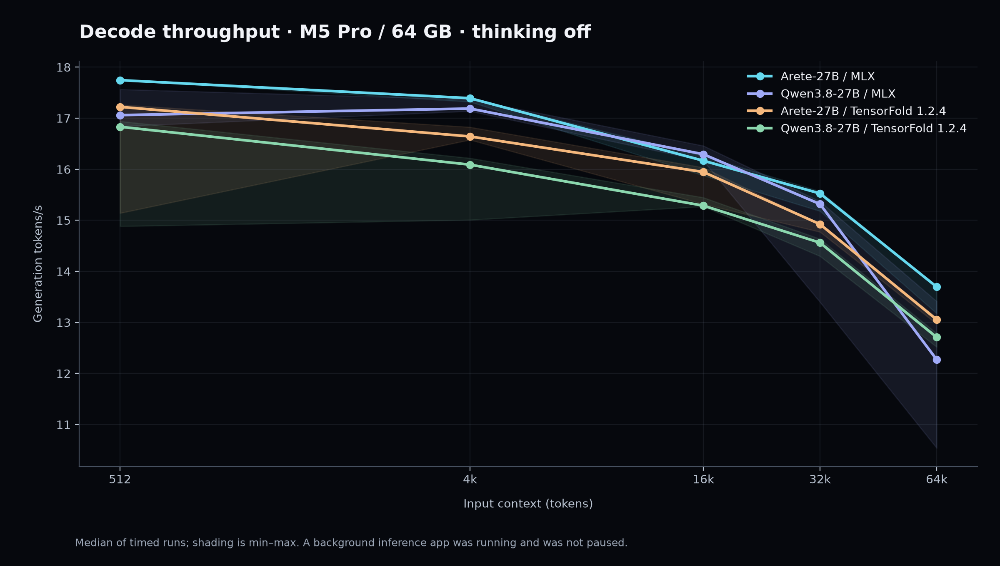
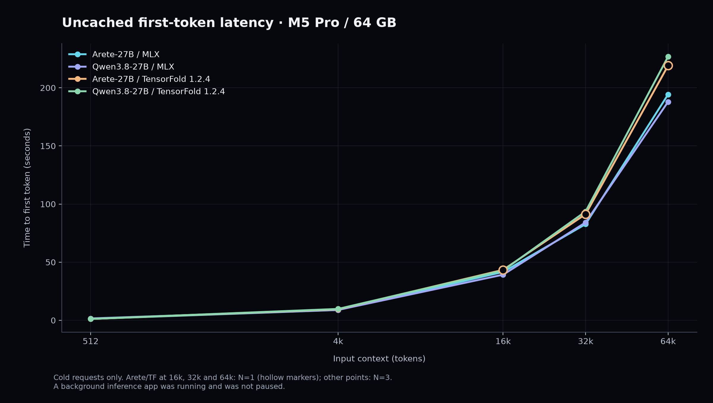
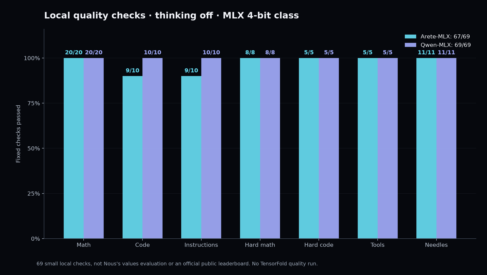

# Arete-27B and Qwen3.8-27B

Date: 2026-11-07

Measured on November 7, 2026 on my Mac mini. Arete-27B is Nous Research's supervised fine-tune of Alibaba's Qwen3.8-27B. The architecture does not change, so I expected decode speed to stay close. I ran both models in the same affine 4-bit, group 64 class, on MLX and on TensorFold 1.2.4. Two models, two runtimes.

At 512 input tokens, generation was 17.75 tok/s for Arete on MLX, 17.06 for Qwen on MLX, 17.22 for Arete on TensorFold, and 16.83 for Qwen on TensorFold. The four stay near each other from 512 tokens out to 64k. That is the result.

A background inference app was running and was not paused.

## The setup

- Mac mini, Apple M5 Pro, 64 GB unified memory, macOS 27.0.1 (26A434).
- A background inference app was running and was not paused.
- Arete weights: community [Duckets/Arete-27B-MLX-4bit](https://huggingface.co/Duckets/Arete-27B-MLX-4bit), revision `bd3f7163ded581ead599600681f3400e7e5634e0`. Duckets is a community conversion, not Nous's own quantization. The base model is [NousResearch/Arete-27B](https://huggingface.co/NousResearch/Arete-27B), revision `108f0afbdcfaa1ceeda4a635004304dfff6d4da2`, a supervised fine-tune of [Qwen/Qwen3.8-27B](https://huggingface.co/Qwen/Qwen3.8-27B).
- Qwen weights: [TensorFold/Qwen3.8-27B-MLX-4bit](https://huggingface.co/TensorFold/Qwen3.8-27B-MLX-4bit), revision `22d8d538154e0e5b6f8dcb1fcc74a60a0798104c`. Both the MLX and TensorFold Qwen runs loaded this same build.
- Both builds are affine 4-bit, group 64. Each safetensors set is 16,054,541,349 bytes. MLX loaded 15,132,802,048 bytes of text tensors for each, about 15.13 GB. Text-only effective bits per weight are 4.5011. Overall stored bits per weight are 4.6948 once the BF16 vision tensors are counted. I did not evaluate vision.
- The two builds rendered the same 74 chat prompts to the same token sequences. Qwen's config still lists an MTP entry this run did not use, and Arete sets zero MTP layers. TensorFold ran with `--no-drafts`, so neither runtime used speculative decoding.
- Conversion provenance still differs. Matching 4-bit group 64 is the same class, and it is not proof of an identical quantization pipeline. A one or two item gap on the local suite cannot separate the fine-tune from the conversion.
- MLX 0.32.4, mlx-lm 0.32.2, tensorfold-native 1.2.4.
- Temperature 0, thinking off, seed 1234, 256 generated tokens. One discarded warmup, then 3 timed generation trials, reported as the median. If the first generation spread was over 10%, I took 3 more trials and kept the rerun median.
- Text only, through 65,536 input tokens. That is the planned 64k point, not the model's full context limit.

## Generation

Generation tok/s is the median of the timed trials. Cold time to first token, and the cold prompt rate beside it, use a stricter cut on TensorFold: non-warmup trials with no cached prompt tokens and a first-token time of at least 0.5 seconds. Cold prompt tok/s is input tokens divided by that cold first-token time, so it includes request overhead. It is a prefill proxy.

Arete on TensorFold has 3 cold observations at 512 and 4k, and 1 cold observation at 16k, 32k, and 64k. Every other cold point is N=3. Generation at those long Arete TensorFold points is still the 3-trial median. The single observation is the cold first-token measurement.

| Model | Runtime | Input tokens | Gen tok/s | Cold TTFT s | Cold N | Cold prompt tok/s | Peak GB |
| --- | --- | ---: | ---: | ---: | ---: | ---: | ---: |
| Arete-27B | MLX | 512 | 17.75 | 1.18 | 3 | 434.70 | 16.40 |
| Arete-27B | MLX | 4096 | 17.39 | 8.88 | 3 | 461.52 | 18.26 |
| Arete-27B | MLX | 16384 | 16.17 | 41.59 | 3 | 393.97 | 19.07 |
| Arete-27B | MLX | 32768 | 15.53 | 82.73 | 3 | 396.08 | 20.14 |
| Arete-27B | MLX | 65536 | 13.70 | 194.29 | 3 | 337.31 | 22.40 |
| Qwen3.8-27B | MLX | 512 | 17.06 | 1.59 | 3 | 321.02 | 16.40 |
| Qwen3.8-27B | MLX | 4096 | 17.19 | 8.97 | 3 | 456.58 | 18.26 |
| Qwen3.8-27B | MLX | 16384 | 16.29 | 39.23 | 3 | 417.62 | 19.07 |
| Qwen3.8-27B | MLX | 32768 | 15.32 | 84.18 | 3 | 389.28 | 20.14 |
| Qwen3.8-27B | MLX | 65536 | 12.27 | 187.96 | 3 | 348.68 | 22.40 |
| Arete-27B | TensorFold 1.2.4 | 512 | 17.22 | 1.16 | 3 | 443.16 | 32.89 |
| Arete-27B | TensorFold 1.2.4 | 4096 | 16.64 | 9.53 | 3 | 429.73 | 32.89 |
| Arete-27B | TensorFold 1.2.4 | 16384 | 15.95 | 43.40 | 1 | 377.55 | 32.89 |
| Arete-27B | TensorFold 1.2.4 | 32768 | 14.92 | 91.29 | 1 | 358.93 | 32.89 |
| Arete-27B | TensorFold 1.2.4 | 65536 | 13.06 | 219.08 | 1 | 299.14 | 32.89 |
| Qwen3.8-27B | TensorFold 1.2.4 | 512 | 16.83 | 1.15 | 3 | 444.17 | 32.89 |
| Qwen3.8-27B | TensorFold 1.2.4 | 4096 | 16.09 | 9.79 | 3 | 418.34 | 32.89 |
| Qwen3.8-27B | TensorFold 1.2.4 | 16384 | 15.29 | 42.87 | 3 | 382.16 | 32.89 |
| Qwen3.8-27B | TensorFold 1.2.4 | 32768 | 14.56 | 93.59 | 3 | 350.11 | 32.89 |
| Qwen3.8-27B | TensorFold 1.2.4 | 65536 | 12.71 | 226.82 | 3 | 288.93 | 32.89 |

MLX peak GB is allocator peak for the trial. TensorFold's 32.89 GB is a physical-footprint-backed server peak. The two metrics are different, so this is not a RAM head-to-head. TensorFold served one request at a time with a 66,560-token window, and the recorded peak stays flat across context lengths because it is a session peak.





The runs were sequential, and background load changed over time. I read the table as four configurations in the same band, which is what an unchanged architecture should do on one machine. I do not treat a gap between two medians as a clean model or runtime ranking.

Cold prefill is the long wait. At 65,536 tokens, cold time to first token is 194.29 s for Arete on MLX and 187.96 s for Qwen on MLX. On TensorFold those cold figures are 219.08 s for Arete and 226.82 s for Qwen. Arete's TensorFold values at 16k, 32k, and 64k are single cold observations.

### Spread after the reruns

Spread is `(max - min) / median` on the three retained generation trials. It is a range, not a confidence interval. These four stayed above 10% after the recorded rerun:

- Qwen on MLX at 32,768 tokens: 12.9%, 13.40 to 15.37 tok/s.
- Qwen on MLX at 65,536 tokens: 23.4%, 10.54 to 13.41 tok/s.
- Arete on TensorFold at 512 tokens: 12.3%, 15.14 to 17.26 tok/s.
- Qwen on TensorFold at 512 tokens: 12.2%, 14.88 to 16.94 tok/s.

Qwen on MLX at 64k still spans 10.54 to 13.41 tok/s after that rerun. Arete on MLX at the same length has a median of 13.70 tok/s, and its three trials sit from 13.18 to 13.70. The ranges meet, so I leave both medians as measured.

### TensorFold prompt reuse

TensorFold cold TTFT and cold prompt rates exclude native cache hits. Repeat identical prompts showed in-memory reuse of about 67 to 95 ms even with `--prompt-cache-gib 0`. Those are not cold compute speed. I did not run an equivalent cache-reuse experiment on MLX.

A background inference app was running and was not paused.

## Quality, MLX only

I scored both MLX builds on a small fixed local suite, 69 checks, with the same prompts, the same seed, temperature 0, and thinking off. Arete scored 67/69. Qwen scored 69/69. This is my suite, not Nous's 803-prompt values evaluation. I did not run quality on TensorFold.

| Check | Arete on MLX | Qwen on MLX |
| --- | ---: | ---: |
| Math | 20/20 | 20/20 |
| Code | 9/10 | 10/10 |
| Instructions | 9/10 | 10/10 |
| Hard math | 8/8 | 8/8 |
| Hard code | 5/5 | 5/5 |
| Tools | 5/5 | 5/5 |
| Needles | 11/11 | 11/11 |

Needles are 8 ordinary checks plus 3 distractor checks. Both builds returned the vault key `cobalt-heron-4471` on all 11, through the planned 64k point. Tool checks compared function names and arguments. No external functions ran. No quality response was cut off at its output cap.

Arete's two misses, under the fixed scorer:

- The word-frequency function used `for char in '.!?':` and omitted the requested comma handling, so `word_freq` failed.
- The ocean description was 61 words, one above the 40 to 60 word limit.

Math, hard math, hard code, tools, and needles matched. The two misses sit on a community 4-bit conversion of a fine-tune, scored against TensorFold's 4-bit conversion of the base model. I record them as local observations.



## Reproduce

TensorFold served one model at a time. Drafts off, thinking off, temperature 0, prompt-cache capacity zero, context window 66,560:

```sh
tensorfold serve /Users/pratik/launch-benchmarks/arete-27b-2026-11-07/models/arete --name local-model --host 127.0.0.1 --port 18087 --context 66560 --parallel 1 --temperature 0 --no-thinking --prompt-cache-gib 0 --no-drafts --no-update-check
```

```sh
tensorfold serve /Users/pratik/launch-benchmarks/arete-27b-2026-11-07/models/qwen --name local-model --host 127.0.0.1 --port 18087 --context 66560 --parallel 1 --temperature 0 --no-thinking --prompt-cache-gib 0 --no-drafts --no-update-check
```

The four measured configurations, from `~/launch-benchmarks/`:

```sh
.venv/bin/python -u arete-27b-2026-11-07/run_benchmark.py mlx qwen speed,quality
.venv/bin/python -u arete-27b-2026-11-07/run_benchmark.py mlx arete speed,quality
.venv/bin/python -u arete-27b-2026-11-07/run_benchmark.py tf arete speed
.venv/bin/python -u arete-27b-2026-11-07/run_benchmark.py tf qwen speed
```

Obtain the weights from the repositories above under their own licenses. This note does not include model weights. Adapt the absolute paths to your machine.

A background inference app was running and was not paused.

## Licenses and credit

Measurements and this note: **CC BY 4.0**, attribution **Pratik Gandhi**. [License text](https://creativecommons.org/licenses/by/4.0/).

Both models are **Apache-2.0**. No weights are redistributed.

Credit to Nous Research for Arete, to Alibaba and the Qwen team for Qwen3.8-27B, to Duckets for the community Arete MLX build, and to TensorFold for the 1.2.4 runtime and the Qwen 4-bit build. Another pair I can run on a machine I already have. The speeds sit together, which is what this fine-tune should do, and the spreads and the cold-cache caveat stay in the note.

## Data

- Hugging Face benchmark data: [pratikgx/arete-27b-m5-pro-mac-mini-bench](https://huggingface.co/datasets/pratikgx/arete-27b-m5-pro-mac-mini-bench)
- `results/2026-11-07-arete-27b.csv` / `.json` keep the unrounded generation, cold first-token, cold prompt, peak, and spread figures behind the table above.
