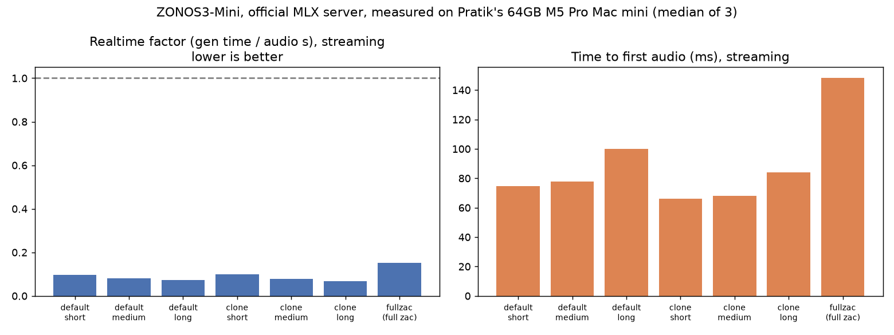

# ZONOS3-Mini

Date: 2026-11-09

Measured on November 9, 2026 on my 64GB M5 Pro Mac mini. ZONOS3-Mini is Zyphra's open-weight text-to-speech and voice-cloning model. I ran the official Apple Silicon MLX server, the default `zonos3-ptq.gguf` build, and the default `zac-keep2` decoder.

It ran 10 to 15 times faster than realtime. First audio arrived in 75 to 100 ms on a stock voice. A 38 second clip took 2.8 seconds to generate. Cloning a new 11 to 13 second clip took about 1.3 seconds to first audio. After that, the same voice was as fast as a stock one.

A background inference app was running and was not paused.

The public dataset is [pratikgx/zonos3-mini-m5-pro-mac-mini-bench](https://huggingface.co/datasets/pratikgx/zonos3-mini-m5-pro-mac-mini-bench).

## The setup

- Mac mini, Apple M5 Pro, 64 GB unified memory, macOS 27.0.1 (26A434), AC power, no thermal warnings.
- A background inference app was running and was not paused.
- Official MLX server from [Zyphra/ZONOS3-Mini](https://github.com/Zyphra/ZONOS3-Mini), commit `5e313c36417b`. Weights from [Zyphra/ZONOS3-Mini](https://huggingface.co/Zyphra/ZONOS3-Mini), default `zonos3-ptq.gguf` (663 MB) and default `zac-keep2` decoder.
- mlx 0.32.4, zonos3-mlx 0.1.0, zonos3 0.1.0, gguf 0.19.0, Python 3.12.15, uv 0.13.0.
- Seed 1234, server-default sampling (temperature 0.75, top-k 80, top-p 0.69, repetition penalty 2.4, window 96). One request at a time. One discarded warmup, then 3 timed runs, reported as the median.
- RTF is wall-clock generation time divided by output audio duration. Below 1 means faster than realtime. TTFA is request sent to the first streamed audio chunk on localhost `/v2/generate`.
- Text normalization was off, because a dependency it needs is not available on macOS. The test scripts avoid numbers and dates. Speech editing was not tested.

```bash
cd ~/launch-benchmarks/ZONOS3-Mini
.venv/bin/python -m zonos3_mlx servers/ggml/gguf/zonos3-ptq.gguf --host 127.0.0.1 --port 1919 --tts-default-voices-dir assets/default_voices
```

## Streaming results

| Condition | Audio s | Gen s | RTF | ×RT | TTFA ms |
| --- | ---: | ---: | ---: | ---: | ---: |
| Stock voice, short (11 words) | 3.93 | 0.375 | 0.095 | 10.5 | 75 |
| Stock voice, medium (23 words) | 8.87 | 0.706 | 0.080 | 12.6 | 78 |
| Stock voice, long (105 words) | 38.53 | 2.811 | 0.073 | 13.7 | 100 |
| Cached clone, short / medium / long | 3.00 / 7.93 / 37.87 | 0.298 / 0.623 / 2.517 | 0.099 / 0.079 / 0.067 | 10.1 / 12.7 / 15.0 | 66 / 68 / 84 |
| New uncached 10.8–13.2 s clip, medium | 7.5–8.7 | 1.938 | 0.237 | 4.2 | 1276 |
| Full `zac.gguf` decoder (not default), stock medium | 8.87 | 1.338 | 0.151 | 6.6 | 148 |

The stock voice is AmericanFemale. The cached clone used a 9.67 s reference clip after the server had already seen it. A clip the server has not seen adds about 1.3 s before audio starts, with the encoder already warm. The first clone after starting the server took 8.3 s to first audio because it loads the cloning models. After they unload when idle, the next new clip took 5.6 s.



Whole-file (non-streamed) RTF was 0.070 to 0.094, about the same speed as streaming. With the full decoder it was 0.101. Buffered WAVs are 0.2 s longer than streamed PCM, which matches the default 3-frame silence prefill.

## Memory

Memory is the whole server process, measured with macOS `footprint`, including GPU memory. The server does not report MLX's own peak.

- Stock-voice streaming used about 2.6 to 3.4 GB while generating, and up to 7.4 GB on the long whole-file request. A brief peak with stock voices only was 8.5 GB.
- After the first clone, the server held about 5.2 to 5.4 GB at rest.
- Overall peak was about 16 GB, during that first clone, while it loaded the 4.0 GB and 1.5 GB cloning model files.
- The full-decoder server peaked at 6.26 GB (stock voice only).
- Server start to ready was about 9.2 s. 64 GB is plenty for this working set.

## Quality

I transcribed the saved files with Whisper large-v3-turbo. Word error rate was 0 to 4% on medium and long text. The medium-text errors are Whisper spelling "Zyphra" as "Zyphro" or "Zyfra". No silent samples or clipping, and every run produced speech. I did not measure speaker similarity or listener quality scores.

## Caveats

- A background inference app was running and was not paused. Three conditions went over 10% spread and were rerun once: long stock-voice streaming TTFA (one 138 ms outlier), long stock-voice whole-file generation, and the full decoder. All raw runs are in the dataset.
- I did not test concurrency, and I did not reproduce Zyphra's published H100 figures. Those are their lab numbers, not mine.
- The headline uses the default `zac-keep2` decoder. The full `zac.gguf` decoder was slower on the one medium stock-voice comparison I ran.

## Files

- Dataset: [pratikgx/zonos3-mini-m5-pro-mac-mini-bench](https://huggingface.co/datasets/pratikgx/zonos3-mini-m5-pro-mac-mini-bench)
- Chart: [notes/img/2026-11-09-zonos3-mini-rtf-ttfa.png](img/2026-11-09-zonos3-mini-rtf-ttfa.png)
- Copy of the results table: [results/2026-11-09-zonos3-mini.csv](../results/2026-11-09-zonos3-mini.csv)
