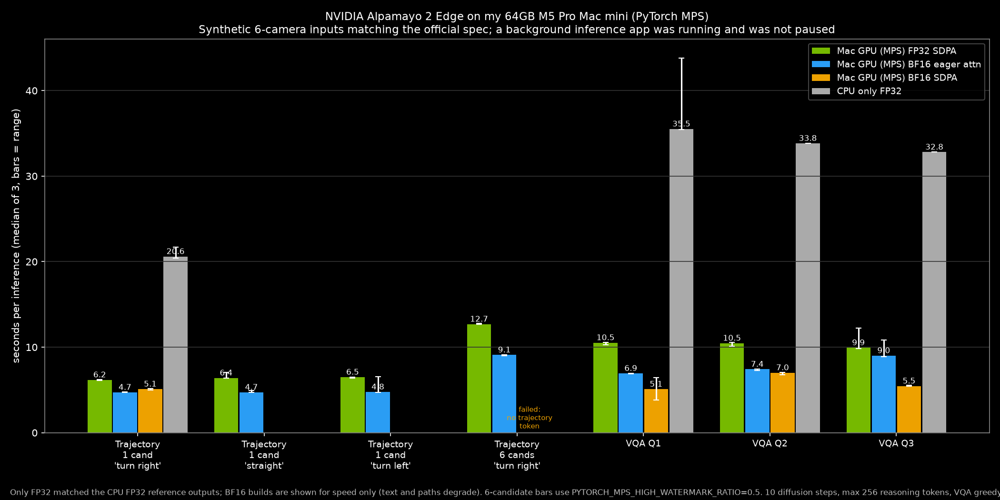

# Alpamayo 2 Edge

Date: 2026-11-10

Measured on November 10, 2026 on my 64GB M5 Pro Mac mini. Alpamayo 2 Edge is NVIDIA's 2.65B open-weight vision-language-action model for driving research. I ran [NVIDIA's own PyTorch code](https://github.com/NVlabs/alpamayo2-edge) (`02f55a7`) on the Mac GPU (MPS) with one 9-line autocast patch, using the official [nvidia/Alpamayo2-Edge](https://huggingface.co/nvidia/Alpamayo2-Edge) weights (revision `f8951d0`).

**These inputs are synthetic.** I drew a 6-camera scene that matches NVIDIA's published input size (22 frames at 1080x1920, 3,261 prompt tokens). This is not a real street, and it is not a driving-quality test. Official clips from NVIDIA's gated PhysicalAI-Autonomous-Vehicles dataset are not included in this write-up.

A full path with reasoning took a median of 6.17 seconds and peaked at 17.3 GiB. Six candidate paths took 12.69 s and 21.0 GiB once I capped the Mac GPU cache. A scene question took 10.52 s. FP32 on the Mac GPU matched the CPU FP32 reference word for word. BF16 was faster, but the text and paths came out wrong, so FP32 is the build I trust here.

A background inference app was running and was not paused.

The public dataset is [pratikgx/alpamayo2-edge-m5-pro-mac-mini-bench](https://huggingface.co/datasets/pratikgx/alpamayo2-edge-m5-pro-mac-mini-bench).

## The setup

- Mac mini, Apple M5 Pro, 64 GB unified memory, macOS 27.0.1 (26A434).
- A background inference app was running and was not paused.
- Weights: nvidia/Alpamayo2-Edge at `f8951d0`, about 5.0 GiB. Code: NVlabs/alpamayo2-edge at `02f55a7`. Python 3.12.15, torch 2.8.0, torchvision 0.23.0, transformers 5.17.0 (macOS wheels, not the Linux/CUDA lockfile). Attention is PyTorch SDPA. No FlashAttention.
- NVIDIA's CLI defaults: seed 43, temperature 0.6, top_p 0.98, 10 flow-matching steps, thinking off. VQA is greedy.
- 1 warmup, then 3 timed runs. Reported as the median. Timing is end to end. Peak memory is the process `phys_footprint`, sampled every 0.2 s.
- One op falls back to CPU: `aten::_cholesky_solve_helper`.

```bash
cd ~/launch-benchmarks/alpamayo2-edge-2026-11-10
export PYTHONPATH=repo/src PYTORCH_ENABLE_MPS_FALLBACK=1
PYTHONPATH=repo/src python make_synthetic.py
python bench.py --device mps --dtype float32 --attn sdpa --configs all --runs 3 --out results/mps_fp32_sdpa.json
PYTORCH_MPS_HIGH_WATERMARK_RATIO=0.5 PYTORCH_MPS_LOW_WATERMARK_RATIO=0.3 \
  python bench_mem.py --device mps --dtype float32 --attn sdpa \
  --configs traj_1cand_right,traj_6cand_right,vqa_q1_how_drive --runs 3 \
  --out results/memprobe/wm050_float32_sdpa_core.json
```

## Results

| Config | Median (min to max) | Peak memory |
| --- | ---: | ---: |
| 1 candidate, "Turn right in 30m" | 6.17 s (6.11 to 6.19) | 17.3 GiB |
| 6 candidates, MPS cache capped | 12.69 s (12.68 to 12.77) | 21.0 GiB |
| 6 candidates, default allocator | 15.92 s (13.46 to 19.42, swapping) | 73.6 to 75.3 GiB |
| VQA Q1, scene question | 10.52 s (10.30 to 10.55) | 23.0 GiB (capped run) |
| CPU FP32, 1 candidate (reference) | 20.60 s (20.44 to 21.70) | 13.9 to 17.8 GiB |



Prefill is about 70% of a 1-candidate run. The Mac GPU at FP32 is about 3.3x faster than CPU on paths, with the same text.

On this drawn scene, "Turn right in 30m" ended 9.2 m right, "Go straight" stayed nearly straight, and "Turn left in 30m" ended 6.2 m left. That is a qualitative check, not a driving score.

With the default MPS allocator, 6 candidates grew the process to about 73 to 75 GiB and started swapping. Capping the cache at `PYTORCH_MPS_HIGH_WATERMARK_RATIO=0.5` and `PYTORCH_MPS_LOW_WATERMARK_RATIO=0.3` cut the peak to 21.0 GiB and the time to 12.69 s, with the same outputs. Anyone running 6 candidates on a Mac should set this.

NVIDIA's published 12.06 GiB GPU process memory is from an H100, BF16, FlashAttention 2 setup. Mine is a different dtype, attention, and memory metric, so it is not like for like. NVIDIA does not publish a seconds figure for this default PyTorch path.

## Caveats

- Synthetic inputs only. This is not a real driving scene, and official dataset clips are not included.
- The Mac headline is FP32 on MPS, not NVIDIA's default BF16 plus FlashAttention 2. BF16 on MPS gave degraded or garbled outputs here.
- A background inference app was running and was not paused.
- Load time is warm. The weights were already in the page cache.
- I did not run LingoQA, AlpaSim, or minADE.

## Files

- Dataset: [pratikgx/alpamayo2-edge-m5-pro-mac-mini-bench](https://huggingface.co/datasets/pratikgx/alpamayo2-edge-m5-pro-mac-mini-bench), with raw runs, logs, scripts and synthetic samples
- Chart: [notes/img/2026-11-10-alpamayo2-edge-seconds.png](img/2026-11-10-alpamayo2-edge-seconds.png)
- Copy of the results table: [results/2026-11-10-alpamayo2-edge.csv](../results/2026-11-10-alpamayo2-edge.csv)
