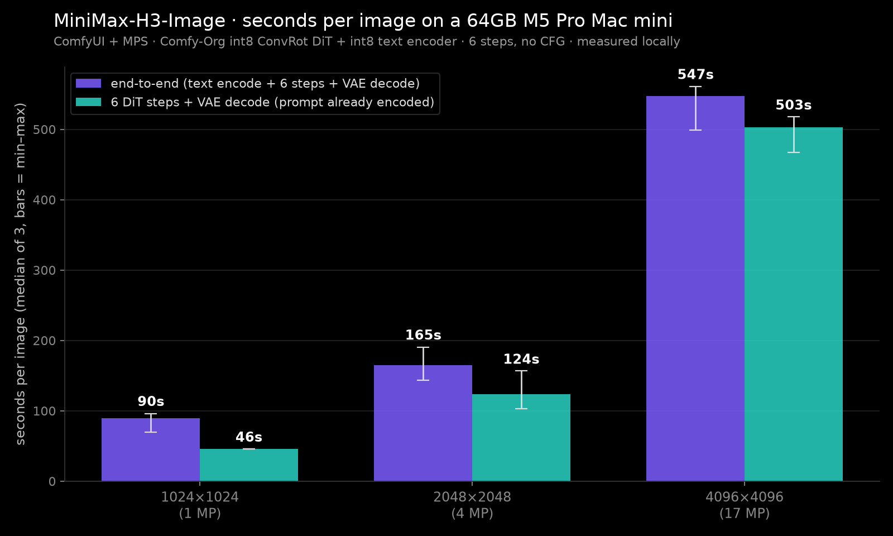

# MiniMax-H3-Image

Date: 2026-11-10

Measured on November 10, 2026 on my 64GB M5 Pro Mac mini. MiniMax-H3-Image is MiniMax's open-weight text-to-image and image-editing model. I ran it in ComfyUI on the Mac GPU (MPS) with the ComfyUI-MPS-INT8 backend.

**This is not the official BF16 model.** It's [Comfy-Org's int8 repack](https://huggingface.co/Comfy-Org/MiniMax-H3-Image) of [MiniMaxAI/MiniMax-H3-Image](https://huggingface.co/MiniMaxAI/MiniMax-H3-Image): a pruned int8 ConvRot DiT (21.0 GB), the Qwen3-VL-32B text encoder in int8 ConvRot (27.1 GB) and the fp16 VAE. The official BF16 set is about 135 GB and doesn't fit in 64 GB.

A native 4096x4096 (16.8 MP) image took a median of 547.3 seconds, about 9 minutes, and peaked at 45.4 GiB. 2048x2048 took 164.9 s and 1024x1024 took 89.6 s. Editing with one reference image at 2048x2048 took 300.8 s. Nothing ran out of memory.

A background inference app was running and was not paused.

The public dataset is [pratikgx/minimax-h3-image-m5-pro-mac-mini-bench](https://huggingface.co/datasets/pratikgx/minimax-h3-image-m5-pro-mac-mini-bench).

## The setup

- Mac mini, Apple M5 Pro, 64 GB unified memory, macOS 27.0.1 (26A434).
- A background inference app was running and was not paused.
- Weights: Comfy-Org/MiniMax-H3-Image commit `a2d7058`. DiT `minimax_h3_image_pruned_int8_convrot` (21.0 GB, "pruned" is Comfy-Org's label: the full-width AdaLN weights are swapped for a compact curve-form basis), text encoder `qwen3vl_32b_minimax_h3_int8_convrot` (27.1 GB), VAE `minimax_h3_image_vae_fp16` (1.17 GB). 49.3 GB download, about 15 minutes.
- ComfyUI `0439dd7` plus ComfyUI-MPS-INT8 `b23c371` (native MPS int8 matmul, dynamic activation mode). Python 3.12.15, torch 2.15.0.
- 6 steps (the distilled setting), no CFG, euler/simple, seed 42, the same as Comfy's official H3 Image templates. MiniMax's own pre-expanded example prompts, no prompt enhancer.
- Text-to-image: 1 warmup, then 3 timed runs per size. Edit: 1 warmup, then 2 timed runs. Reported as the median.
- End-to-end is text encoding plus 6 steps plus VAE decode. Peak footprint is the process `phys_footprint`, sampled every 0.2 s.

```bash
cd ~/launch-benchmarks/minimax-h3-image-2026-11-10
.venv/bin/python -X faulthandler -u bench.py --mode t2i --sizes 1024x1024,2048x2048,4096x4096 \
  --warmup 1 --runs 3 --seed 42 --tag t2i
.venv/bin/python -X faulthandler -u bench.py --mode edit --sizes 2048x2048 --warmup 1 --runs 2 --seed 42 \
  --prompt $PWD/inputs/revised_prompt.edit.txt --refs inputs/reference1.png --tag edit_1ref
```

## Results

| Condition | End-to-end median (min to max) | Steps + decode median | Peak footprint |
| --- | ---: | ---: | ---: |
| Text-to-image 1024x1024 (1 MP) | 89.6 s (69.7 to 95.9) | 45.7 s | 29.3 GiB |
| Text-to-image 2048x2048 (4 MP) | 164.9 s (143.3 to 190.2) | 123.7 s | 33.7 GiB |
| Text-to-image 4096x4096 (16.8 MP) | 547.3 s (499.2 to 560.6) | 503.0 s | 45.4 GiB |
| Edit, 1 reference, 2048x2048 (n=2) | 300.8 s (275.5 to 326.2) | 199.8 s | 46.2 GiB |



Text encoding took about 40 to 44 s of every image. ComfyUI kept swapping the 27 GB text encoder and the 21 GB DiT in and out of memory, so the encoder was reloaded for every image. If you re-run the same prompt with a new seed, ComfyUI caches the encoding and you get the steps + decode number instead.

The edit used MiniMax's official example reference and prompt. It did what it was told: headphones removed, hair filled in, a fist bump above the sign, and the rest of the scene and the sign text kept. Encoding the reference took about 100 s.

## Cold vs warm

- The first 1024x1024 image after start took 158.2 s vs 89.6 s steady. First use of the DiT added roughly 67 s.
- At 4096x4096 the warmup (500.3 s) was inside the run-to-run noise.
- This wasn't a true cold-disk load. The weights were still in the page cache from the download.

## Caveats

- This is Comfy-Org's quantized, pruned int8 repack, not the official BF16 weights. Quality and speed can differ from MiniMax's own path.
- MiniMax's 10 to 20 s per image figure is from their GPUs. I didn't reproduce it, and this isn't a like-for-like comparison.
- A background inference app was running and was not paused. Its memory swung up to about 37 GB and its CPU hit about 360% at times, which most likely explains the run-to-run spread.
- Swap peaked around 23 GB. Spotlight was indexing the new 49 GB of files during the runs.
- MiniMax says the model works best at 4 to 20 MP, so 1024x1024 isn't its sweet spot. I rendered 1024 directly.
- Not tested: concurrency, the prompt enhancer, and more than one reference image.

## Files

- Dataset: [pratikgx/minimax-h3-image-m5-pro-mac-mini-bench](https://huggingface.co/datasets/pratikgx/minimax-h3-image-m5-pro-mac-mini-bench), with raw runs, logs, scripts and sample images
- Chart: [notes/img/2026-11-10-minimax-h3-image-sec-per-image.png](img/2026-11-10-minimax-h3-image-sec-per-image.png)
- Copy of the results table: [results/2026-11-10-minimax-h3-image.csv](../results/2026-11-10-minimax-h3-image.csv)
