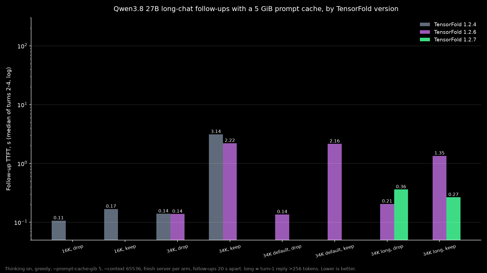
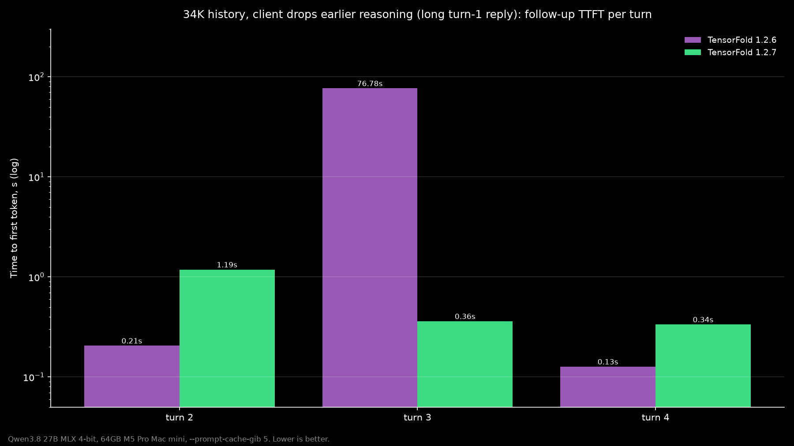
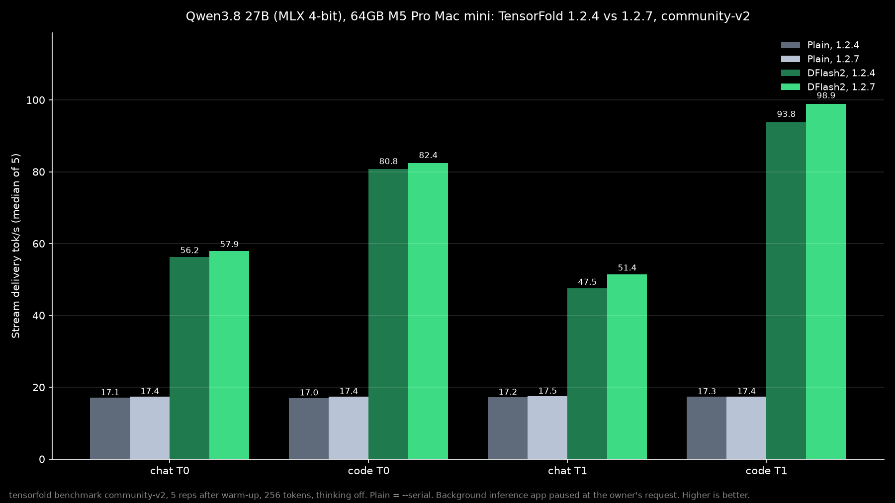

# Qwen3.8 27B on TensorFold 1.2.7

Date: 2026-11-11

I reran Qwen3.8 27B on TensorFold after 1.2.7, on my 64GB M5 Pro Mac mini. The headline is the long-chat fix. In a 34K-token chat where the client drops earlier reasoning, 1.2.6 resumed only 10,240 of 34,354 prompt tokens on turn 3 and took 76.78 s to the first token. 1.2.7 resumed 34,304 tokens on that same turn and started answering in 0.36 s. Every reply was byte-identical between the two versions.

A background inference app was paused for this run at the owner's request.

## The setup

Mac mini, Apple M5 Pro, 64 GB, macOS 27.0.1 (26A434), AC power. Model [TensorFold/Qwen3.8-27B-MLX-4bit](https://huggingface.co/TensorFold/Qwen3.8-27B-MLX-4bit), revision `22d8d538154e0e5b6f8dcb1fcc74a60a0798104c`. Drafter [z-lab/Qwen3.8-27B-DFlash2](https://huggingface.co/z-lab/Qwen3.8-27B-DFlash2).

TensorFold 1.2.4 is the kept Homebrew keg. TensorFold 1.2.7 is Homebrew, upgraded at 12:21 PM PT on November 11, 2026. TensorFold 1.2.6 is the official macOS arm64 release tarball (sha256 `4b50317bfdc00cd34a2c43d02f06eefbdd537b847747bcfa0f6cef6d19386751`), run from a side folder and never installed. That is the pre-fix version measured in issue #2791.

## Long chats when the client drops reasoning

This is the 1.2.7 headline, from issue #2791 and PR #2811. I served the model with `--context 65536 --parallel 1 --temperature 0 --thinking --reasoning-effort low --prompt-cache-gib 5 --no-drafts`, a fresh server per arm, greedy. The first prompt is exactly 34,000 tokens. Then three short follow-ups 20 s apart.

**drop** means the client sends earlier assistant replies back as content only, with the reasoning removed. That is how most chat apps behave. **long** means the first question also asks for a ~200-word description, so the turn-1 reply is 529 tokens including reasoning. That is the condition closest to Ash Hart's #2811 table.

| version | turn | prompt tokens | cached (resumed) tokens | TTFT s | TF prefill s | reply tokens |
|---|---:|---:|---:|---:|---:|---:|
| 1.2.6 | 1 | 34,000 | 0 | 91.04 | 91.02 | 529 |
| 1.2.6 | 2 | 34,309 | 34,282 | 0.21 | 0.20 | 62 |
| 1.2.6 | 3 | 34,354 | 10,240 | 76.78 | 73.71 | 85 |
| 1.2.6 | 4 | 34,384 | 34,363 | 0.13 | 0.12 | 32 |
| 1.2.7 | 1 | 34,000 | 0 | 95.65 | 95.63 | 529 |
| 1.2.7 | 2 | 34,309 | 33,995 | 1.19 | 1.18 | 62 |
| 1.2.7 | 3 | 34,354 | 34,304 | 0.36 | 0.36 | 85 |
| 1.2.7 | 4 | 34,384 | 34,349 | 0.34 | 0.33 | 32 |

On 1.2.6, turn 3 re-prefilled 24,114 tokens. On 1.2.7 every follow-up picked the cache back up. Replies matched byte for byte on every turn.

Turn 2 on 1.2.7 was about a second slower (1.19 s vs 0.21 s) because it resumed slightly fewer tokens (33,995 vs 34,282). That matches the #2811 design when both full snapshots do not fit. It is still a second, versus the 77 s miss it prevents.

This was one run per arm, not an average. On 1.2.6 only one of the three follow-ups missed. Ash measured a miss on all three turns on an M3 Ultra (7,424 resumed, about 85 s). A cold 34K prefill takes about 91 to 97 s here.

With a short first reply (94 tokens), 1.2.4 and 1.2.6 already resumed every follow-up.





## Keep-reasoning follow-ups

Same 34K long history, but the client keeps earlier reasoning. Turns 2 to 4 took 0.27 to 4.04 s to the first token on 1.2.6 (median 1.35 s) and 0.26 to 0.27 s on 1.2.7 (median 0.27 s). Replies were again identical. Follow-ups were already resumed in full on 1.2.6, but client wait times still reached 2 to 5 s on later turns while TensorFold's own prefill was 0.2 to 0.3 s. This is consistent with 1.2.7's Metal keep-warm change (#2725), but I did not isolate the cause. Reported peak memory was 35.31 GiB on 1.2.6 and 35.45 GiB on 1.2.7.

| version | turn | prompt tokens | cached tokens | TTFT s | TF prefill s | reply tokens |
|---|---:|---:|---:|---:|---:|---:|
| 1.2.6 | 2 | 34,560 | 34,528 | 0.27 | 0.27 | 86 |
| 1.2.6 | 3 | 34,678 | 34,645 | 4.04 | 0.20 | 85 |
| 1.2.6 | 4 | 34,788 | 34,762 | 1.35 | 0.22 | 67 |
| 1.2.7 | 2 | 34,560 | 34,528 | 0.27 | 0.26 | 86 |
| 1.2.7 | 3 | 34,678 | 34,645 | 0.27 | 0.27 | 85 |
| 1.2.7 | 4 | 34,788 | 34,762 | 0.26 | 0.25 | 67 |

## Decode, 1.2.4 vs 1.2.7

Standard `tensorfold benchmark`, 256 tokens, thinking off, median of 5 after warmup, plain (`--serial`) and with the DFlash2 drafter. Stream delivery tok/s, median [min-max].

| cell | plain 1.2.4 | plain 1.2.7 | DFlash2 1.2.4 | DFlash2 1.2.7 | speedup 1.2.7 |
| --- | --- | --- | --- | --- | --- |
| chat T0 | 17.06 [16.94-17.13] | 17.39 [17.35-17.40] | 56.22 [56.17-56.35] | 57.90 [33.62-58.06] | 3.33x |
| code T0 | 17.01 [16.93-17.11] | 17.39 [17.35-17.40] | 80.76 [80.18-82.24] | 82.43 [82.43-82.53] | 4.74x |
| chat T1 | 17.17 [16.93-17.37] | 17.49 [17.44-17.50] | 47.51 [42.66-62.45] | 51.41 [44.96-65.74] | 2.94x |
| code T1 | 17.33 [16.86-17.35] | 17.38 [17.33-17.47] | 93.79 [73.57-102.43] | 98.90 [77.58-108.19] | 5.69x |

Greedy T0 output was token for token identical across plain and DFlash2, and across 1.2.4 and 1.2.7. It also matches the November 3 receipts on 1.2.1 and 1.2.2.

Plain chat went from 17.06 to 17.39 tok/s. With DFlash2, 1.2.7 writes greedy chat at 57.90 tok/s (3.33x plain) and sampled code at 98.90 tok/s (5.69x plain).

The sampled DFlash2 cells are up 5.5 to 8.2%, but their ranges overlap, so I treat those as directionally positive rather than precise. One DFlash2 1.2.7 chat T0 rep was an outlier at 33.62 tok/s. The median is 57.90, and the other four reps were 57.61, 57.90, 58.05, and 58.06.



## What I learned

On this Mac, 1.2.7 does what the release promised: a long local chat stays instant from one turn to the next, even when the client drops earlier reasoning. Decode also ticked up a little, with the same greedy output.

## Caveats

- One run per long-chat arm, so this is what happened on my Mac, not an average.
- Turn 2 on the fixed drop arm was about 1 s slower on 1.2.7 than on 1.2.6.
- T1 drafter gains are directional because the ranges overlap.
- One outlier rep is in the DFlash2 1.2.7 chat T0 range.
- This is not a copy of Ash's M3 Ultra test. Same model family and cache settings, different machine, prompt, first-reply length, and I set `--no-drafts`.
- 1.2.6 ran from a side tarball, not a Homebrew install.
- Planned extras (repeats, a long-prompt sweep, and an Arete vs Qwen rerun) did not finish after the Mac went offline around 12:49 PM PT, and they are not in this note.
- The November 3 numbers were measured with a background inference app running, so they are not like for like on background load.

## Reproduce

A fresh server per arm. Default-effort arms omit `--reasoning-effort`. The control arm uses `--prompt-cache-gib 0`. Point `--serve` at a local copy of the TensorFold Qwen3.8-27B MLX 4-bit weights:

```sh
tensorfold serve <local-qwen-mlx-4bit-weights> --name local-model --host 127.0.0.1 --port 18087 --context 65536 --parallel 1 --temperature 0 --thinking --reasoning-effort low --prompt-cache-gib 5 --no-drafts --no-update-check
```

```sh
tensorfold benchmark TensorFold/Qwen3.8-27B-MLX-4bit --serial --output community-v2/B_<ver>.json
tensorfold benchmark TensorFold/Qwen3.8-27B-MLX-4bit --drafter z-lab/Qwen3.8-27B-DFlash2 --output community-v2/C_<ver>.json
```

Exact commands and the long-chat script are in the Hugging Face dataset below.

## Licenses and credit

Measurements and this note: **CC BY 4.0**, attribution **Pratik Gandhi**. [License text](https://creativecommons.org/licenses/by/4.0/).

The model is **Apache-2.0**. No weights are redistributed.

Credit to the Qwen team for Qwen3.8-27B, and to TensorFold and Ash Hart for the 1.2.7 runtime and the long-chat fix. A 27B model with long memory, running on a desk, fully owned.

## Data

- Hugging Face: [pratikgx/qwen3.8-27b-tensorfold-1.2.7-m5-pro-mac-mini-bench](https://huggingface.co/datasets/pratikgx/qwen3.8-27b-tensorfold-1.2.7-m5-pro-mac-mini-bench)
- results/2026-11-11-qwen3.8-27b-tensorfold-1.2.7.csv / .json
