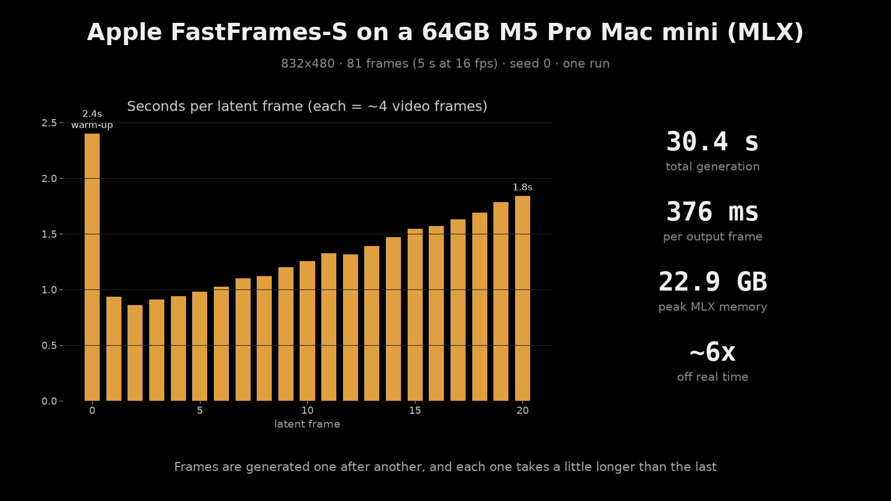

# Apple FastFrames-S (MLX)

Date: 2026-11-18

I got Apple's FastFrames-S open weights generating video on my 64GB M5 Pro Mac mini. The official code is CUDA-only, so I ran it through my MLX port, which is not yet public.

One 832×480, 81-frame clip (5.06 s at 16 fps) took 30.43 s to generate, 375.7 ms per output frame. That's about 6× off real time. Peak memory was 22.93 GB in the MLX allocator, 30.37 GB RSS. It all fit in 64 GB.

A background inference app was paused for this run at the owner's request.

The public dataset, including the clip, is [pratikgx/fastframes-s-m5-pro-mac-mini-bench](https://huggingface.co/datasets/pratikgx/fastframes-s-m5-pro-mac-mini-bench).

## The setup

- Mac mini, Apple M5 Pro, 64 GB unified memory, macOS 27.0.1 (26A434), AC power.
- A background inference app was paused for this run at the owner's request.
- Weights: [apple/FastFrames-S](https://huggingface.co/apple/FastFrames-S) (1.3B). Apple also released [apple/FastFrames-L](https://huggingface.co/apple/FastFrames-L) (14B), which I did not run.
- Official code: [apple-aiml-research/ml-fastframes](https://github.com/apple-aiml-research/ml-fastframes), CUDA-only.
- Runtime: my MLX port, not yet public. Python 3.12.15, mlx 0.32.4, ffmpeg 9.0.2.
- `--bits` quantization was not used.
- Prompt: "A corgi surfing a wave at sunset", Apple's official example prompt, seed 0.

## What broke first

The first smoke test failed before any frames were generated, with `ValueError: float64 is not supported on the GPU`. Metal does not support float64. RoPE table construction in the port used `mx.float64`. I fixed that and reran. The numbers below are from the successful rerun.

## Smoke test

An 8×8, 5-frame smoke test passed in 2.83 s (2.98 s wall).

## Corgi clip

| | |
| --- | --- |
| Resolution | 832×480 |
| Frames | 81 at 16 fps (5.06 s) |
| Seed | 0 |
| Container | H.264, 693 KB |
| Text encoder | 871 ms |
| Latent frames | 21 (first 2,401 ms, then 859 to 1,841 ms, rising) |
| Decoder | 1,116 ms |
| Generation | 30.43 s |
| Wall clock | 35.9 s |
| Per output frame | 375.7 ms (~2.7 fps, about 6× off real time) |
| Memory | 22.93 GB MLX peak, 30.37 GB RSS peak |

Each bar is the time for one latent frame, about 4 video frames. The first latent frame is a 2.4 s warm-up, then they climb from about 0.9 s to 1.8 s as the video gets longer. The rest of the 30.43 s is the text encoder (0.9 s) and the decoder (1.1 s).

It's about 6× off real time on a Mac. But that's a 5 second video in half a minute, from a box on my desk, nothing rented.

## Caveats

- Single run, single seed.
- The MLX port was verified by 13 CPU parity tests vs the reference, but there is no side-by-side output comparison against the official CUDA reference yet.
- `--bits` quantization was not used.
- The MLX port is not yet public. This note and the Hugging Face dataset have the run data, not the port code.

## Licenses and credit

Measurements and this note: **CC BY 4.0**, attribution **Pratik Gandhi**. [License text](https://creativecommons.org/licenses/by/4.0/).

The FastFrames weights and official code are under the Apple Sample Code License (`apple-amlr`). No weights are redistributed.

Credit to Apple and the FastFrames authors.

## Data

- Hugging Face: [pratikgx/fastframes-s-m5-pro-mac-mini-bench](https://huggingface.co/datasets/pratikgx/fastframes-s-m5-pro-mac-mini-bench)
- results/2026-11-18-apple-fastframes-s-mlx.csv / .json
