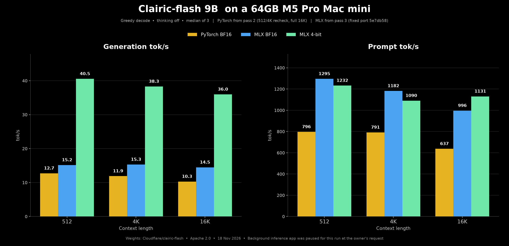

# Cloudflare Clairic-flash (MLX)

Date: 2026-11-18

I ran Cloudflare's Clairic-flash 9B open weights on my 64GB M5 Pro Mac mini, first through the official PyTorch path, then through my MLX port.

On the official path, it scored 34/34 fields on a test receipt image, an invoice PDF and a form image. Generation was 12.7 tok/s at 512 context, 11.9 at 4K and 10.3 at 16K. It loaded in 7.0 seconds and peaked at 28.8 GB.

The MLX port is faster, especially at 4-bit: 40.5 tok/s at 512 context, 38.3 at 4K and 36.0 at 16K, loading in 3.2 seconds with a 7.18 GB Metal peak. Text input scored 33/34 (a truncated item name on the receipt). Image and PDF input is currently broken. BF16 scored 1/34 and 4-bit scored 0/34, and the outputs were garbled. Use the official PyTorch path for images and PDFs until the vision tower is fixed.

A background inference app was paused for these runs at the owner's request.

The MLX port (code only, no weights) is [pratikgx/Clairic-Flash-MLX](https://huggingface.co/pratikgx/Clairic-Flash-MLX). The public dataset is [pratikgx/clairic-flash-m5-pro-mac-mini-bench](https://huggingface.co/datasets/pratikgx/clairic-flash-m5-pro-mac-mini-bench).

## The setup

- Mac mini, Apple M5 Pro, 64 GB unified memory, macOS 27.0.1, 20 GPU cores, AC power.
- A background inference app was paused for these runs at the owner's request.
- Weights: [Cloudflare/clairic-flash](https://huggingface.co/Cloudflare/clairic-flash) (9.65B, Apache-2.0). Cloudflare also released [Cloudflare/clairic](https://huggingface.co/Cloudflare/clairic) (27.8B), which I did not run.
- Blog: [Open Clairic](https://blog.cloudflare.com/open-clairic/).
- Official runtime: PyTorch 2.13.0, transformers 5.10.2, xgrammar 0.2.1, on MPS, BF16.
- MLX port: [pratikgx/Clairic-Flash-MLX](https://huggingface.co/pratikgx/Clairic-Flash-MLX), commit `5e7db582b1d442b4bcbe582fd8bb701c9773ed1d`, mlx 0.32.4.
- Speed settings: greedy, thinking off, 256 new tokens, 1 warmup + 3 timed runs, median reported.

## Speed

Values are median tok/s and time to first token. PyTorch headlines are from pass 2. MLX headlines are from pass 3, after the port fixes.

| Backend | Context | Prompt tok/s | Gen tok/s | TTFT |
| --- | ---: | ---: | ---: | ---: |
| MLX BF16 | 512 | 1295 | 15.2 | 0.40 s |
| MLX BF16 | 4K | 1182 | 15.3 | 3.47 s |
| MLX BF16 | 16K | 996 | 14.5 | 16.4 s |
| MLX 4-bit | 512 | 1232 | 40.5 | 0.42 s |
| MLX 4-bit | 4K | 1090 | 38.3 | 3.76 s |
| MLX 4-bit | 16K | 1131 | 36.0 | 14.5 s |
| PyTorch BF16 (MPS) | 512 | 796 | 12.7 | 0.64 s |
| PyTorch BF16 (MPS) | 4K | 791 | 11.9 | 5.18 s |
| PyTorch BF16 (MPS) | 16K | 637 | 10.3 | 25.7 s |

### Load time and memory

| Backend | Load | Memory |
| --- | --- | --- |
| MLX BF16 | 3.1 s | 17.8 GB Metal peak |
| MLX 4-bit | 3.2 s | 7.18 GB Metal peak at load; 29.0 GB after the 16K run |
| MLX 4-bit `convert` output (6.5 GB) | 1.1 s | 6.3 GB Metal peak |
| PyTorch BF16 (MPS) | 7.0 s | 28.8 GB peak |

`convert --bits 4` wrote a 6.5 GB backbone plus the unchanged 261.5 MB head. That directory loaded in 1.1 s.

## Extraction

Synthetic documents with known ground truth: a rendered receipt PNG, an invoice PDF and a registration form PNG. This is a 3-document field-level check. It is not Cloudflare's 576-field synthetic receipt eval, and it should not be presented as one.

Official PyTorch path (pass 2):

| Task | Input | Time | Score |
| --- | --- | ---: | ---: |
| Receipt | image | 45 s | 9/9 |
| Invoice | PDF | 121 s | 12/12 |
| Form | image | 44 s | 13/13 |
| **Total** |  |  | **34/34** |

MLX port (pass 3):

- Text input, 4-bit: **33/34** (receipt 8/9, a truncated item name; invoice 12/12; form 13/13). Matched PyTorch on 33/34 fields.
- Image and PDF input: **fails**. BF16 scored 1/34 and 4-bit scored 0/34. Outputs were garbled (for example the receipt merchant came out as "bistrocof", and a subtotal of 16.00 as 160). The vision tower has not been numerically matched to the real Clairic vision weights.

`pytest` on Metal: **19/19** passed.

## Lab claims

Cloudflare reports (self-reported, not reproduced here): fresh text fields 328/336; mixed-input 213/226; synthetic receipt fields 576/576. I did not run those evals.

## Caveats

- Three passes the same evening. Pass 1 was cut off after a 16K first run and skipped extraction. Pass 2 completed PyTorch extraction and a full 16K set. Pass 3 tested the fixed MLX port. 32K was never run.
- Pass 1 4K PyTorch was about twice as slow as the pass 2 recheck, with tight internal spread. Treat pass 2 as the PyTorch headline.
- Speed is backbone greedy generate, 256 new tokens, not the extraction decoder. Extraction has its own wall times above.
- The official linear-attention fast path was not installed. Prefill and decode used the PyTorch implementation.
- MLX BF16 16K decode spread was 16.4%. The median is 14.5 tok/s.
- BF16 form text was not measured in pass 3 because the image primary scored 1/13 and the text fallback only ran on a 0 score or an error.
- A background inference app was paused for each run at the owner's request, then restarted after each run.

## Licenses and credit

Measurements and this note: **CC BY 4.0**, attribution **Pratik Gandhi**. [License text](https://creativecommons.org/licenses/by/4.0/).

The Clairic weights and official runtime are Apache-2.0. No weights are redistributed.

Credit to Cloudflare and the Workers AI team.

## Data

- Hugging Face model (code only): [pratikgx/Clairic-Flash-MLX](https://huggingface.co/pratikgx/Clairic-Flash-MLX)
- Hugging Face dataset: [pratikgx/clairic-flash-m5-pro-mac-mini-bench](https://huggingface.co/datasets/pratikgx/clairic-flash-m5-pro-mac-mini-bench)
- results/2026-11-18-cloudflare-clairic-flash-mlx.csv / .json
