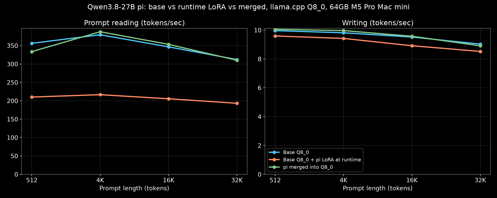
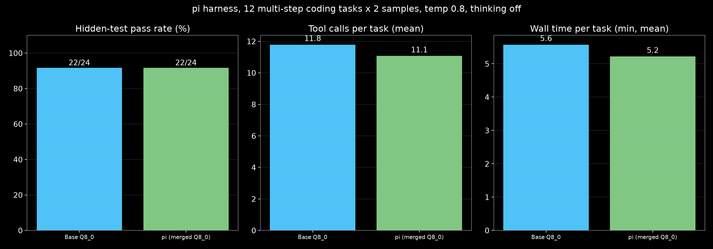
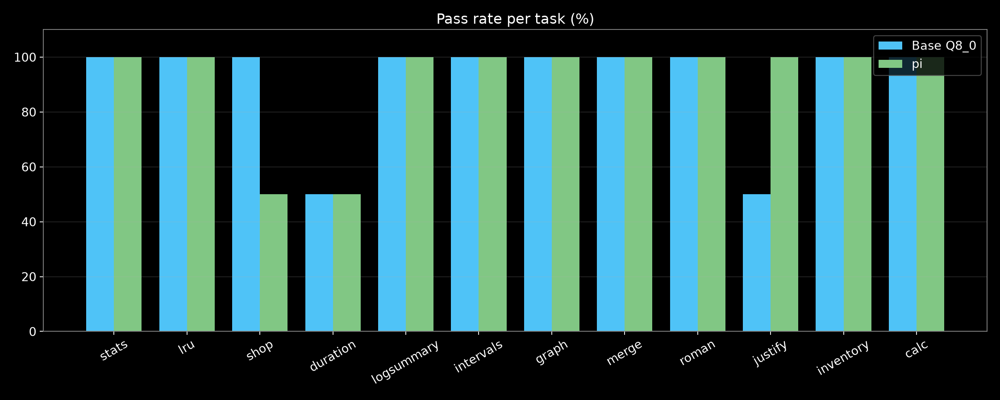

# Qwen3.8-27B pi-adapted

Date: 2026-11-18

I ran the official pi adapter for Qwen3.8-27B against the base model on my 64GB M5 Pro Mac mini. The headline is the merge. Once the LoRA is merged into Q8_0, there is no speed cost versus the base model. Applying the same adapter at runtime costs about 40% of prompt-processing speed.

A background inference app was paused for this run at the owner's request.

## The setup

Mac mini, Apple M5 Pro, 64 GB, macOS 27.0.1 (26A434), AC power. llama.cpp b11940 (commit `eb7818c`), Metal.

- Base model: [Qwen/Qwen3.8-27B](https://huggingface.co/Qwen/Qwen3.8-27B)
- Base GGUF: [ggml-org/Qwen3.8-27B-GGUF](https://huggingface.co/ggml-org/Qwen3.8-27B-GGUF) (`Qwen3.8-27B-Q8_0.gguf`, 28.6 GB)
- Adapter: [harness-hub/Qwen3.8-27B-pi-adapted](https://huggingface.co/harness-hub/Qwen3.8-27B-pi-adapted)
- Official F16 LoRA GGUF: [harness-hub/Qwen3.8-27B-pi-adapted-GGUF](https://huggingface.co/harness-hub/Qwen3.8-27B-pi-adapted-GGUF) (`Qwen3.8-27B-pi-lora-F16.gguf`)

Speed runs used llama-server stream, thinking off, temp 0, median of 3. The merged file is `Qwen3.8-27B-pi-merged-Q8_0.gguf` (28,595,763,840 bytes), built with `llama-export-lora` and then re-quantized to Q8_0. Peak memory on the merged speed suite was 37.3 GB, all in memory.

Base and runtime-LoRA speed rows come from November 17 on this same machine and build. Merged rows are from November 18.

## Speed, base vs runtime LoRA vs merged

| Context | Prompt tok/s base / runtime LoRA / merged | Gen tok/s base / runtime / merged | TTFT s base / runtime / merged |
|---|---|---|---|
| 512 | 356.3 / 210.2 / 333.8 | 9.97 / 9.60 / 10.06 | 1.4 / 2.4 / 1.5 |
| 4K | 379.6 / 216.6 / 387.7 | 9.82 / 9.42 / 9.97 | 10.8 / 18.9 / 10.5 |
| 16K | 346.6 / 205.5 / 353.4 | 9.52 / 8.92 / 9.58 | 47.2 / 79.7 / 46.3 |
| 32K | 312.1 / 193.2 / 310.1 | 9.03 / 8.52 / 8.91 | 105.0 / 169.7 / 105.6 |

At 4K, prompt speed is 380 vs 217 vs 388 tok/s, and generation is 9.82 vs 9.42 vs 9.97 tok/s. At 32K, time to first token is 105 s base, 170 s with the runtime LoRA, and 106 s merged.

Merged pi costs no speed. A runtime LoRA costs about 40% of prompt speed and about 4 to 6% of generation speed. Merge your adapters.

A llama-bench cross-check on base vs merged agreed, within about 1% at every length (for example 9.87 vs 9.79 gen tok/s at 4K).

## Coding agent test

I also had the base model and the merged pi model solve 12 small Python tasks in the lab's pi coding agent (0.73.1), 2 runs each, temp 0.8, thinking off, 10 minute cap, hidden unit tests.

| Metric | Base | pi |
|---|---|---|
| Passes | 22/24 | 22/24 |
| Tool calls/task (mean) | 11.8 | 11.1 |
| Tool calls/task (median) | 10.5 | 11 |
| Tool errors/task | 0.63 | 1.38 |
| Time per task (mean) | 334 s | 313 s |
| Timeouts | 5 | 3 |

pi missed t03_shop once, and base missed t10_justify once. t04_duration failed once for both (both timed out). Sample 1 was 12/12 for both. Sample 2 was 10/12 for both. The run was stopped after 2 of a planned 3 samples so the background inference app could come back sooner.

The original t12_calc grader banned the substring `compile(`, which also matched `re.compile(`. Both pi t12_calc runs failed only on that check. With a corrected check, all four t12_calc runs pass. The table above uses the corrected grade. Before the fix, scores were base 22/24 and pi 20/24.

## November 17 quality suite

On the earlier runtime-LoRA run, a short quality suite was identical on both arms: math 20/20, code 10/10, instructions 10/10, hard code 5/5, tool calling 5/5. Hard math ran only on the base model (8/8). Long-context needles were cut after a slow 32K prefill.

## What I learned

On this Mac, a runtime LoRA is not free. Merge it and you get the adapter at full speed, with the merged 28.6 GB file fitting comfortably in 64 GB. The small coding suite is too saturated to say much about quality or tool-call savings.

## Caveats

- These are 12 small Python tasks the base model already solves, not Terminal-Bench or SWE-bench Pro. Temp 0.8 adds noise. Mean tool calls were about 6% lower (11.8 vs 11.1), but the median was slightly higher on pi and pi made more tool errors. This does not confirm the lab's 55% to 62% fewer-tool-calls claim.
- The merged model is a re-quantized merge, close to but not bit-identical with the runtime LoRA.
- Only 2 of the planned 3 agent samples were counted.
- Base and runtime-LoRA speed rows are from November 17; merged rows are from November 18.

## Licenses and credit

Measurements and this note: **CC BY 4.0**, attribution **Pratik Gandhi**. [License text](https://creativecommons.org/licenses/by/4.0/).

The model and adapter are **Apache-2.0**. No weights are redistributed.

Credit to the Qwen team for Qwen3.8-27B, and to Harness / the pi team for the adapter.

## Data

- Hugging Face: [pratikgx/qwen3.8-27b-pi-adapted-m5-pro-mac-mini-bench](https://huggingface.co/datasets/pratikgx/qwen3.8-27b-pi-adapted-m5-pro-mac-mini-bench)
- results/2026-11-18-qwen3.8-27b-pi-adapted.csv / .json
