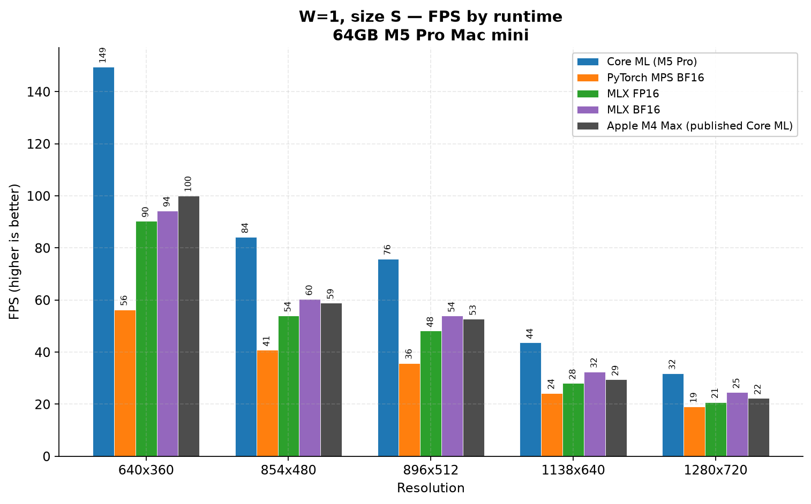
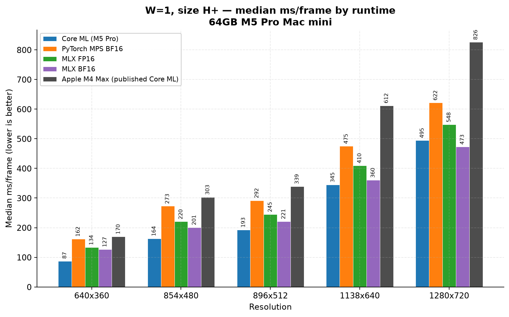
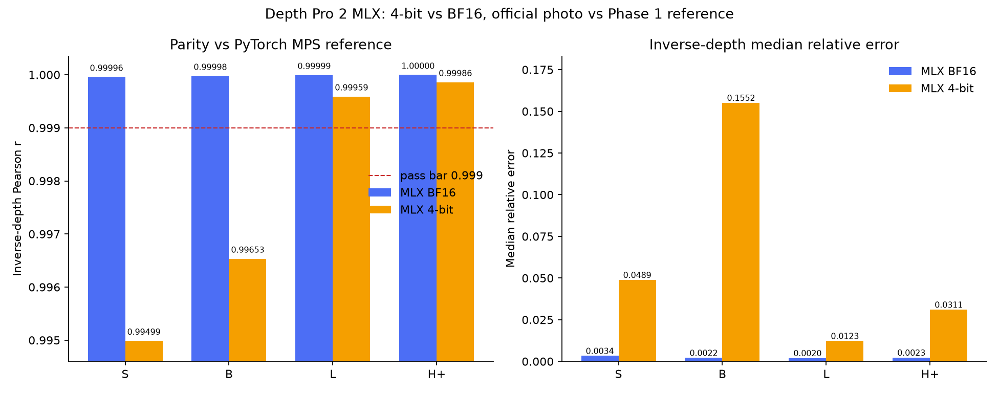

# Apple Depth Pro 2 (Core ML, PyTorch, MLX)

Date: 2026-11-19

I ran Apple's Depth Pro 2 on my 64GB M5 Pro Mac mini. Depth Pro 2 turns a photo or a video into a metric depth map, in meters, and it comes in four sizes (S, B, L, and H+) plus a small focal-length head. I compared three runtimes: Apple's official Core ML packages, the official PyTorch code on MPS, and an MLX port. The next morning I also made a 4-bit MLX conversion and checked whether the depth maps still matched.

At 720p, a single H+ frame took 472.7 ms in MLX BF16, 494.8 ms in Core ML, and 621.7 ms in PyTorch MPS. Apple's published figure for that same cell is 826 ms, measured on a 64GB M4 Max MacBook Pro. That M4 Max number is Apple's, on a different machine.

The public dataset is [pratikgx/depth-pro-2-m5-pro-mac-mini-bench](https://huggingface.co/datasets/pratikgx/depth-pro-2-m5-pro-mac-mini-bench). The 4-bit weights that passed the accuracy check are at [pratikgx/Depth-Pro-2-MLX-4bit](https://huggingface.co/pratikgx/Depth-Pro-2-MLX-4bit).

## The setup

- Mac mini, Apple M5 Pro, 64 GB unified memory, macOS 27.0.1 (26A434), AC power.
- A background inference app was paused for the Phase 1 and Phase 2 speed runs at the owner's request. The 4-bit quality check left it running.
- Weights: [apple/DepthPro2](https://huggingface.co/apple/DepthPro2), sizes [S](https://huggingface.co/apple/DepthPro2-S), [B](https://huggingface.co/apple/DepthPro2-B), [L](https://huggingface.co/apple/DepthPro2-L), and [H+](https://huggingface.co/apple/DepthPro2-H), plus [apple/DepthPro2-focal](https://huggingface.co/apple/DepthPro2-focal).
- Official code: [apple-aiml-research/ml-depth-pro-2](https://github.com/apple-aiml-research/ml-depth-pro-2), commit `919ff37a`.
- Phase 1 runtime: Python 3.12.15, torch 2.15.0 (MPS), coremltools 9.0.
- Phase 2 runtime: MLX 0.32.4, `depth_pro_2_mlx` 0.1.0. The MLX port was built by [@SpaceXSI](https://x.com/SpaceXSI) with a coding agent. The port itself is not in the dataset.
- Timing follows Apple's official demo README: drop the first prediction and the next `window + 2` warmups, then take the median of the remaining timed frames. W=1 is a single frame. W=4 is unbuffered streaming.

## Speed

Core ML still wins most single-frame cells. S ran at 149 fps at 360p (6.7 ms) and 31 fps at 720p (31.5 ms).

On the largest model, MLX BF16 had the edge. At 720p, single-frame H+ was 472.7 ms in MLX BF16, 494.8 ms in Core ML, and 621.7 ms in PyTorch.

For streaming (W=4) at 720p, MLX BF16 was fastest on S (60.3 ms), L (353.6 ms), and H+ (629.1 ms, versus 1,081.8 ms in Core ML). On B, PyTorch was 135.4 ms and MLX BF16 was 139.4 ms.

The shared focal-length head was 15.6 ms in MLX and 27.7 ms in Core ML, at 896×512.

`mx.compile` helped a little on S at 1280×720, about 1.07× to 1.08× versus eager.

The M4 Max columns in the dataset tables are Apple's published numbers, not this run.

## Did the depth maps match?

I compared MLX against Phase 1 PyTorch MPS reference outputs on Apple's official example photo (1920×1440). In BF16, inverse-depth Pearson r was at least 0.99995 on every size. BF16 video was at least 0.99998. That is a tight match.

FP16 is a different story. MLX FP16 produced all-NaN depth maps on some cells: the L photo at native resolution, and buffered video for B and H+. Use BF16 for full precision, not FP16.

## 4-bit

I quantized the encoder's linear layers to 4-bit (group size 64) and checked the official photo against those same references. The bar was no NaNs and Pearson r of at least 0.999.

| Size | 4-bit r | BF16 r | Uploaded |
| --- | ---: | ---: | --- |
| S | 0.99499 | 0.99996 | no |
| B | 0.99653 | 0.99998 | no |
| L | 0.99959 | 0.99999 | yes |
| H+ | 0.99986 | 1.00000 | yes |

L and H+ cleared the bar, with no NaNs, and are in [pratikgx/Depth-Pro-2-MLX-4bit](https://huggingface.co/pratikgx/Depth-Pro-2-MLX-4bit). S and B did not, so I did not upload those sizes. The focal-length head was left in BF16.

## Caveats

- Use BF16 for full-precision MLX, not FP16. Some FP16 cells produced all-NaN depth maps.
- Three optional FP16 video cells were skipped to stay inside the bench window. Every required speed, FOV, photo, and BF16 video cell completed.
- Peak memory readings from the buffered video runs should not be trusted. Some back-to-back cells reported the same peak, including values above the 64 GB of this machine.
- The 4-bit quality numbers come from a small test set. S and B missed the 0.999 bar, so only L and H+ were uploaded.
- Apple's M4 Max figures are from the official demo README, measured on a different machine.

## Licenses and credit

Measurements and this note: **CC BY 4.0**, attribution **Pratik Gandhi**. [License text](https://creativecommons.org/licenses/by/4.0/).

Apple Machine Learning Research Model is licensed under the Apple Machine Learning Research Model License Agreement. Depth Pro 2 is for research use only. No original weights are redistributed in the dataset. The 4-bit conversion is a Model Derivative and carries that same license.

Credit to Apple and the Depth Pro 2 authors, and to [@SpaceXSI](https://x.com/SpaceXSI) for the MLX port, which was built with a coding agent.

## Data

- Hugging Face dataset: [pratikgx/depth-pro-2-m5-pro-mac-mini-bench](https://huggingface.co/datasets/pratikgx/depth-pro-2-m5-pro-mac-mini-bench)
- 4-bit MLX weights: [pratikgx/Depth-Pro-2-MLX-4bit](https://huggingface.co/pratikgx/Depth-Pro-2-MLX-4bit)
- results/2026-11-19-apple-depth-pro-2-mlx.csv / .json
