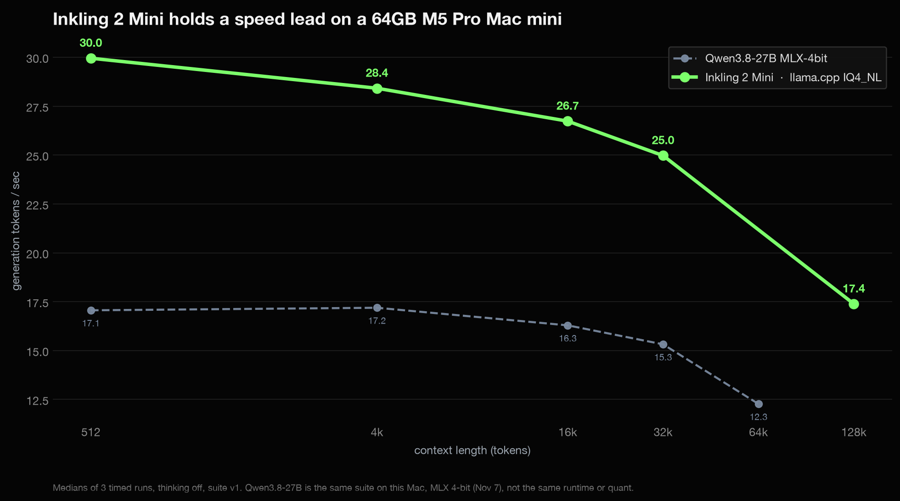
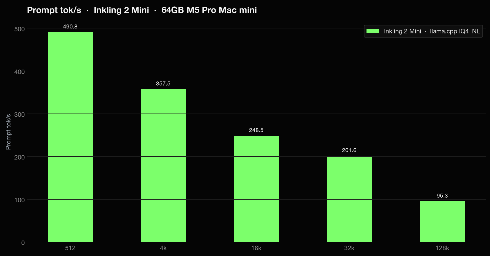
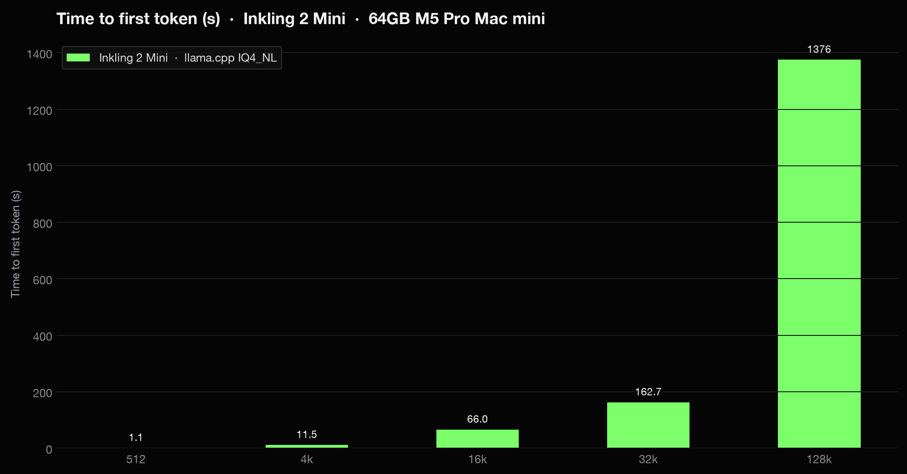
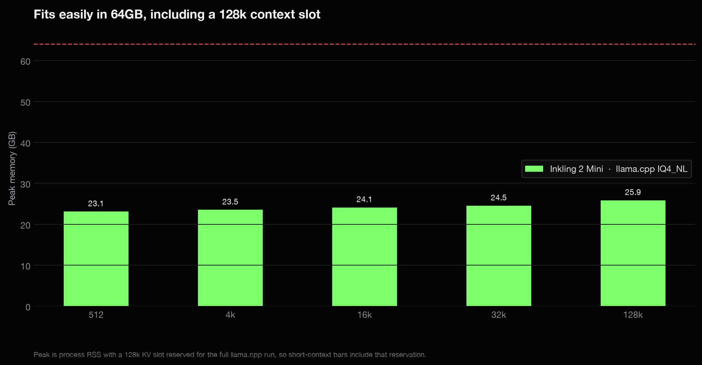
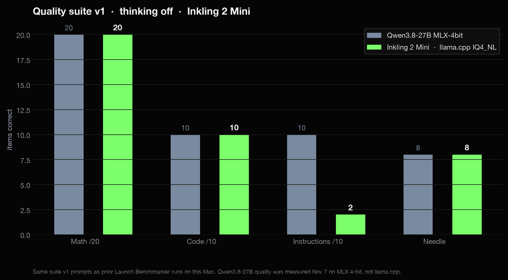

# Thinking Machines Inkling 2 Mini (llama.cpp)

Date: 2026-11-20

I ran Thinking Machines Lab's Inkling 2 Mini on my 64GB M5 Pro Mac mini, using the official ggml-org IQ4_NL GGUF (17.63 GB) in llama.cpp. The weights fit comfortably. Generation was 29.95 tok/s at 512 prompt tokens, 24.97 tok/s at 32k, and 17.39 tok/s at 128k. On my usual local quality suite it scored 20/20 on math, 10/10 on code, and 8/8 on needle-in-a-haystack tests.

Instruction following was 2/10. The misses put a planning preamble into the visible answer even with reasoning set to none, which matches the lab's warning that setting reasoning effort to its minimum does not fully disable reasoning.

A background inference app was paused for these runs at the owner's request.

The public dataset is [pratikgx/inkling-2-mini-m5-pro-mac-mini-bench](https://huggingface.co/datasets/pratikgx/inkling-2-mini-m5-pro-mac-mini-bench).

A November 21 tuning pass on the same setup is in [notes/2026-11-21-thinking-machines-inkling-2-mini-tuning.md](2026-11-21-thinking-machines-inkling-2-mini-tuning.md). The stock baseline remained the fastest lossless config. Raw files: [pratikgx/inkling-2-mini-m5-pro-mac-mini-tuning](https://huggingface.co/datasets/pratikgx/inkling-2-mini-m5-pro-mac-mini-tuning).

## The setup

- Mac mini, Apple M5 Pro, 64 GB unified memory, macOS 27.0.1 (26A434), AC power.
- A background inference app was paused for these runs at the owner's request.
- Weights: official [ggml-org/Inkling-2-Mini-GGUF](https://huggingface.co/ggml-org/Inkling-2-Mini-GGUF) `Inkling-2-Mini-IQ4_NL.gguf`, 17,627,940,768 bytes (17.63 GB). Source model: [thinkingmachines/Inkling-2-Mini](https://huggingface.co/thinkingmachines/Inkling-2-Mini) (Apache 2.0).
- Runtime: [llama.cpp PR #32694](https://github.com/ggml-org/llama.cpp/pull/32694) (official `inkling2_loop` loader), commit `d7cb78c91`, version 1.0.0-dev (build 12587). Metal, `ngl=99`, flash-attn on, persistent `llama-server` with a 133,120-token context slot. Time to first token is from the streaming `/completion` endpoint.
- Settings: temperature 0, seed 42, thinking off (`reasoning_effort=none`), 256 generated tokens for the speed cells, 1 warmup + 3 timed runs, median reported. The official `generation_config` uses temperature 1.0 with sampling on; this bench used temperature 0.
- Quality: the same local suite v1 prompts as earlier Launch Benchmarker runs on this machine (20 math, 10 code, 10 instruction-following, plus needles at 32k and 64k).
- Speed peak RSS includes the reserved 128k KV slot, so 23.10 GB at 512 tokens is not a tight short-context footprint. Needle-test peak RSS was 32.14 GB at 32k and 32.65 GB at 64k.

## Speed

Values are medians. The largest generation-speed spread across the three timed runs at any context was 0.81%.

| Prompt tokens | Prompt tok/s | Gen tok/s | TTFT | Peak RSS |
| ---: | ---: | ---: | ---: | ---: |
| 512 | 490.8 | 29.95 | 1.117 s | 23.10 GB |
| 4,096 | 357.5 | 28.42 | 11.54 s | 23.53 GB |
| 16,384 | 248.5 | 26.74 | 66.05 s | 24.13 GB |
| 32,768 | 201.6 | 24.97 | 162.7 s | 24.54 GB |
| 131,072 | 95.29 | 17.39 | 1,376 s (22.9 min) | 25.86 GB |

The 128k cell completed without running out of memory. Peak RSS there was 25.86 GB on this 64 GB machine.

## Quality

| Task | Score |
| --- | ---: |
| Math | 20/20 |
| Code | 10/10 |
| Instruction following | 2/10 |
| Needles (32k) | 5/5 |
| Needles (64k) | 3/3 |
| Needles total | 8/8 |
| Unclosed think blocks | 0 |

The instruction-following misses put a planning preamble into the visible answer (for example, "The user wants...") even with `reasoning_effort=none`. Two of the ten items still met their output constraints. Math, code, and every needle test passed.

This is a small local suite, not a public leaderboard.

## Comparison with Qwen3.8-27B (not apples to apples)

On this same Mac mini, and the same suite v1 protocol with thinking off, I previously measured [TensorFold/Qwen3.8-27B-MLX-4bit](https://huggingface.co/TensorFold/Qwen3.8-27B-MLX-4bit) through MLX on November 7, 2026. That is a different model family, a different runtime, and a different quantization path, so this is not a like-for-like comparison. I am including it because it is the closest dense 27B number I have on this machine with the same suite.

| Prompt tokens | Inkling 2 Mini gen tok/s (llama.cpp IQ4_NL, 2026-11-20) | Qwen3.8-27B gen tok/s (MLX 4-bit, 2026-11-07) | Ratio |
| ---: | ---: | ---: | ---: |
| 512 | 29.95 | 17.06 | 1.76x |
| 4,096 | 28.42 | 17.19 | 1.65x |
| 16,384 | 26.74 | 16.29 | 1.64x |
| 32,768 | 24.97 | 15.32 | 1.63x |
| 65,536 | (not a dedicated speed cell) | 12.27 | |
| 131,072 | 17.39 | (no 128k Qwen number) | |

Inkling's 128k generation speed (17.39 tok/s) was still higher than that earlier Qwen 64k figure (12.27 tok/s). The earlier Qwen MLX quality run was 20/20 math, 10/10 code, 10/10 instruction following, and 8/8 needles. Memory metrics also differ (MLX allocator peak versus llama.cpp process RSS), so those should not be compared directly.

## Runtimes that could not run it

I only published timed and quality numbers from llama.cpp. I also tried three other local runtimes on this machine the same day, and none of them ran the model:

- mlx-lm PR #2061 (mlx 0.32.4, mlx-lm 0.32.3.dev25+gf00f0798a): loading the official looped weights failed with `ValueError: Received 146 parameters not in model`, including `middle_cycle_cross_pass_queries` and `middle_cycle_cross_pass_kv_queries`. The full MLX suite was skipped. I did not create an MLX port.
- TensorFold 1.2.7: no Inkling / `inkling2_loop` support in the installed build. TensorFold was not used, and it was not upgraded for this bench.
- Ollama 0.40.14: no local Inkling 2 Mini library model (the local list showed only `qwen3.8:27b`). No new model was pulled during the bench, so Ollama was not used.

## Caveats

- These are measurements on one 64GB M5 Pro Mac mini, one official IQ4_NL GGUF, and one llama.cpp commit. Your numbers will differ.
- Speed peak RSS includes a reserved 128k KV slot. Use the needle peaks if you want the higher observed process RSS on this run.
- Temperature was 0. That is not the official default (temperature 1.0, sampling on).
- Thinking was off (`reasoning_effort=none`). Instruction following still showed planning text in the answer, as the lab warned.
- I measured context through 128k. I did not measure longer prompts, and I did not test image input.
- The Qwen3.8-27B overlay is not apples to apples.
- The quality suite is small and local. Math 20/20, code 10/10, and needles 8/8 should be read as results on that suite, not as a public benchmark score.

## Licenses and credit

Measurements and this note: **CC BY 4.0**, attribution **Pratik Gandhi**. [License text](https://creativecommons.org/licenses/by/4.0/).

Inkling 2 Mini is released by Thinking Machines Lab under Apache 2.0. The IQ4_NL GGUF used here is the official ggml-org build. No model weights are redistributed in the dataset.

Credit to Thinking Machines Lab for Inkling 2 Mini, and to the ggml-org / llama.cpp contributors (including the [PR #32694](https://github.com/ggml-org/llama.cpp/pull/32694) official loader) for making the GGUF path work so quickly on launch day.

## Data

- Hugging Face dataset: [pratikgx/inkling-2-mini-m5-pro-mac-mini-bench](https://huggingface.co/datasets/pratikgx/inkling-2-mini-m5-pro-mac-mini-bench)
- results/2026-11-20-thinking-machines-inkling-2-mini.csv / .json
