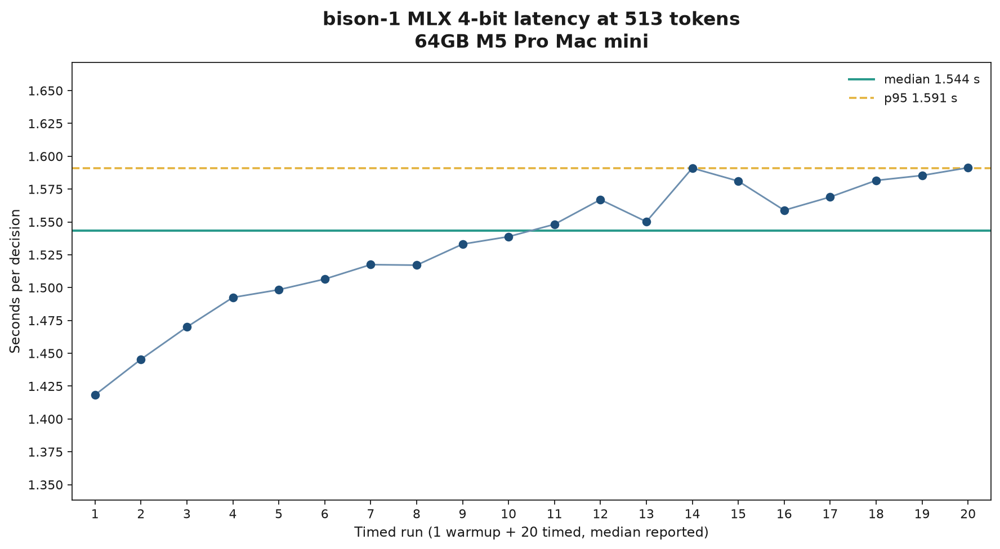
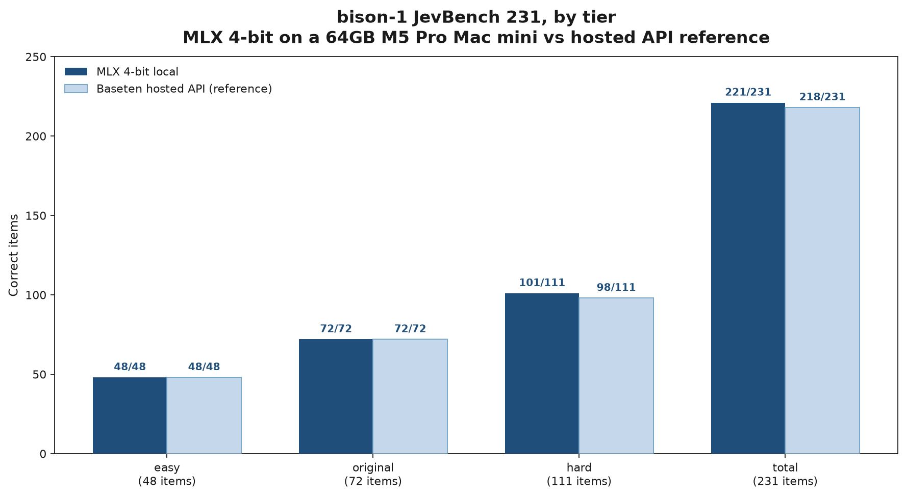
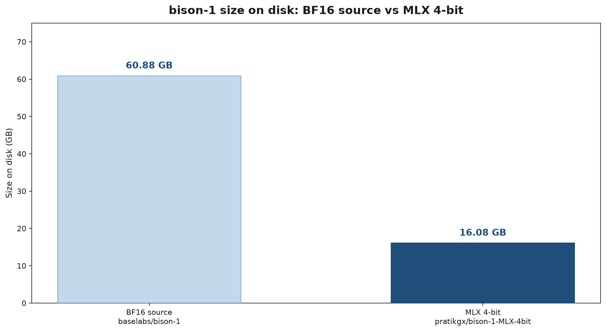

# Baseten bison-1 (MLX 4-bit)

Date: 2026-11-21

Baseten's bison-1 on my 64GB M5 Pro Mac mini. bison-1 is a decision model, not a chat model: you give it a state and a typed question, and it returns a probability for every option in one forward pass. So I measured seconds per decision and decision accuracy, not tokens per second.

The official weights are from [baselabs/bison-1](https://huggingface.co/baselabs/bison-1) (31B dense, built on Gemma 4, MIT and Apache 2.0). There was no published MLX port that implemented Baseten's System One path, so I ran a local 4-bit MLX conversion and a small decision engine. That port was built with a coding agent. I measured [groundhog-1](2026-11-21-baseten-groundhog-1-mlx.md) the same way, earlier the same day.

Another workload kept running during these measurements. These are not isolated-idle figures, and I am not treating a system memory peak as the model's memory. The 4-bit weights are 16.08 GB on disk.

## The setup

- Mac mini, Apple M5 Pro, 64 GB unified memory.
- Weights: [pratikgx/bison-1-MLX-4bit](https://huggingface.co/pratikgx/bison-1-MLX-4bit), 16.08 GB. Affine 4-bit, group size 64. Converted from the official BF16 snapshot (60.88 GB).
- Runtime: mlx 0.32.4, mlx-lm 0.32.2, plus the System One engine in that repo (qev-labels-v2 prompts, slot_lm readout with 256 slots, block-bidirectional full-attention, causal sliding-window).
- Settings: temperature 0, thinking off. One question per request.
- Latency: 513-token noul prompt, 1 warmup + 20 timed runs, median reported.
- Accuracy: public JevBench, 231 items, same scoring I used for GLiDE (noul yes if P(yes) >= 0.5, choice is the top option, score is argmax).
- Agreement: 30 of those items were first answered on Baseten's hosted System One API, then rerun locally. That is hosted-API agreement, not local BF16 OneJev parity.

## Latency per decision

| build | weights | context | median | p95 |
| --- | --- | --- | ---: | ---: |
| MLX 4-bit | 16.08 GB | 513 tokens | 1.544 s | 1.591 s |

0.648 decisions/s at the median. The 20 timed runs ranged from 1.418 s to 1.591 s.

## Accuracy (public JevBench, 231 items)

| run | total | easy | original | hard |
| --- | --- | --- | --- | --- |
| MLX 4-bit (this Mac) | 221/231 | 48/48 | 72/72 | 101/111 |
| Baseten hosted API (reference) | 218/231 | 48/48 | 72/72 | 98/111 |

The hosted score is a different runtime, not a like-for-like comparison. Local JevBench median was 0.824 s per item (p95 10.35 s), because some hard items are much longer than the 513-token latency prompt.

On the 30-item agreement set, local 4-bit matched the hosted API's top decision 29/30. Mean absolute probability difference was 0.0176, max 0.248. The one miss was `hard-opus-b-multi_hop-05`: local predicted 2, hosted predicted 3, and the JevBench gold label was 2. Local matched gold; it still counts as a miss against hosted.

## Compared with groundhog-1 and GLiDE on this Mac

The same-day [groundhog-1 4-bit](2026-11-21-baseten-groundhog-1-mlx.md) run scored 206/231 in 0.840 s, with 13.22 GB weights. bison-1 is a 31B dense model, so it is slower here (1.544 s) and a good deal ahead on JevBench (221/231 vs 206/231). Fastino GLiDE v1.2 27B, through the community MLX port I measured on November 5, scored 213/231 in 1.45 s at ~512 tokens (4-bit) and 215/231 in 1.67 s (8-bit). bison-1 4-bit is a little slower than GLiDE 4-bit and ahead on this JevBench run. These are different models and different engines, so that is a context check, not a head-to-head on the same codebase.

## What I learned

A 31B dense decision model fits this Mac at 4-bit in 16.08 GB, and it answers in about a second and a half at a 513-token prompt even with another workload still running. On the public 231-item set the local 4-bit port scored 221/231, three items above the hosted API reference, all on the hard slice. Treat that gap carefully: it is a different runtime, not a claim that the port beats official serving. Hosted-API agreement was 29/30, and the one miss was a case where local matched the gold label. The MLX repo is a code port, so treat these as numbers for that port, not for Baseten's official serving stack.

## Data

- MLX 4-bit weights and engine: [pratikgx/bison-1-MLX-4bit](https://huggingface.co/pratikgx/bison-1-MLX-4bit)
- Hugging Face benchmark data: [pratikgx/bison-1-m5-pro-mac-mini-bench](https://huggingface.co/datasets/pratikgx/bison-1-m5-pro-mac-mini-bench)
- Official model: [baselabs/bison-1](https://huggingface.co/baselabs/bison-1)
- Same-day groundhog-1 note: [2026-11-21-baseten-groundhog-1-mlx.md](2026-11-21-baseten-groundhog-1-mlx.md)
- results/2026-11-21-baseten-bison-1-mlx.csv / .json
