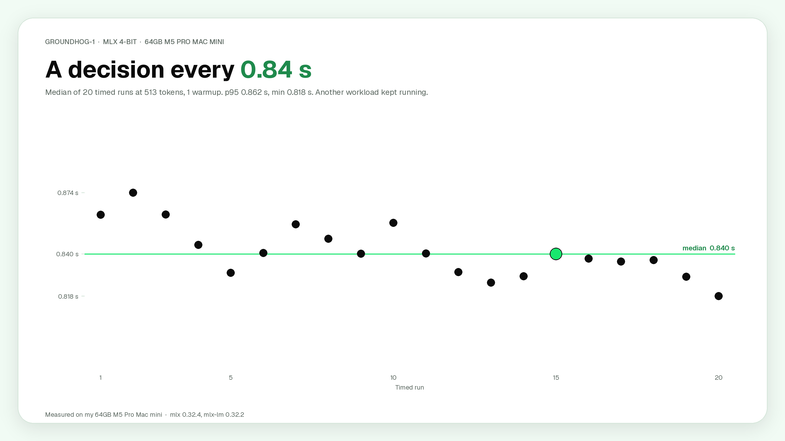
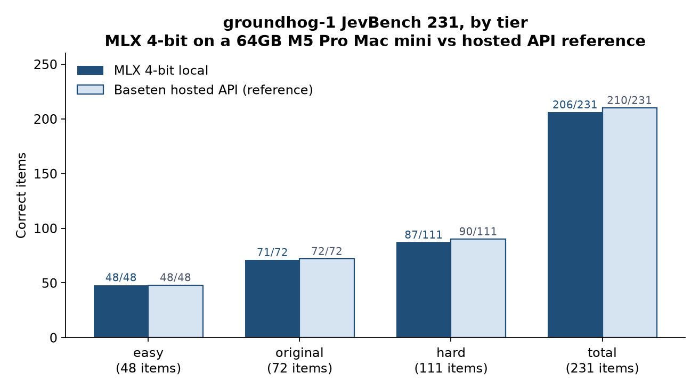
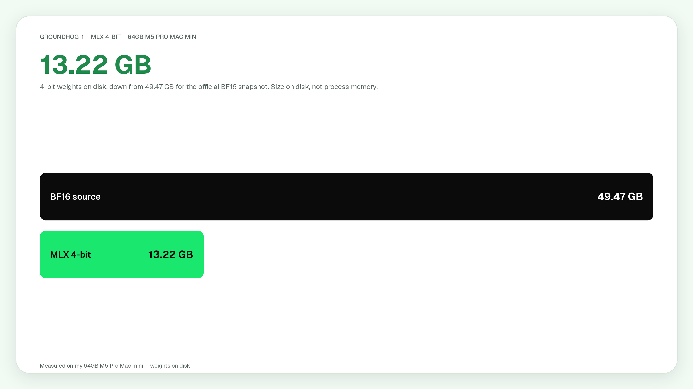

# Baseten groundhog-1 (MLX 4-bit)

Date: 2026-11-21

Baseten's groundhog-1 on my 64GB M5 Pro Mac mini. groundhog-1 is a decision model, not a chat model: you give it a state and a typed question, and it returns a probability for every option in one forward pass. So I measured seconds per decision and decision accuracy, not tokens per second.

The official weights are from [baselabs/groundhog-1](https://huggingface.co/baselabs/groundhog-1) (26B MoE, about 4B active, built on Gemma 4, MIT and Apache 2.0). There was no published MLX port that implemented Baseten's System One path, so I ran a local 4-bit MLX conversion and a small decision engine. That port was built with a coding agent.

Another workload kept running during these measurements. These are not isolated-idle figures, and I am not treating a system memory peak as the model's memory. The 4-bit weights are 13.22 GB on disk.

## The setup

- Mac mini, Apple M5 Pro, 64 GB unified memory.
- Weights: [pratikgx/groundhog-1-MLX-4bit](https://huggingface.co/pratikgx/groundhog-1-MLX-4bit), 13.22 GB. Affine 4-bit, group size 64, routers kept at 8-bit. Converted from the official BF16 snapshot (49.47 GB).
- Runtime: mlx 0.32.4, mlx-lm 0.32.2, plus the System One engine in that repo (qev-labels-v2 prompts, slot_lm readout with 256 slots, block-bidirectional full-attention, causal sliding-window).
- Settings: temperature 0, thinking off. One question per request.
- Latency: 513-token noul prompt, 1 warmup + 20 timed runs, median reported.
- Accuracy: public JevBench, 231 items, same scoring I used for GLiDE (noul yes if P(yes) >= 0.5, choice is the top option, score is argmax).
- Agreement: 30 of those items were first answered on Baseten's hosted System One API, then rerun locally. That is hosted-API agreement, not local BF16 OneJev parity.

## Latency per decision

| build | weights | context | median | p95 |
| --- | --- | --- | ---: | ---: |
| MLX 4-bit | 13.22 GB | 513 tokens | 0.840 s | 0.862 s |

1.19 decisions/s at the median. The 20 timed runs sat in a tight band, from 0.818 s to 0.874 s.

## Accuracy (public JevBench, 231 items)

| run | total | easy | original | hard |
| --- | --- | --- | --- | --- |
| MLX 4-bit (this Mac) | 206/231 | 48/48 | 71/72 | 87/111 |
| Baseten hosted API (reference) | 210/231 | 48/48 | 72/72 | 90/111 |

The hosted score is a different runtime, not a like-for-like comparison. Local JevBench median was 0.268 s per item (p95 1.42 s), because most items are shorter than the 513-token latency prompt.

On the 30-item agreement set, local 4-bit matched the hosted API's top decision 30/30. Mean absolute probability difference was 0.0167, max 0.275. The larger probability gaps were still on items where the top answer agreed.

## Compared with GLiDE on this Mac

Fastino GLiDE v1.2 27B, through the community MLX port I measured on November 5, scored 213/231 in 1.45 s at ~512 tokens (4-bit) and 215/231 in 1.67 s (8-bit). groundhog-1 4-bit is faster here (0.840 s) and a little behind on JevBench (206/231 vs 213/231). These are different models and different engines, so that is a context check, not a head-to-head on the same codebase.

## What I learned

A 26B MoE decision model fits this Mac at 4-bit in 13.22 GB, and it answers in well under a second at a 513-token prompt even with another workload still running. The hosted API remains slightly ahead on the hard JevBench slice. The MLX repo is a code port, so treat these as numbers for that port, not for Baseten's official serving stack.

## Data

- MLX 4-bit weights and engine: [pratikgx/groundhog-1-MLX-4bit](https://huggingface.co/pratikgx/groundhog-1-MLX-4bit)
- Hugging Face benchmark data: [pratikgx/groundhog-1-m5-pro-mac-mini-bench](https://huggingface.co/datasets/pratikgx/groundhog-1-m5-pro-mac-mini-bench)
- Official model: [baselabs/groundhog-1](https://huggingface.co/baselabs/groundhog-1)
- results/2026-11-21-baseten-groundhog-1-mlx.csv / .json
- Same-day bison-1 note: [2026-11-21-baseten-bison-1-mlx.md](2026-11-21-baseten-bison-1-mlx.md)
