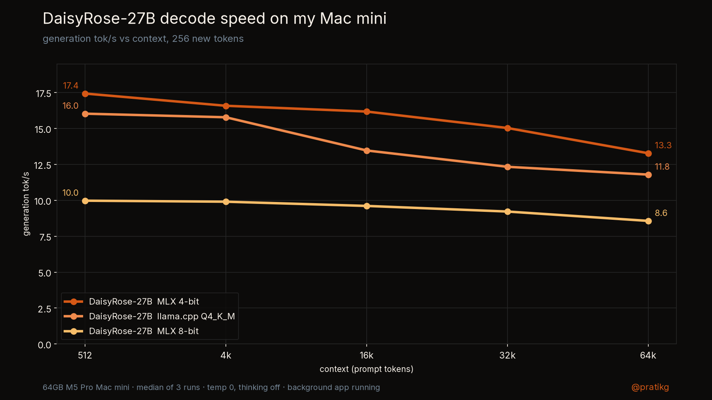
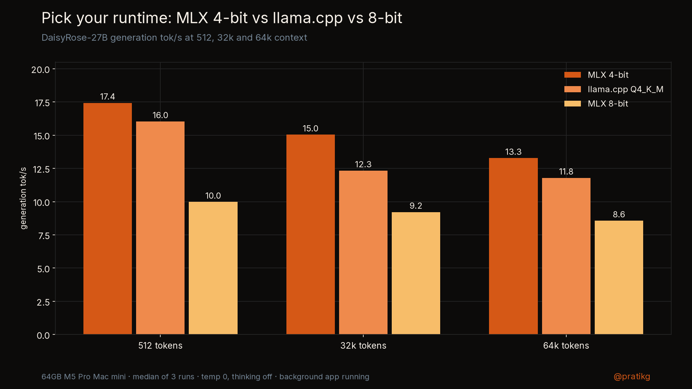
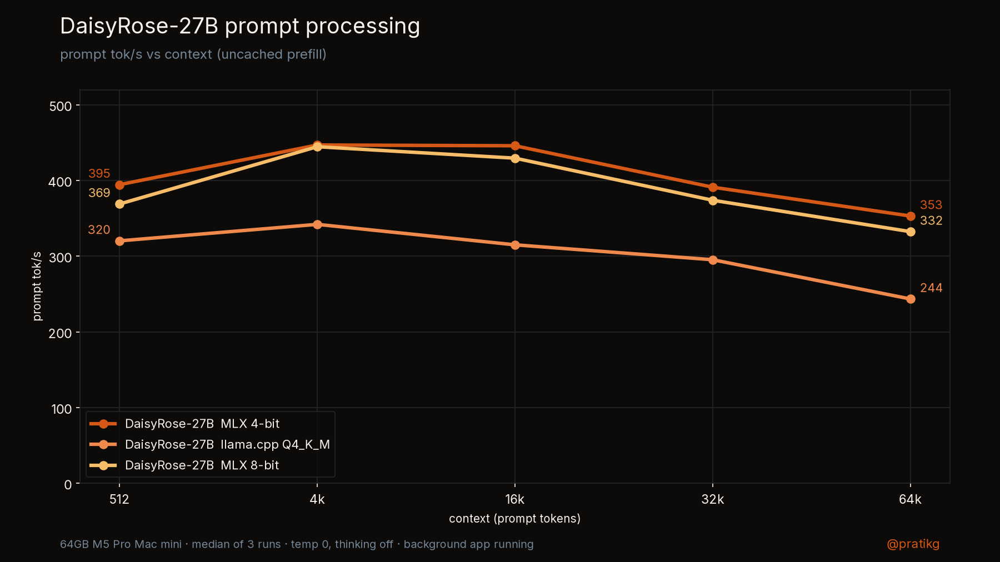
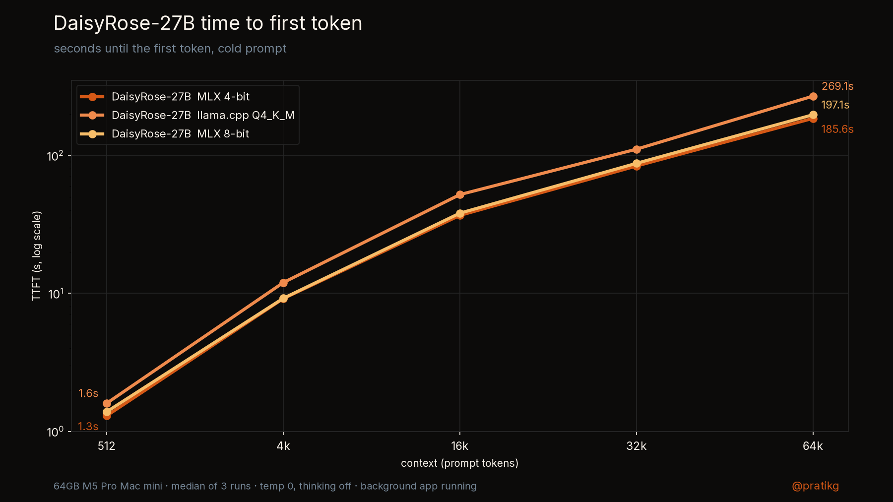
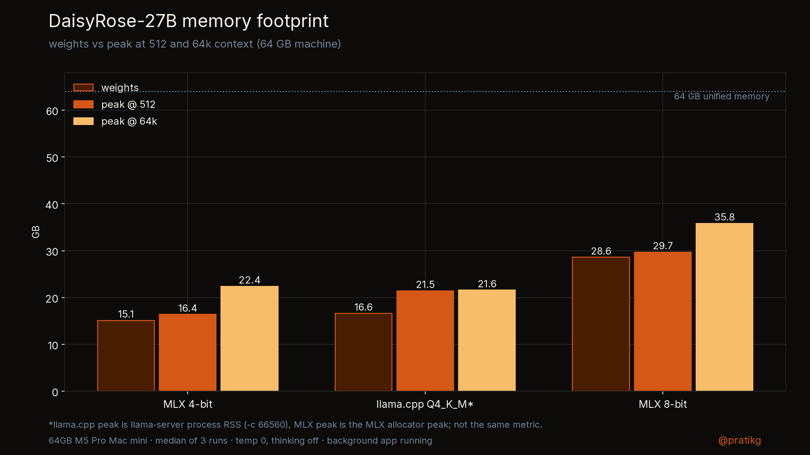
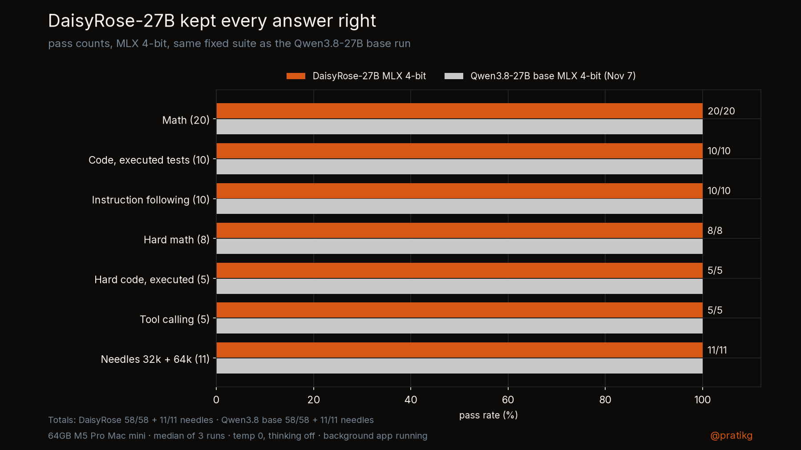
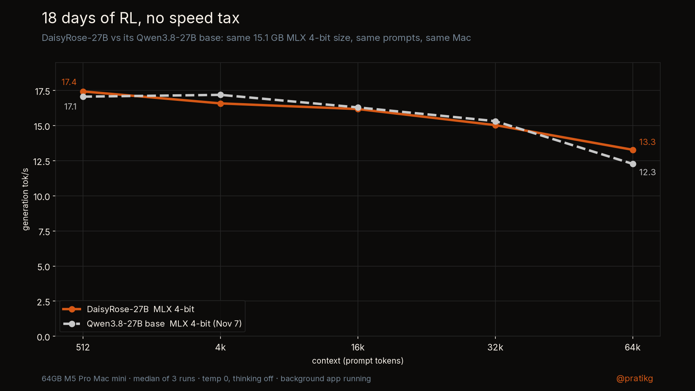

# RadixArk DaisyRose-27B (MLX 4-bit, llama.cpp Q4_K_M, MLX 8-bit)

Date: 2026-11-21 (overnight run, finished 2026-11-22)

RadixArk's DaisyRose-27B on my 64GB M5 Pro Mac mini. DaisyRose-27B is RadixArk's first open-weight model: Qwen3.8-27B post-trained with RL on 1,200 curated long-horizon agent tasks, 18 days on 144 H200s, using their Miles framework. Because it keeps the Qwen3.8-27B architecture, I could run it on the exact same fixed suite I used for the plain Qwen3.8-27B on November 7 and put the two side by side.

I measured three local builds: the [mlx-community 4-bit](https://huggingface.co/mlx-community/DaisyRose-27B-4bit) MLX weights (main build, speed plus the full quality suite), RadixArk's own [official GGUF](https://huggingface.co/RadixArk/DaisyRose-27B-GGUF) at Q4_K_M through llama.cpp (speed only), and a community MLX 8-bit conversion (speed only). I did not make an MLX port for this one. BF16 (about 55.6 GB) was not run.

A background app was running at my request during every run and was not paused. The November 7 Qwen3.8-27B baseline was measured under the same condition. These are not isolated-idle figures, and I am not treating any system memory number as the model's memory.

## The setup

- Mac mini, Apple M5 Pro, 64 GB unified memory, macOS 27.0.1 (26A434), on AC power.
- MLX 4-bit: [mlx-community/DaisyRose-27B-4bit](https://huggingface.co/mlx-community/DaisyRose-27B-4bit), 15.13 GB loaded tensors (byte-identical tensor size to the Qwen3.8-27B MLX 4-bit build).
- GGUF: [RadixArk/DaisyRose-27B-GGUF](https://huggingface.co/RadixArk/DaisyRose-27B-GGUF), `DaisyRose-27B-Q4_K_M.gguf`, 16,619,308,512 bytes.
- MLX 8-bit: [netprojects/DaisyRose-27B-MLX-8bit](https://huggingface.co/netprojects/DaisyRose-27B-MLX-8bit) (community conversion), 28.58 GB loaded tensors.
- Runtimes: mlx 0.32.4, mlx-lm 0.32.2, transformers 5.22.2, Python 3.12.15. llama.cpp `llama-server`, local Metal build (the build hash was not captured in the run logs).
- Settings: temperature 0, seed 1234, thinking off (`enable_thinking=False` in the chat template), 256 new tokens per speed request.
- Speed: 1 warmup, then 3 timed uncached runs per context (512, 4k, 16k, 32k, 64k). Median reported. If the first 3 runs spread more than 10%, 3 more were collected and those were used.
- Quality: the same fixed suite v1 + deep-v1 (prompt manifest sha256 `7a3e4fea…f1d3e3`) as the November 7 Qwen3.8-27B run. 58 items: 20 math, 10 code (executed against tests), 10 instruction following, 8 hard math, 5 hard code (executed), 5 tool calling. Plus 11 needle-in-a-haystack checks (5 depths at 32k, 6 at 64k).
- Memory: MLX numbers are the MLX allocator peak (`mx.get_peak_memory()`). llama.cpp numbers are `llama-server` process RSS sampled during the run, with a 66,560-token context and 4 slots. These are different metrics.

### Exact commands

```bash
# weights
hf download mlx-community/DaisyRose-27B-4bit --local-dir models/daisy-4bit
hf download RadixArk/DaisyRose-27B-GGUF --include "DaisyRose-27B-Q4_K_M.gguf" --local-dir models/daisy-gguf
hf download netprojects/DaisyRose-27B-MLX-8bit --local-dir models/daisy-8bit

# runs (sequential, one process at a time)
python -u run_benchmark.py mlx daisy-4bit speed,quality
python -u run_benchmark.py llamacpp daisy-gguf speed
python -u run_benchmark.py mlx daisy-8bit speed

# llama.cpp server started by the runner
llama.cpp/build/bin/llama-server -m models/daisy-gguf/DaisyRose-27B-Q4_K_M.gguf \
  --host 127.0.0.1 --port 18088 -ngl 999 -c 66560 --jinja --no-warmup
# requests: POST /completion with the chat-templated prompt, n_predict 256, temperature 0, cache_prompt false
```

## Generation speed

| build | 512 | 4k | 16k | 32k | 64k |
| --- | ---: | ---: | ---: | ---: | ---: |
| MLX 4-bit | 17.43 | 16.58 | 16.18 | 15.03 | 13.28 |
| llama.cpp Q4_K_M | 16.03 | 15.78 | 13.47 | 12.33 | 11.79 |
| MLX 8-bit | 9.97 | 9.90 | 9.61 | 9.22 | 8.57 |

Generation tok/s, median of 3. MLX 4-bit is the fastest build at every context, 8.7% ahead of llama.cpp Q4_K_M at 512 and 12.6% ahead at 64k. It still does 13.28 tok/s with a 64k prompt.





## Prompt processing and time to first token

| build | prompt tok/s 512 | 4k | 16k | 32k | 64k | TTFT 512 | TTFT 32k | TTFT 64k |
| --- | ---: | ---: | ---: | ---: | ---: | ---: | ---: | ---: |
| MLX 4-bit | 394.5 | 446.9 | 445.9 | 391.2 | 353.1 | 1.30 s | 83.8 s | 185.6 s |
| llama.cpp Q4_K_M | 320.3 | 342.1 | 315.0 | 295.3 | 243.5 | 1.60 s | 111.0 s | 269.1 s |
| MLX 8-bit | 369.0 | 444.7 | 429.5 | 373.9 | 332.4 | 1.39 s | 87.6 s | 197.1 s |

Cold, uncached prefill. With a 64k prompt, MLX 4-bit reaches the first token 31% sooner than llama.cpp Q4_K_M here (185.6 s vs 269.1 s). MLX 8-bit prefill is close to 4-bit; the 8-bit cost shows up in decode.





## Memory

| build | weights | peak at 512 | peak at 64k | metric |
| --- | ---: | ---: | ---: | --- |
| MLX 4-bit | 15.13 GB | 16.40 GB | 22.40 GB | MLX allocator peak |
| llama.cpp Q4_K_M | 16.62 GB | 21.45 GB | 21.59 GB | llama-server RSS, `-c 66560` |
| MLX 8-bit | 28.58 GB | 29.71 GB | 35.85 GB | MLX allocator peak |

The 4-bit MLX build runs a 64k prompt inside 22.40 GB, about a third of this machine. llama.cpp reserves its KV cache for the full 66,560-token context up front, so its RSS is flat across contexts; do not compare it directly with the MLX allocator peak.



## Quality (MLX 4-bit)

| suite | DaisyRose-27B | Qwen3.8-27B base (Nov 7) |
| --- | --- | --- |
| Math | 20/20 | 20/20 |
| Code, executed tests | 10/10 | 10/10 |
| Instruction following | 10/10 | 10/10 |
| Hard math | 8/8 | 8/8 |
| Hard code, executed | 5/5 | 5/5 |
| Tool calling | 5/5 | 5/5 |
| Needles, 32k x5 + 64k x6 | 11/11 | 11/11 |

58/58 and 11/11. RL post-training for long-horizon agent work did not cost anything on this fixed local suite. The suite is saturated for both models, so it shows nothing was lost, not how much was gained; RadixArk's Terminal-Bench 4.1 result (5.6% to 12.0%) is theirs and I did not reproduce it.



## Compared with plain Qwen3.8-27B on this Mac

Same MLX 4-bit tensor size (15.13 GB), same prompts, same runtime versions, same background-app condition, measured on November 7.

| context | DaisyRose-27B | Qwen3.8-27B | difference |
| --- | ---: | ---: | ---: |
| 512 | 17.43 | 17.06 | +2.2% |
| 4k | 16.58 | 17.19 | -3.5% |
| 16k | 16.18 | 16.29 | -0.7% |
| 32k | 15.03 | 15.32 | -1.9% |
| 64k | 13.28 | 12.27 | +8.2% |

Generation tok/s, MLX 4-bit, median of 3. The two are within run-to-run noise from 512 to 32k, which is what you expect from the same architecture. Treat the 64k gap as mostly noise: the Qwen run at 64k needed a rerun after its first three runs spread more than 10%, and its final three still ranged from 10.54 to 13.41 tok/s. Peak MLX memory matched to two decimals at every context.



## What I learned

RadixArk's 18 days of RL turned Qwen3.8-27B into an agent-tuned model with no speed or memory tax at all on my Mac: same 15.13 GB at 4-bit, the same 17 tok/s at short context, still 13 tok/s with a 64k prompt, and a perfect score on my fixed suite and needles. MLX 4-bit was the fastest way to run it here, ahead of the official Q4_K_M GGUF in llama.cpp at every context for both decode and prefill. MLX 8-bit runs at about 57% of the 4-bit decode speed for nearly double the weights. All of this is with a background app still running, so an idle machine should do a little better.

## Data

- Hugging Face benchmark data: [pratikgx/daisyrose-27b-m5-pro-mac-mini-bench](https://huggingface.co/datasets/pratikgx/daisyrose-27b-m5-pro-mac-mini-bench)
- MLX 4-bit weights used: [mlx-community/DaisyRose-27B-4bit](https://huggingface.co/mlx-community/DaisyRose-27B-4bit)
- Official GGUF: [RadixArk/DaisyRose-27B-GGUF](https://huggingface.co/RadixArk/DaisyRose-27B-GGUF)
- results/2026-11-21-radixark-daisyrose-27b-mlx.csv / .json
