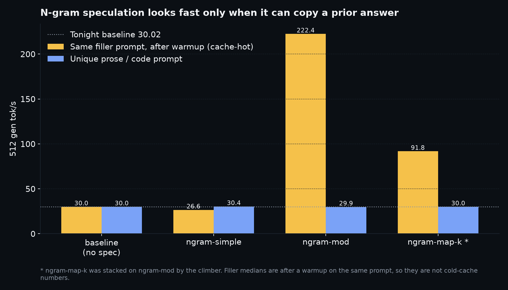
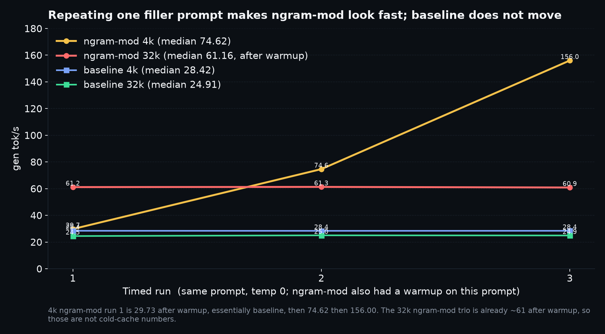
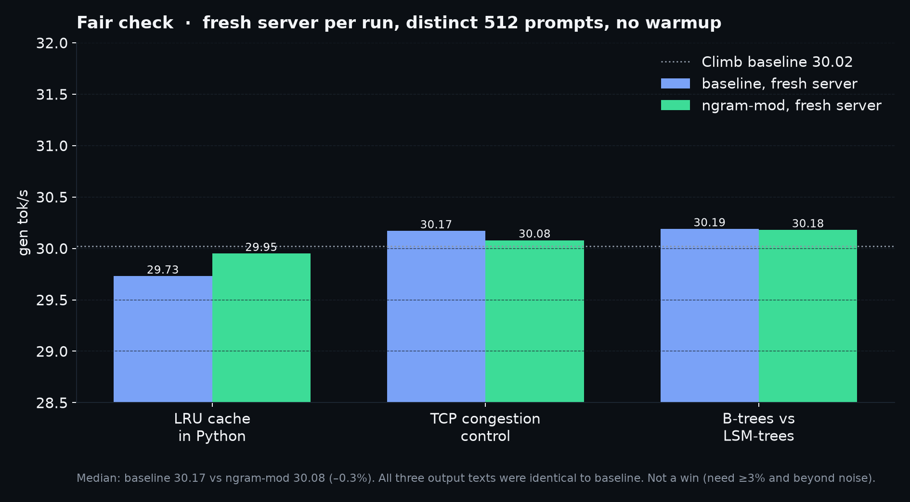
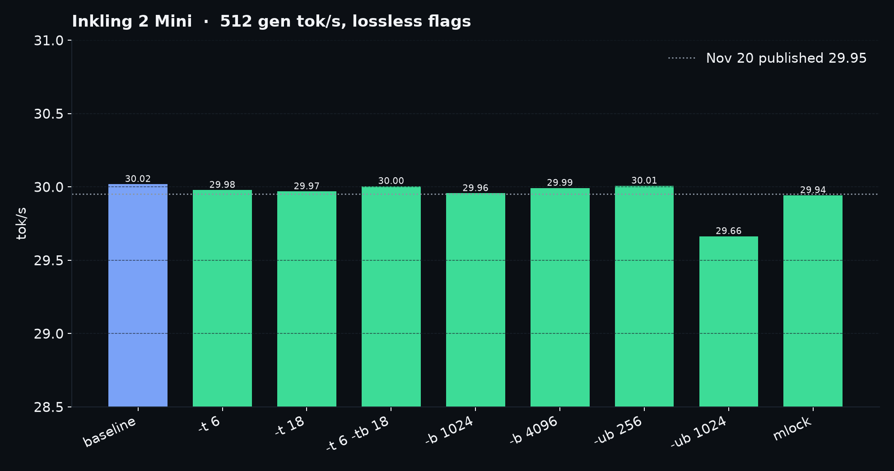
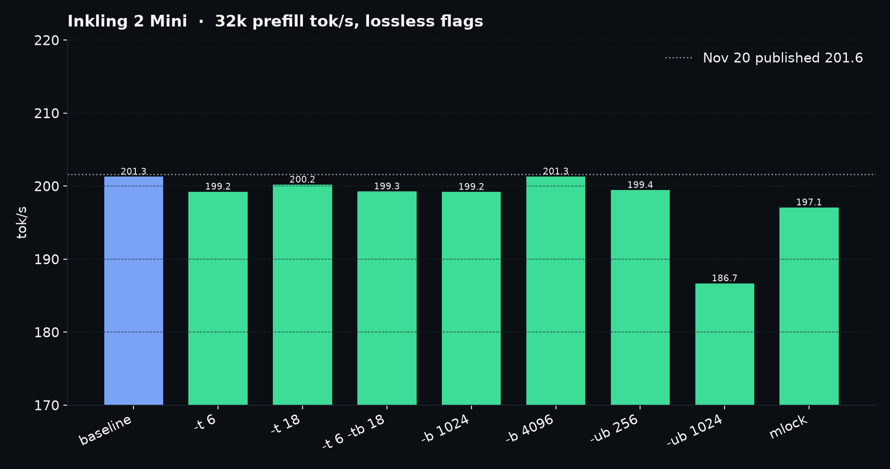
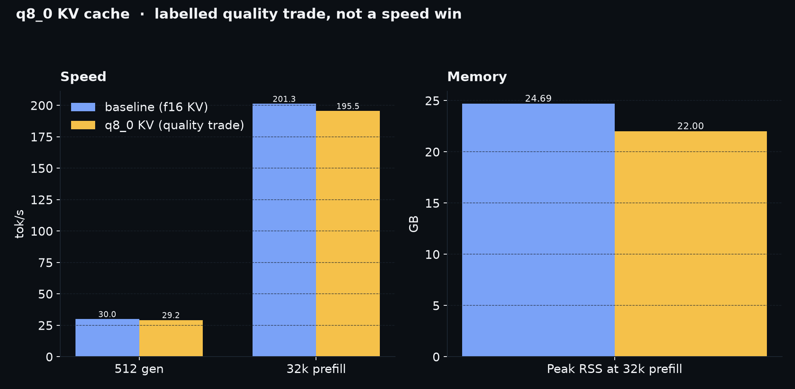

# Thinking Machines Inkling 2 Mini tuning (llama.cpp)

Date: 2026-11-21

I ran a morning hill-climb on Thinking Machines Lab's Inkling 2 Mini on my 64GB M5 Pro Mac mini, using the official ggml-org IQ4_NL GGUF (17.63 GB) in llama.cpp. The stock setup is already the fastest lossless config I found. Twelve settings from 0xSero's [inference-optimisation skill](https://github.com/sybil-solutions/inference-optimisation-skill/tree/fda968e) (commit `fda968e`) did not beat baseline beyond noise on unique prompts.

This follows the November 20 speed and quality bench. The public datasets are [pratikgx/inkling-2-mini-m5-pro-mac-mini-tuning](https://huggingface.co/datasets/pratikgx/inkling-2-mini-m5-pro-mac-mini-tuning) and [pratikgx/inkling-2-mini-m5-pro-mac-mini-bench](https://huggingface.co/datasets/pratikgx/inkling-2-mini-m5-pro-mac-mini-bench).

A background app was paused at my request during these runs.

## The setup

- Mac mini, Apple M5 Pro, 64 GB unified memory, macOS 27.0.1, AC power.
- Weights: official [ggml-org/Inkling-2-Mini-GGUF](https://huggingface.co/ggml-org/Inkling-2-Mini-GGUF) `Inkling-2-Mini-IQ4_NL.gguf`, 17.63 GB. Source model: [thinkingmachines/Inkling-2-Mini](https://huggingface.co/thinkingmachines/Inkling-2-Mini) (Apache 2.0).
- Runtime: [llama.cpp PR #32694](https://github.com/ggml-org/llama.cpp/pull/32694), commit `d7cb78c91`, version 1.0.0-dev (build 12587). Metal, `ngl=99`, flash-attn on, persistent `llama-server` with a 135,168-token context slot.
- Settings: temperature 0, seed 42, thinking off, 256 generated tokens for the speed cells.
- Climb protocol: 1 warmup + 3 timed runs, median reported, plus a 32k prefill gate that had to stay within 3% of baseline. A lossless flag had to gain at least 3% on 512-token generation to be accepted.
- Fair-check protocol: a fresh `llama-server` per run, three distinct 512-token prompts, no warmup, 256 generated tokens. Output text was compared to a paired baseline run of the same prompt.
- Twelve settings tried, on top of a no-extra-flags baseline: `-t 6`, `-t 18`, `-t 6 -tb 18`, `-b 1024`, `-b 4096`, `-ub 256`, `-ub 1024`, `--mlock`, `--spec-type ngram-simple`, `--spec-type ngram-mod`, `--spec-type ngram-mod` plus `ngram-map-k`, and q8_0 KV cache (`-ctk q8_0 -ctv q8_0`). The last one is a labelled quality trade, not a lossless flag.

## Winning command

The published winner is the stock baseline: no extra flags.

```
llama-server \
  -m Inkling-2-Mini-IQ4_NL.gguf \
  --host 127.0.0.1 --port 18765 -c 135168 -ngl 99 \
  --no-jinja --reasoning off --temp 0 --seed 42 \
  --flash-attn on
```

Do not add `--spec-type ngram-mod` when you want numbers that hold up on unique prompts.

## Baseline verify (same night)

Medians of 3 timed runs, 256 gen tokens, after 1 warmup. Tonight's baseline matches the November 20 published numbers within noise.

| Context | Nov 20 gen tok/s | Tonight baseline median | Tonight baseline run 1 | Tonight baseline prompt tok/s |
| ---: | ---: | ---: | ---: | ---: |
| 512 | 29.95 | 30.02 | 29.97 | 491.70 |
| 4,096 | 28.42 | 28.42 | 28.43 | 359.41 |
| 32,768 | 24.97 | 24.91 | 24.48 | 198.47 |

512, 16k, and 128k were not all re-verified in this shorter morning pass. The November 20 published figures at 16k and 128k remain 26.74 and 17.39 tok/s.

Baseline 4k run-by-run: 28.43, 28.38, 28.42 (spread 0.002). Baseline 32k run-by-run: 24.48, 25.02, 24.91 (spread 0.022).

## N-gram cache caveat

`--spec-type ngram-mod` looked dramatically faster on the standard filler prompt used by the climber: 512 median 222.45 tok/s, 4k median 74.62, 32k median 61.16. That is not a real-world speedup. Repeating one identical prompt at temperature 0 lets n-gram speculation copy the earlier answer.

Those figures are cache-hot and should not be published as speed:

- 512 ngram-mod climb, after a warmup on the same prompt: 207.13, 222.45, 224.05 (median 222.45). A recheck was 220.43, 225.83, 223.45 (median 223.45). Even timed run 1 was already hot. A unique prose prompt on that same already-running server was 29.87 tok/s, against the 30.02 baseline.
- 4k verify, same filler prompt, after warmup: 29.73, then 74.62, then 156.00 tok/s (spread 1.69). Run 1 is already essentially the 28.42 baseline.
- 32k verify, same filler prompt: 61.16, 61.30, 60.86 tok/s. All three timed runs came after a warmup on that prompt, so they are not cold-cache numbers.





## Fair check (the number that matters)

Fresh `llama-server` per run, three distinct 512-token prompts, no warmup, 256 gen tokens, temperature 0, seed 42.

| Prompt | Baseline tok/s | ngram-mod tok/s | Gain | Text identical |
| --- | ---: | ---: | ---: | --- |
| Write a Python LRU cache with O(1) get/put | 29.73 | 29.95 | +0.7% | yes |
| Explain TCP congestion control step by step | 30.17 | 30.08 | -0.3% | yes |
| Compare B-trees and LSM-trees for write-heavy DBs | 30.19 | 30.18 | -0.04% | yes |
| Median | 30.17 | 30.08 | -0.3% | all identical |

A win required at least a 3% gain beyond noise. This is a wash. The outputs matched the paired baseline, so speculation was lossless, but it was not faster on unique prompts. A 32k distinct-prompt fair check did not fit in the morning window (each 32k cell takes several minutes).



## Lossless flags (all rejected)

None of the thread, batch, ubatch, or mlock flags cleared a 3% gain. Several were slightly slower.

| Flag | 512 gen median | vs baseline | 32k prefill tok/s | vs baseline |
| --- | ---: | ---: | ---: | ---: |
| baseline (no extra flags) | 30.02 | n/a | 201.3 | n/a |
| `-t 6` | 29.98 | -0.1% | 199.2 | -1.0% |
| `-t 18` | 29.97 | -0.2% | 200.2 | -0.5% |
| `-t 6 -tb 18` | 30.00 | -0.0% | 199.3 | -1.0% |
| `-b 1024` | 29.96 | -0.2% | 199.2 | -1.0% |
| `-b 4096` | 29.99 | -0.1% | 201.3 | +0.0% |
| `-ub 256` | 30.01 | -0.0% | 199.4 | -0.9% |
| `-ub 1024` | 29.66 | -1.2% | 186.7 | -7.3% |
| `--mlock` | 29.94 | -0.2% | 197.1 | -2.1% |
| ngram-simple (filler, cache-hot) | 26.55 | -11.6% | 197.1 | -2.1% |
| ngram-simple unique prose | 30.37 | +1.2% | n/a | n/a |





## Quality-changing knob (not a winner)

q8_0 KV cache is a labelled quality trade. It was slightly slower and used less memory. It was not selected as a speed winner, and quality was not re-run for this flag.

| Name | 512 gen tok/s | 32k prefill tok/s | 32k peak RSS | Notes |
| --- | ---: | ---: | ---: | --- |
| baseline (f16 KV) | 30.02 | 201.3 | 24.69 GB | stock setup |
| q8_0 KV (`-ctk q8_0 -ctv q8_0`) | 29.25 | 195.5 | 22.00 GB | labelled quality trade |



DSpark was not used. Mainline llama.cpp commit `d7cb78c91` does not support it.

## Caveats

- These are measurements on one 64GB M5 Pro Mac mini, one official IQ4_NL GGUF, and one llama.cpp commit. Your numbers will differ.
- The climb used a repeated filler prompt at temperature 0. N-gram speculative decoding can copy a prior identical completion in that setup. Only the fair-check numbers (fresh server, distinct prompts, no warmup) should be used to judge ngram-mod.
- Quality was not re-run during this tune, except that fair-check outputs were compared to baseline for losslessness.
