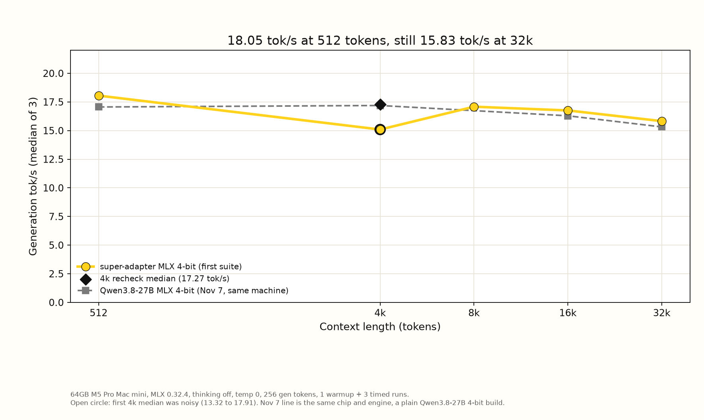
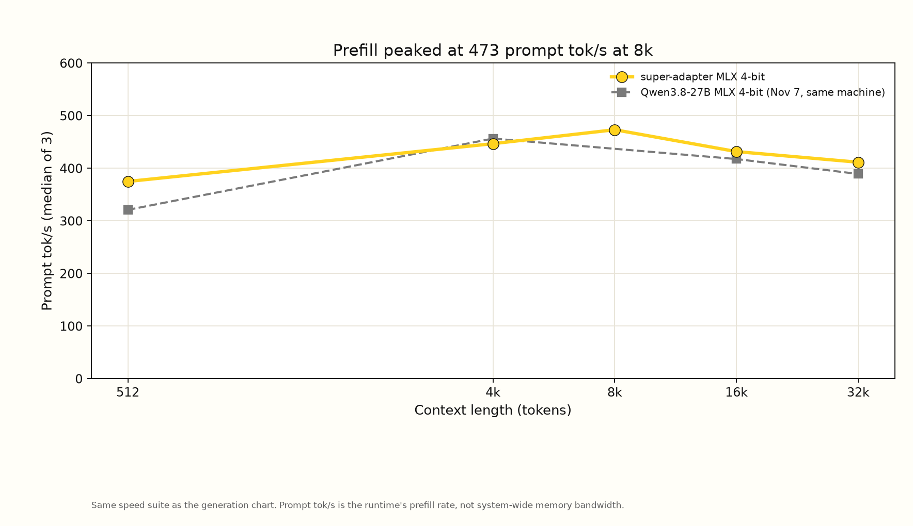
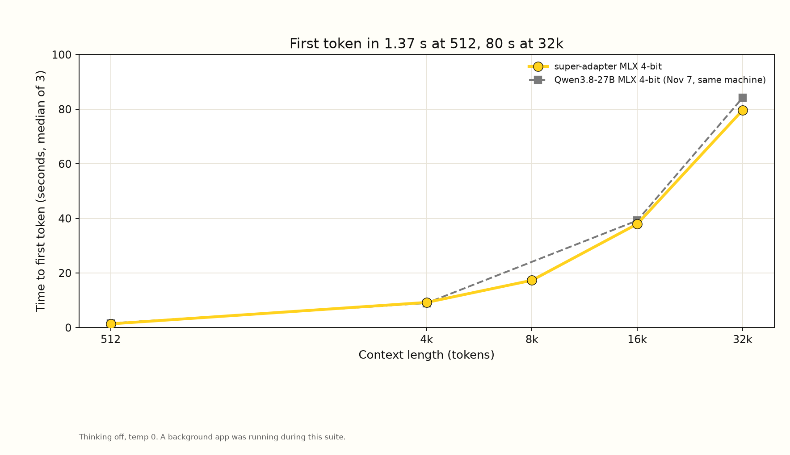
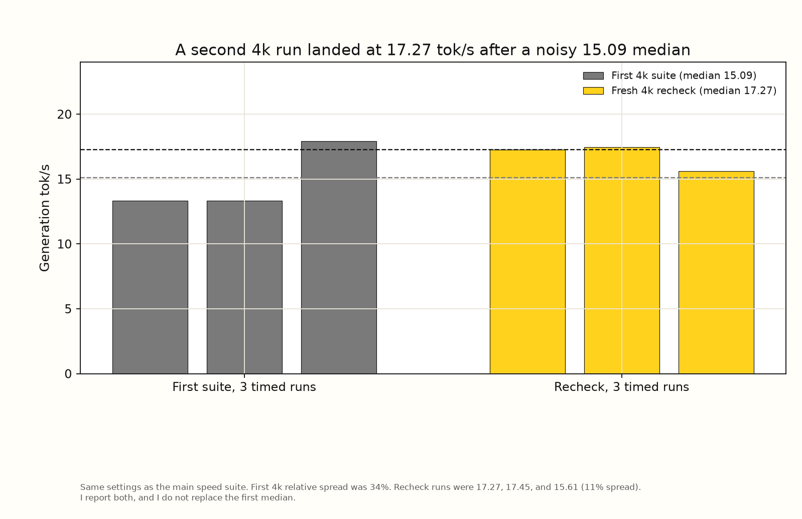
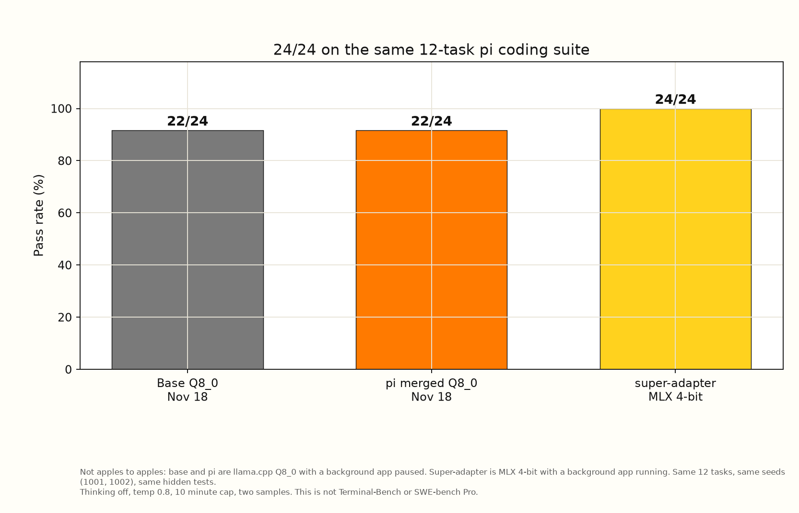
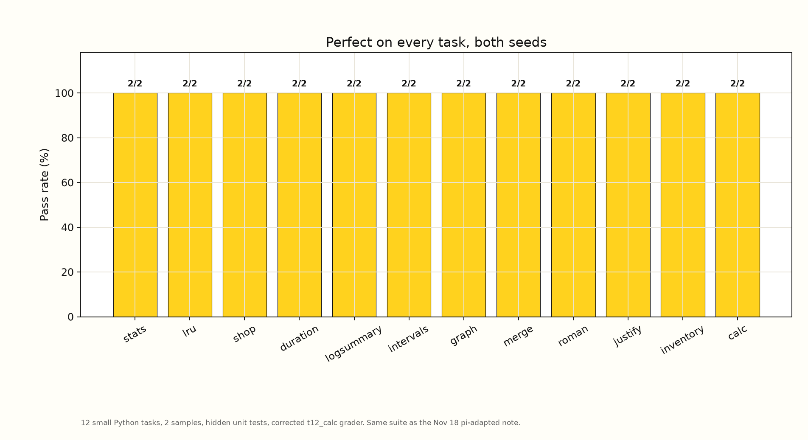
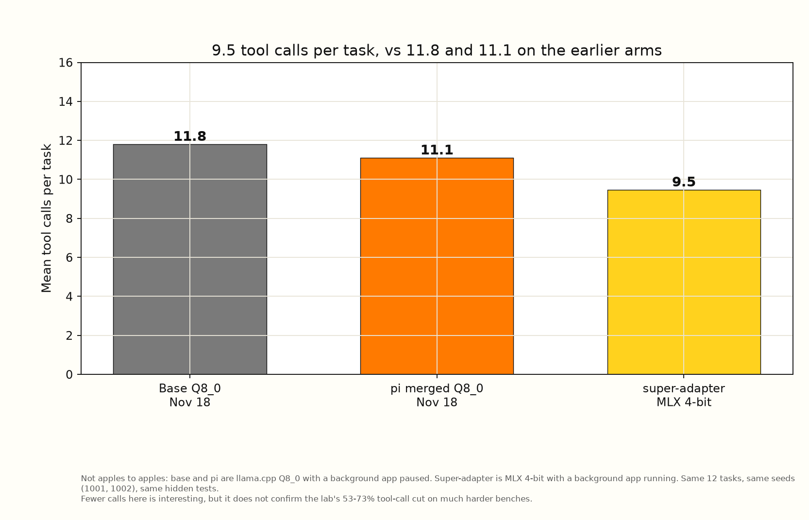
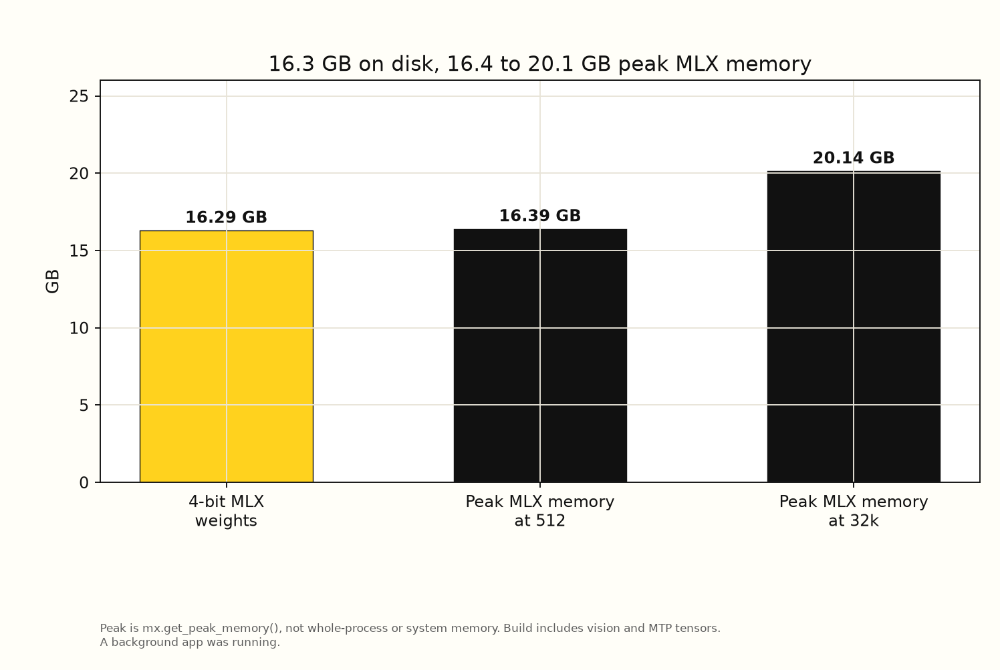

# Qwen3.8-27B super-adapter on a 64GB M5 Pro Mac mini

Field notes for a local speed and agent run of the Qwen3.8-27B super-adapter, a merged LoRA of pi, Hermes, and OpenCode, served as a 4-bit MLX build. I ran this on my 64GB M5 Pro Mac mini on November 22 and 23, 2026 (America/Vancouver).

These notes are meant to travel with the numbers and the charts. They are not a model card, and they are not a claim that this adapter is state of the art on hard agent benches.

## Setup

- Machine: 64GB M5 Pro Mac mini, macOS 27.0.1 (26A434), AC power
- Official peak memory bandwidth: 307 GB/s (Apple's Mac mini specs)
- Engine: MLX 0.32.4, mlx-lm 0.32.2, Python 3.12.15
- The super-adapter is from @yb2698 (younes) and the Hugging Face team, described in [Harness adapters at scale](https://huggingface.co/blog/harness-adapters-at-scale), built on Alibaba Qwen's [Qwen3.8-27B](https://huggingface.co/Qwen/Qwen3.8-27B).
- Official adapter card: [harness-hub/Qwen3.8-27B-super-adapter](https://huggingface.co/harness-hub/Qwen3.8-27B-super-adapter)
- Build I actually loaded: [netprojects/Qwen3.8-27B-super-adapter-MLX-4bit](https://huggingface.co/netprojects/Qwen3.8-27B-super-adapter-MLX-4bit), 4-bit affine, group size 64, 16.293 GB on disk, vision and MTP tensors retained
- A background app was running during both the speed suite and the agent suite

I did not merge or quantize this build myself for the timed runs. I used the published MLX 4-bit weights as served.

## Speed

Method: `mlx_lm` `stream_generate`, thinking off, temperature 0, 256 generation tokens, one warmup plus three timed runs, median reported. Contexts were 512, 4k, 8k, 16k, and 32k.

| Context | Prompt tok/s | Gen tok/s | TTFT (s) | Peak MLX memory (GB) | Gen spread (3 runs) |
| --- | ---: | ---: | ---: | ---: | --- |
| 512 | 375.0 | 18.05 | 1.37 | 16.40 | 16.91, 18.05, 18.13 |
| 4k (first suite) | 446.9 | 15.09 | 9.22 | 18.26 | 13.32, 13.33, 17.91 |
| 8k | 473.4 | 17.09 | 17.32 | 18.53 | 15.48, 17.57, 16.64 |
| 16k | 431.8 | 16.76 | 37.96 | 19.07 | 15.96, 16.76, 16.82 |
| 32k | 411.6 | 15.83 | 79.64 | 20.14 | 15.83, 15.85, 15.64 |

The 4k row in that first suite is noisy. Relative spread on generation speed was about 34%. I ran a fresh 4k load later the same day, same settings, three new timed runs: 17.27, 17.45, and 15.61 tok/s, median 17.27, prompt 438.8 tok/s, TTFT 9.34 s, peak 18.26 GB. I report both and I do not replace the first 4k median. The 8k generation spread was also a bit wide, about 13%.

At 512 tokens, estimated effective bandwidth was 260 GB/s, about 85% of the official 307 GB/s peak. That estimate comes from model geometry plus a KV/runtime residual, not a hardware counter. Vision and MTP weights are in the loaded build.

Peak memory is `mx.get_peak_memory()`. That is not whole-process memory and it is not system-wide memory.

### Same-machine reference, not a third arm of this study

On November 7 I ran a plain Qwen3.8-27B MLX 4-bit build on this same machine and engine class (suite v1, no 8k point): 17.06 tok/s at 512, 17.19 at 4k, 16.29 at 16k, 15.32 at 32k. The super-adapter build is in the same speed band. I am not treating that older run as a controlled A/B of the adapter itself.

## Agent

I reused the same 12-task Python coding suite from my November 18 pi-adapted note, including the corrected `t12_calc` grader. Two samples, seeds 1001 and 1002, thinking off, temperature 0.8, 10 minute cap, hidden unit tests. The model was served with `mlx_lm.server` behind a local proxy that injected the seed and rewrote the request model id to `default_model`.

Headline: **24/24 passed**. Mean 9.46 tool calls per task (median 9), mean 0.83 tool errors, mean 8.5 turns, mean 2,618 generated tokens, mean 170 s wall time, 0 timeouts. Every task passed on both seeds.

| Task | Passes |
| --- | ---: |
| t01_stats | 2/2 |
| t02_lru | 2/2 |
| t03_shop | 2/2 |
| t04_duration | 2/2 |
| t05_logsummary | 2/2 |
| t06_intervals | 2/2 |
| t07_graph | 2/2 |
| t08_merge | 2/2 |
| t09_roman | 2/2 |
| t10_justify | 2/2 |
| t11_inventory | 2/2 |
| t12_calc | 2/2 |

This is a small, hidden-test Python suite. It is not Terminal-Bench, and it is not SWE-bench Pro.

### Comparison I will not over-claim

On November 18, the same 12 tasks and the same seeds, a llama.cpp Q8_0 base Qwen3.8-27B and a pi-merged Q8_0 build both went 22/24, with mean tool calls of 11.8 and 11.1, and 5 and 3 timeouts. Those earlier arms had a background app paused at the owner's request. This super-adapter arm is a different engine and a different quant, and a background app was running. So: same tasks, same seeds, not apples to apples.

The drop from 11.8 / 11.1 tool calls to 9.5 is interesting. It does not confirm the lab's reported 53% to 73% tool-call cut on much harder benches.

## Size and memory

16.293 GB on disk. Peak MLX memory ran from 16.40 GB at 512 tokens to 20.14 GB at 32k. A 64GB machine had plenty of room with a background app still running.

## What I would not claim

- I would not say this run proves the super-adapter is better at coding than the November 18 Q8_0 arms. The stack changed.
- I would not quote 15.09 tok/s as the 4k speed without also quoting the 17.27 recheck and the noisy first spread.
- I would not treat 24/24 on this suite as a Terminal-Bench or SWE-bench Pro result.
- I would not treat 9.5 tool calls as confirmation of the lab's 53% to 73% reduction.
- I have not published the 4-bit weights from this machine. The build I timed is the one already on the Hub under netprojects.

## Commands, at a high level

Weights: `hf download netprojects/Qwen3.8-27B-super-adapter-MLX-4bit`

Speed: load with `mlx_lm`, thinking off, temperature 0, 256 generation tokens, contexts 512 / 4k / 8k / 16k / 32k, one warmup plus three timed runs, take the median. A later script repeated only the 4k point after a fresh load.

Agent: start `mlx_lm.server` on the same 4-bit build, proxy requests so the body uses `model: "default_model"` and a fixed seed, then run the 12-task suite, two samples, seeds 1001 and 1002, temperature 0.8, 10 minute cap.

Exact scripts and logs stayed on the bench machine under `~/launch-benchmarks/qwen38-super-adapter-2026-11-21/`.

## Links

- Official adapter: https://huggingface.co/harness-hub/Qwen3.8-27B-super-adapter
- MLX 4-bit build used here: https://huggingface.co/netprojects/Qwen3.8-27B-super-adapter-MLX-4bit
- Dataset: https://huggingface.co/datasets/pratikgx/qwen3.8-27b-super-adapter-m5-pro-mac-mini-bench
- These notes on GitHub: https://github.com/pratikgx/local-ai-field-notes/blob/main/notes/2026-11-22-qwen3.8-27b-super-adapter.md
