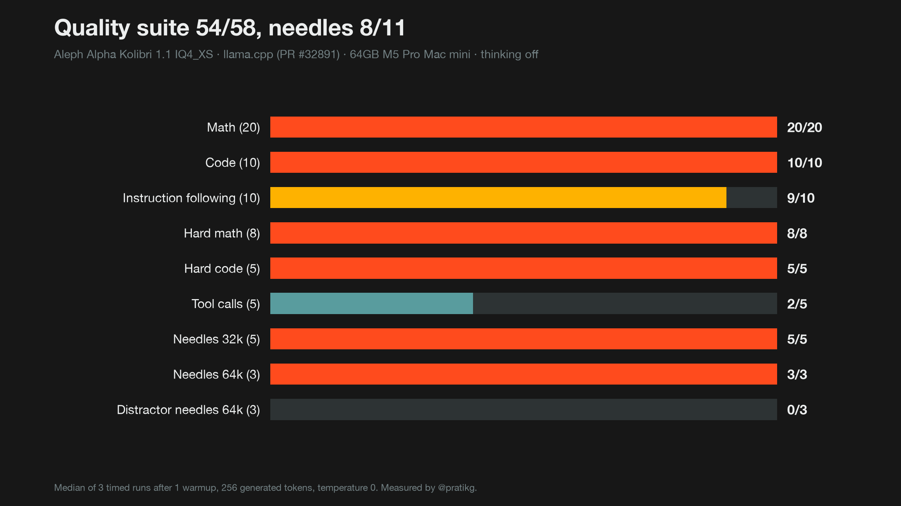

# Aleph Alpha Kolibri 1.1 on a 64GB M5 Pro Mac mini (day one, llama.cpp)

Date: 2026-11-23 (PT). Model: [Aleph-Alpha/Kolibri-1.1](https://huggingface.co/Aleph-Alpha/Kolibri-1.1), 75.1B total MoE, 3.44B active (384 routed experts, 6 per token, 1 shared), 50 layers (2 dense + 48 MoE), sliding-window (513) plus 10 sparse/indexed full-attention layers, 4 KV heads, 262K native context, Apache 2.0.

## Setup
- Weights: official `Kolibri-1.1-IQ4_XS.gguf` from [Aleph-Alpha/Kolibri-1.1-GGUF](https://huggingface.co/Aleph-Alpha/Kolibri-1.1-GGUF), 40.18 GB, 4.28 bits per weight overall (routed experts IQ4_XS, output head Q6_K), sha256 `53874fd9...dcae0e3`.
- Runtime: llama.cpp built from [ggml-org/llama.cpp#32891](https://github.com/ggml-org/llama.cpp/pull/32891) (head `5f4d2228`), Metal. Released llama.cpp can't load Kolibri 1.1 until that PR merges.
- Server: `llama-server -m Kolibri-1.1-IQ4_XS.gguf -c 81920 -np 1 -ngl 999 --jinja --reasoning off --temp 0 --seed 1234 --cache-ram 0 -b 2048 -ub 512`
- Thinking off (`enable_thinking=false`), temperature 0, seed 1234, 256 generated tokens per speed run, 1 warmup + 3 timed runs, median. No SSD streaming, default GPU memory limit.
- A background app was paused at Pratik's request for this run and restarted afterwards.

## Speed
| Prompt | Gen tok/s (median) | Runs | Prompt tok/s | TTFT | Peak RSS |
|---|---|---|---|---|---|
| 512 | 76.5 | 76.5 / 76.5 / 76.4 | 1,382 | 0.37 s | 41.2 GB |
| 4k (3,997) | 74.0 | 74.1 / 74.0 / 74.0 | 994 | 4.0 s | 41.3 GB |
| 16k | 67.4 | 66.7 / 68.3 / 67.4 | 917 | 17.9 s | 41.3 GB |
| 32k | 64.0 | 64.4 / 64.0 / 62.8 | 862 | 38.0 s | 41.4 GB |
| 64k | 57.1 | 57.1 / 56.8 / 57.4 | 773 | 84.8 s | 41.4 GB |

Peak memory is the sampled llama-server process RSS, not a GPU counter. Long context barely moves memory (41.2 to 41.4 GB from 512 to 64k) because only a few layers keep a full KV cache.

Effective bandwidth estimate (from GGUF geometry, not a hardware counter): about 2.10 GB of weights touched per token (always-on tensors + shared expert + output head + 6/384 of routed experts), giving about 164 GB/s at 512 tokens, roughly 53% of the M5 Pro's 307 GB/s. Sparse attention makes the KV share uncertain at long context.

## Quality (same fixed prompts as earlier runs, thinking off)
- Math 20/20, code 10/10, instruction following 9/10, hard math 8/8, hard code 5/5, tool calls 2/5. Total 54/58.
- Needles: 5/5 at 32k, 3/3 at 64k, 0/3 distractor needles at 64k (answered with the revoked passphrase every time). Total 8/11.
- Tool calls: the two calendar/tip tasks produced clean tool calls; the three "right now" tasks (weather, currency, time) got a polite decline instead of a call, with thinking off.
- The one instruction miss was a 40 to 60 word limit.

## Caveats
- Local fixed suite, not Aleph Alpha's benchmarks; their published evals use reasoning on and different sampling, so there is no direct overlap.
- PR build, not a released llama.cpp; numbers may change after merge.
- Prompts use Kolibri's own chat template, so token counts differ slightly from other models on the same text (needle prompts were 31.6k and 63.2k tokens).

## Data

- Hugging Face benchmark data: [pratikgx/kolibri-1.1-m5-pro-mac-mini-bench](https://huggingface.co/datasets/pratikgx/kolibri-1.1-m5-pro-mac-mini-bench)
- Results: [results/2026-11-23-aleph-alpha-kolibri-1.1.csv](../results/2026-11-23-aleph-alpha-kolibri-1.1.csv), [results/2026-11-23-aleph-alpha-kolibri-1.1.json](../results/2026-11-23-aleph-alpha-kolibri-1.1.json)
