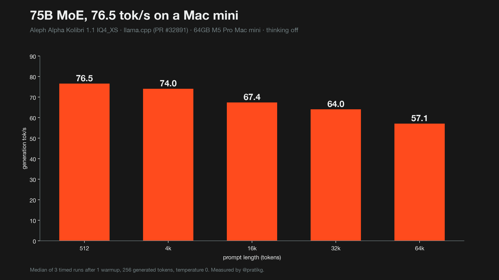
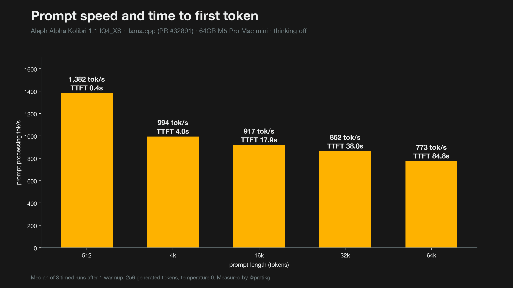
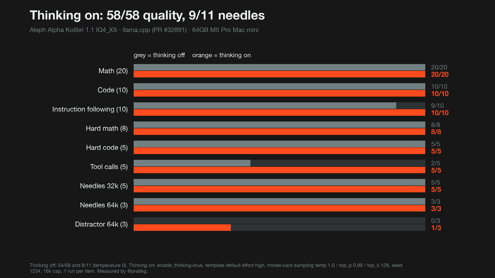
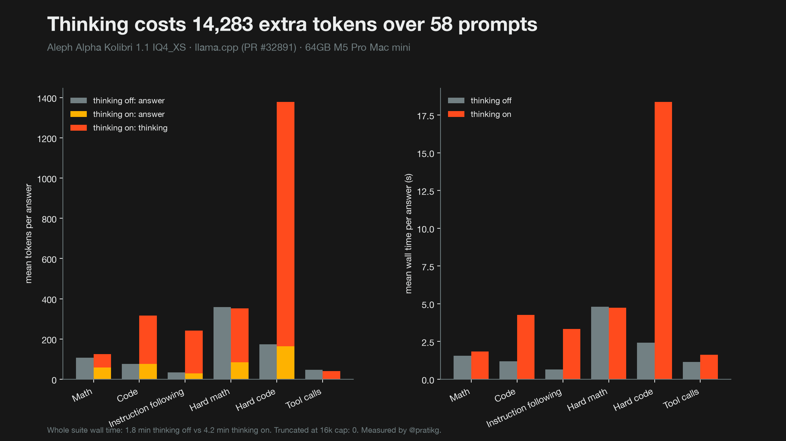
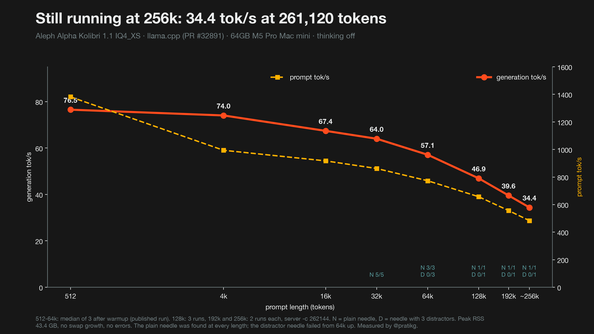
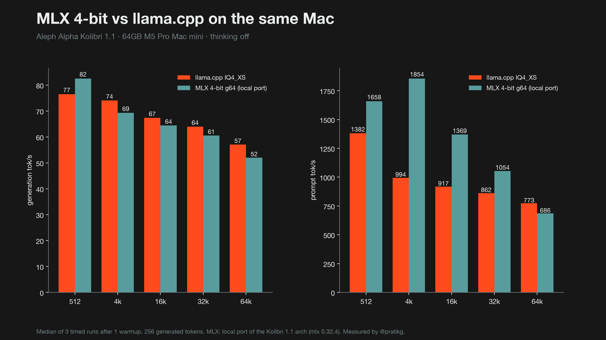

# Aleph Alpha Kolibri 1.1 on a 64GB M5 Pro Mac mini (day one, llama.cpp)

Date: 2026-11-23 (PT). Model: [Aleph-Alpha/Kolibri-1.1](https://huggingface.co/Aleph-Alpha/Kolibri-1.1), 75.1B total MoE, 3.44B active (384 routed experts, 6 per token, 1 shared), 50 layers (2 dense + 48 MoE), sliding-window (513) plus 10 sparse/indexed full-attention layers, 4 KV heads, 262K native context, Apache 2.0.

## Setup
- Weights: official `Kolibri-1.1-IQ4_XS.gguf` from [Aleph-Alpha/Kolibri-1.1-GGUF](https://huggingface.co/Aleph-Alpha/Kolibri-1.1-GGUF), 40.18 GB, 4.28 bits per weight overall (routed experts IQ4_XS, output head Q6_K), sha256 `53874fd9...dcae0e3`.
- Runtime: llama.cpp built from [ggml-org/llama.cpp#32891](https://github.com/ggml-org/llama.cpp/pull/32891) (head `5f4d2228`), Metal. Released llama.cpp can't load Kolibri 1.1 until that PR merges.
- Server: `llama-server -m Kolibri-1.1-IQ4_XS.gguf -c 81920 -np 1 -ngl 999 --jinja --reasoning off --temp 0 --seed 1234 --cache-ram 0 -b 2048 -ub 512`
- Thinking off (`enable_thinking=false`), temperature 0, seed 1234, 256 generated tokens per speed run, 1 warmup + 3 timed runs, median. No SSD streaming, default GPU memory limit.
- A background app was paused at Pratik's request for this run and restarted afterwards.

## Speed
| Prompt | Gen tok/s (median) | Runs | Prompt tok/s | TTFT | Peak RSS |
|---|---|---|---|---|---|
| 512 | 76.5 | 76.5 / 76.5 / 76.4 | 1,382 | 0.37 s | 41.2 GB |
| 4k (3,997) | 74.0 | 74.1 / 74.0 / 74.0 | 994 | 4.0 s | 41.3 GB |
| 16k | 67.4 | 66.7 / 68.3 / 67.4 | 917 | 17.9 s | 41.3 GB |
| 32k | 64.0 | 64.4 / 64.0 / 62.8 | 862 | 38.0 s | 41.4 GB |
| 64k | 57.1 | 57.1 / 56.8 / 57.4 | 773 | 84.8 s | 41.4 GB |

Peak memory is the sampled llama-server process RSS, not a GPU counter. Long context barely moves memory (41.2 to 41.4 GB from 512 to 64k) because only a few layers keep a full KV cache.

Effective bandwidth estimate (from GGUF geometry, not a hardware counter): about 2.10 GB of weights touched per token (always-on tensors + shared expert + output head + 6/384 of routed experts), giving about 164 GB/s at 512 tokens, roughly 53% of the M5 Pro's 307 GB/s. Sparse attention makes the KV share uncertain at long context.

## Quality (same fixed prompts as earlier runs, thinking off)
- Math 20/20, code 10/10, instruction following 9/10, hard math 8/8, hard code 5/5, tool calls 2/5. Total 54/58.
- Needles: 5/5 at 32k, 3/3 at 64k, 0/3 distractor needles at 64k (answered with the revoked passphrase every time). Total 8/11.
- Tool calls: the two calendar/tip tasks produced clean tool calls; the three "right now" tasks (weather, currency, time) got a polite decline instead of a call, with thinking off.
- The one instruction miss was a 40 to 60 word limit.

## Caveats
- Local fixed suite, not Aleph Alpha's benchmarks; their published evals use reasoning on and different sampling, so there is no direct overlap.
- PR build, not a released llama.cpp; numbers may change after merge.
- Prompts use Kolibri's own chat template, so token counts differ slightly from other models on the same text (needle prompts were 31.6k and 63.2k tokens).

## Data

- Hugging Face benchmark data: [pratikgx/kolibri-1.1-m5-pro-mac-mini-bench](https://huggingface.co/datasets/pratikgx/kolibri-1.1-m5-pro-mac-mini-bench)
- Day-one results: [results/2026-11-23-aleph-alpha-kolibri-1.1.csv](../results/2026-11-23-aleph-alpha-kolibri-1.1.csv), [results/2026-11-23-aleph-alpha-kolibri-1.1.json](../results/2026-11-23-aleph-alpha-kolibri-1.1.json)
- Overnight follow-up (2026-11-24): [results/2026-11-24-aleph-alpha-kolibri-1.1.csv](../results/2026-11-24-aleph-alpha-kolibri-1.1.csv), [results/2026-11-24-aleph-alpha-kolibri-1.1.json](../results/2026-11-24-aleph-alpha-kolibri-1.1.json)

## Overnight follow-up (2026-11-24): thinking on, the 256k breaking point, and MLX 4-bit

Overnight follow-up to the first Kolibri 1.1 run, measured Nov 24 2026, 00:44 to 03:07 PT. A background app was paused at Pratik's request for the session.
Hardware: Apple M5 Pro, 64 GB, macOS (same Mac mini as the published run). Runtime: llama.cpp built from Aleph Alpha's PR ggml-org/llama.cpp#32891 @ 5f4d2228, Aleph Alpha's official IQ4_XS GGUF (40.18 GB, 4.28 bpw). MLX: mlx 0.32.4 / mlx-lm 0.32.2 with a local port of the Kolibri 1.1 architecture, converted from the official FP8 checkpoint to affine 4-bit group 64 (42.32 GB).

## 1. Thinking on (llama.cpp IQ4_XS)

Settings: enable_thinking=true (the chat template's default effort is high), Aleph Alpha's recommended sampling from the model card (temperature 1.0, top_p 0.99, top_k 128), seed 1234, 16,384-token cap per answer including thinking, 1 sampled run per item. Same 58 prompts and 11 needles as the published run.

| | Thinking off (published) | Thinking on |
|---|---|---|
| Math | 20/20 | 20/20 |
| Code | 10/10 | 10/10 |
| Instruction following | 9/10 | 10/10 |
| Hard math | 8/8 | 8/8 |
| Hard code | 5/5 | 5/5 |
| Tool calls | 2/5 | 5/5 |
| Quality total | 54/58 | 58/58 |
| Needles 32k | 5/5 | 5/5 |
| Needles 64k | 3/3 | 3/3 |
| Distractor needles 64k | 0/3 | 1/3 |

- Tool calls: with thinking on, all 5 tasks produced a correct structured call (get_weather Vancouver celsius, convert_currency 250 USD to EUR, get_time Asia/Tokyo, create_event Dentist 2026-11-12 15:00, calculate_tip 84.5 at 18%), using 18 to 63 thinking tokens and 1.1 to 2.1 s each. With thinking off, the three "right now" tasks were declined.
- Cost: 14,283 thinking tokens plus 3,708 answer tokens over the 58 prompts (thinking off: 7,211 tokens total). Whole suite wall time 4.2 min vs 1.8 min. Hard code is the expensive category (mean 1,213 thinking tokens, 18.4 s per answer; max 4,499 thinking tokens on one item). No quality answer hit the 16k cap.
- Distractor needles at 64k: depth 0.2 passed (229 thinking tokens). Depths 0.5 and 0.8 hit the 16,384-token cap with no answer: the thinking drifted into copying the filler text and repeated "..." lines. Logged as fails.
- Decode speed with thinking on (1,024 generated tokens, median of 3 after warmup): 76.0 tok/s at 512, 65.0 tok/s at 32k (31,688-token prompt). A full 256-token sweep with the thinking-on template and sampling: 76.8 / 74.8 / 68.4 / 65.0 / 57.9 tok/s at 512 / 4k / 16k / 32k / 64k. Thinking does not slow decoding; the cost is the extra tokens.

## 2. Breaking point (thinking off, same settings as the published run, server -c 262144)

| Prompt tokens | Runs | Gen tok/s | Prompt tok/s | TTFT | Peak RSS | Plain needle | Distractor needle |
|---|---|---|---|---|---|---|---|
| 512 | 3 | 76.52 | 1,381.9 | 0.37 s | 41.16 GB | | |
| 32,768 | 3 | 64.00 | 861.9 | 38.0 s | 41.35 GB | 5/5 | |
| 65,536 | 3 | 57.09 | 772.9 | 84.8 s | 41.40 GB | 3/3 | 0/3 |
| 131,072 | 3 | 46.93 | 657.0 | 199.6 s | 43.03 GB | 1/1 | 0/1 |
| 196,608 | 2 | 39.55 | 556.6 | 353.4 s | 43.22 GB | 1/1 | 0/1 |
| 261,120 | 2 | 34.38 | 483.3 | 540.5 s | 43.41 GB | 1/1 | 0/1 |
(512 to 64k rows are the published run, median of 3 after 1 warmup. 128k to 256k: medians of the listed runs, no separate warmup; the server was already warm.)

- Nothing broke: no OOM, no swap growth (swap stayed about 2.4 to 2.5 GB, the watchdog limit was +6 GB), no errors, coherent output at every length. Peak RSS grew only 2.3 GB from 512 to 261,120 tokens.
- Speed degrades smoothly: generation falls to 45% of the 512-token speed at ~256k, and prompt processing to 35%.
- Recall: the plain needle (depth 0.5) was found at 128k, 192k and ~256k. The distractor needle fails at every length from 64k up: at 64k, 128k and ~256k the model returned the revoked passphrase amber-falcon-2290; at 192k it said it could not determine a current passphrase. This is the clearest weak spot found.

## 3. MLX 4-bit (local port) vs llama.cpp IQ4_XS, thinking off

| Prompt | llama.cpp gen | MLX gen | llama.cpp prompt | MLX prompt | llama.cpp TTFT | MLX TTFT | MLX peak (mx) |
|---|---|---|---|---|---|---|---|
| 512 | 76.5 | 82.5 | 1,382 | 1,658 | 0.37 s | 0.31 s | 42.7 GB |
| 4k | 74.0 | 69.3 | 994 | 1,854 | 4.0 s | 2.2 s | 43.4 GB |
| 16k | 67.4 | 64.4 | 917 | 1,369 | 17.9 s | 12.0 s | 44.5 GB |
| 32k | 64.0 | 60.5 | 862 | 1,054 | 38.0 s | 31.1 s | 44.6 GB |
| 64k | 57.1 | 52.0 | 773 | 686 | 84.8 s | 95.6 s | 46.1 GB |
(Median of 3 after 1 warmup, 256 tokens, temperature 0. MLX peak = mx.get_peak_memory.)
- MLX quality: 55/58 (20/20, 10/10, 10/10, 8/8, 5/5, tool calls 2/5 with the same three declines). Needles 8/11 (5/5 at 32k, 3/3 at 64k, distractors 0/3, again amber-falcon-2290).
- The MLX port was validated layer-truncated against the llama.cpp PR build on identical weights (next-token logprob correlation 0.993 to 0.998 across dense, sparse and pooled-sparse regimes).

All numbers are measured; nothing is extrapolated.
