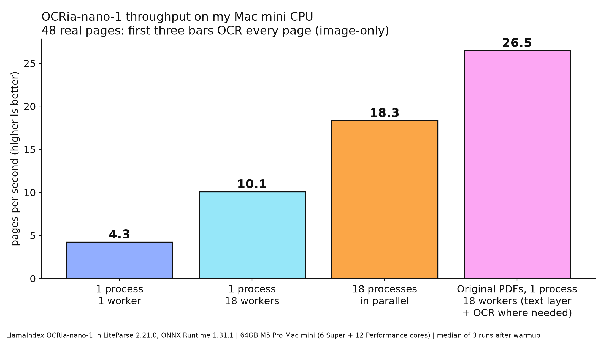
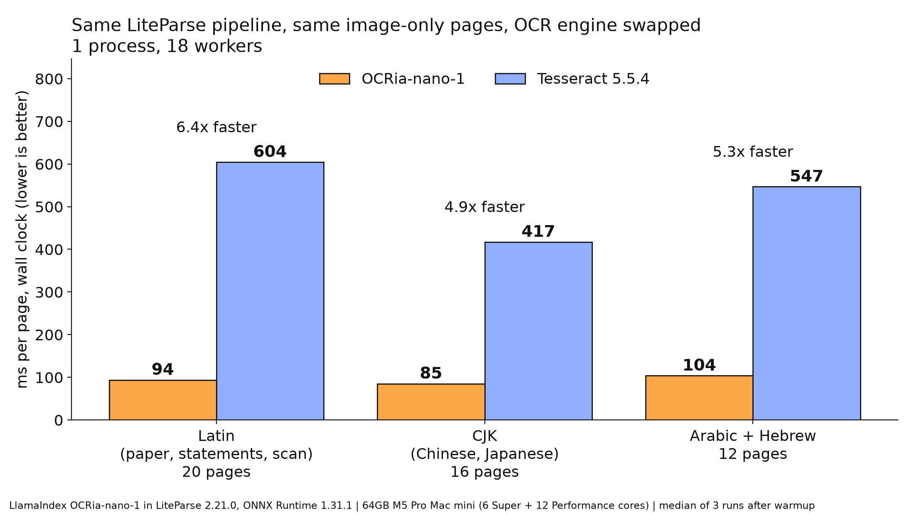
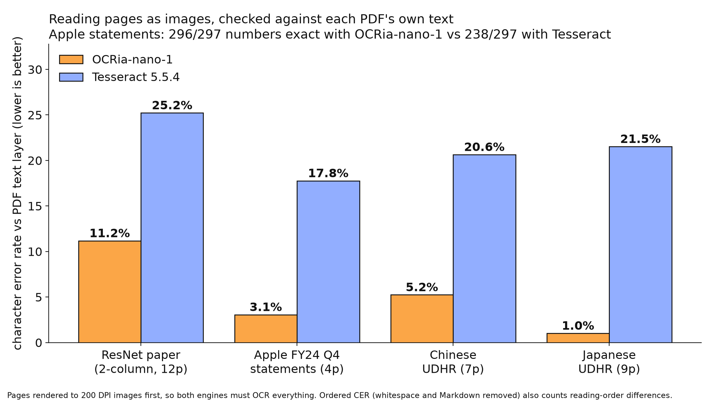

# OCRia-nano-1 (LlamaIndex) on a 64GB M5 Pro Mac mini, CPU only

Date: 2026-11-23. Everything here is measured locally unless marked "lab claim". Official model: [llamaindex/OCRia-nano-1](https://huggingface.co/llamaindex/OCRia-nano-1).

## Setup
- Mac mini, Apple M5 Pro (hw.perflevel0 "Super" 6 cores + hw.perflevel1 "Performance" 12 cores = 18), 64 GB, macOS 27.0.1.
- LiteParse 2.21.0 (`pip install liteparse`, Python 3.12 venv), models via `lit models pull ocria-nano` (ocria-nano@1.0.0, 75.3 MB incl. ONNX Runtime 1.31.1).
- Tesseract 5.5.4 + leptonica 1.87.0 (Homebrew, `tesseract-lang`), run through the same LiteParse pipeline with `--ocr-backend tesseract`.
- Output: Markdown (`--format markdown`), default 250 DPI OCR render.
- Timing: `/usr/bin/time -l lit batch-parse <dir> <out> --format markdown -q --num-workers N`, 1 warmup + 3 timed runs, median. Wall time includes process start and model load.
- A background app was running during all runs and was still reloading its memory (8.8 to 18.2 GB RSS, 0.05 to 1.4 CPU cores on average per run). No other benchmark or model process was running (runs were gated on that and on swap not growing).
- An earlier pass (10:25-10:37 AM PT) overlapped another benchmark job and caused swap; it is kept only for reference in `results_overlap_kolibri/` and is not used here.

## Test set (48 pages, public PDFs)
| File | Pages | Type | Source |
|---|---|---|---|
| resnet_arxiv_1512.03385v1.pdf | 12 | 2-column paper with tables | https://arxiv.org/pdf/1512.03385v1 |
| apple_fy24q4_statements.pdf | 4 | table-heavy financial statements | https://www.apple.com/newsroom/pdfs/fy2024-q4/FY24_Q4_Consolidated_Financial_Statements.pdf |
| udhr_chinese.pdf | 7 | Chinese | https://www.ohchr.org/sites/default/files/UDHR/Documents/UDHR_Translations/chn.pdf |
| udhr_japanese.pdf | 9 | Japanese | https://www.ohchr.org/sites/default/files/UDHR/Documents/UDHR_Translations/jpn.pdf |
| udhr_hebrew.pdf | 4 | Hebrew (text layer uses a broken font encoding) | https://www.ohchr.org/sites/default/files/UDHR/Documents/UDHR_Translations/hbr.pdf |
| un_sdg_report_2026_arabic_p1-8.pdf | 8 | Arabic (pages 1-8 of the UN SDG report) | https://unstats.un.org/sdgs/files/report/2026/secretary-general-sdg-report-2026--AR.pdf |
| jfk_memo_scan_docid-32404166.pdf | 4 | real scan, image-only typewritten memo | https://www.archives.gov/files/research/jfk/releases/docid-32404166.pdf |

sha256 in `sha256_pdfs.txt`. Two variants were benchmarked:
- `sets/native`: the original PDFs (LiteParse uses the text layer and OCRs only where needed).
- `sets/ocr`: every born-digital PDF rendered to 200 DPI images and re-saved as image-only PDFs, plus the real scan, so every page must be OCR'd.

## Speed (median of 3, clean rerun 11:01-11:09 AM PT)
| Config | Pages | Wall | ms/page | pages/s | CPU ms/page | Peak RSS |
|---|---|---|---|---|---|---|
| OCR every page, 1 process, 1 worker | 48 | 11.29 s | 235 | 4.25 | 866 | 0.96 GB |
| OCR every page, 1 process, 6 workers | 48 | 4.26 s | 89 | 11.26 | 677 | 1.80 GB |
| OCR every page, 1 process, 18 workers | 48 | 4.76 s | 99 | 10.09 | 788 | 2.31 GB |
| OCR every page, 4 processes x 1 worker | 48 | 4.30 s | 90 | 11.16 | 1037 | 3.26 GB (sum) |
| OCR every page, 6 processes x 1 worker | 48 | 3.60 s | 75 | 13.32 | 1082 | 4.46 GB (sum) |
| OCR every page, 12 processes x 1 worker | 48 | 2.78 s | 58 | 17.25 | 961 | 8.31 GB (sum) |
| OCR every page, 18 processes x 1 worker | 48 | 2.62 s | 55 | 18.35 | 896 | 11.95 GB (sum) |
| Original PDFs, 1 process, 1 worker | 48 | 3.15 s | 66 | 15.26 | 182 | 0.84 GB |
| Original PDFs, 1 process, 18 workers | 48 | 1.81 s | 38 | 26.48 | 178 | 1.47 GB |

The 1 process / 18 worker image-only runs were 3.85, 4.76 and 5.03 s (25% spread); the other configs were within about 16%. Swap did not grow during any timed run, no other model or heavy process ran, and runs would have been redone automatically if either happened (none needed).

Notes on threading: `--num-workers` parallelises pages inside one document; `batch-parse` walks files one at a time. Even with 1 worker, ONNX Runtime used about 3.7 cores (CPU time / wall), and LiteParse 2.21.0 does not expose ORT intra/inter-op thread settings, so a true single-thread number could not be forced on macOS (no CPU pinning). The closest proxy is CPU time per page: about 0.87 s per OCR'd page and 0.18 s per page on the original PDFs (this includes ORT thread spin, so it overstates pure compute).

## OCRia-nano-1 vs Tesseract (same pages, same LiteParse pipeline, 1 process, 18 workers)
| Script group | Pages | OCRia-nano-1 ms/page | Tesseract ms/page | Speedup |
|---|---|---|---|---|
| Latin (paper, statements, scan) | 20 | 94 | 604 | 6.4x |
| CJK (Chinese, Japanese) | 16 | 85 | 417 | 4.9x |
| Arabic + Hebrew | 12 | 104 | 547 | 5.3x |
| Latin, 1 worker each | 20 | 313 | 1999 | 6.4x |

Tesseract language packs: eng / chi_sim+jpn / ara+heb per group (combined packs slow Tesseract down and mix scripts, which is a handicap for it on the CJK and RTL groups).

## Quality
Accuracy scores recomputed on the rerun outputs were identical to the first pass.

Character error rate against each PDF's own text layer, on the image-only versions (whitespace and Markdown removed; "ordered" CER also penalises reading-order differences). Character-bag F1 ignores order.

| Document | OCRia-nano-1 CER | Tesseract CER | OCRia bag F1 | Tesseract bag F1 | Original PDF through LiteParse, CER |
|---|---|---|---|---|---|
| ResNet paper (12p) | 11.2% | 25.2% | 0.992 | 0.964 | 11.9% |
| Apple statements (4p) | 3.1% | 17.8% | 0.990 | 0.985 | 5.5% |
| Chinese UDHR (7p) | 5.2% | 20.6% | 0.964 | 0.966 | 0.1% |
| Japanese UDHR (9p) | 1.0% | 21.5% | 0.994 | 0.992 | 0.2% |

The ResNet CER is high for every row, including the original PDF, because pdfium's text-layer order differs from Markdown reading order (figures, equations, footnotes). On Chinese and Japanese the character-bag scores are nearly identical, so most of Tesseract's gap there is spacing, ordering and line structure rather than wrong characters.

Numbers check on Apple's statements from images: 296 of 297 numbers exact with OCRia-nano-1 (only miss: "(94,949)"), 238 of 297 with Tesseract. From the original PDF: 297 of 297.

Spot checks (excerpts in `out/`):
- Tables: Apple's statement of operations came out as an HTML table with the "Three Months Ended / Twelve Months Ended" spanning headers (colspan=2) and every row on its own line. Tesseract's version merged "Products" and "Services" into one row and read 43,879 as "43.879". Small OCRia slips: a dropped "$" on one cell and a stray "()" after "Total net sales".
- ResNet: Table 4 (single-model results) came out row-for-row correct except "8.43†" read as "8.437". One table was merged with the neighbouring Figure 5 labels. Two-column reading order was correct; a stray "S" from a figure appears after the abstract.
- CJK: Chinese header "一九四八年十二月十日第217A(III)号" came out as "－九四八年十二月十日第217())号". Japanese dropped "譲" in "平等で譲ることのできない" and read "軽侮" as "軽俺". Tesseract inserted spaces between most characters and misread "平等" as "下等".
- RTL: the Hebrew PDF's own text layer is garbage (broken font encoding); LiteParse noticed and OCR'd it, producing clean right-to-left Hebrew. The page title line was missing from OCRia's output (Tesseract kept it). On the Arabic report, the original-PDF output is cleaner than the PDF's own text layer (for example "الأمــم المتحـدة" where the text layer has "األمــم"). From images, Arabic headings lost a leading letter or two ("جمعية العامة").
- Real scan (JFK memo): body paragraphs were clean, but "MEMORANDUM FOR: / FROM: / SUBJECT:" labels were split from their values and the paragraph numbers "1." "2." were dropped. Tesseract kept those label/value pairs together.

## Lab claims (from the model card, not measured here)
ParseBench-2 59.2 vs Indra 55.1 and Marker 52.5; 27.8 pages/s on 16 vCPUs; 426 ms/page on one core; about 2x LiteParse with Tesseract. Those are on their 16-vCPU Linux container and ParseBench pages, so they are not comparable to these Mac numbers.

## Caveats
- A background app was running during all runs (average 0.05 to 1.4 cores per run, still reloading memory).
- No true single-thread result (see threading note).
- Small test set (48 pages); the CER reference is the PDF text layer, which has its own ordering quirks.
- Marker was not run.
- License: custom OCRia-nano-1 Model License (OpenRAIL-M based): free for research, personal use and small orgs, commercial license needed above $2M revenue/funding or for competing parsing products. LiteParse itself is Apache 2.0.

## Data

- Hugging Face benchmark data: [pratikgx/ocria-nano-1-m5-pro-mac-mini-bench](https://huggingface.co/datasets/pratikgx/ocria-nano-1-m5-pro-mac-mini-bench)
- Results: [results/2026-11-23-llamaindex-ocria-nano-1.csv](../results/2026-11-23-llamaindex-ocria-nano-1.csv), [results/2026-11-23-llamaindex-ocria-nano-1.json](../results/2026-11-23-llamaindex-ocria-nano-1.json)
