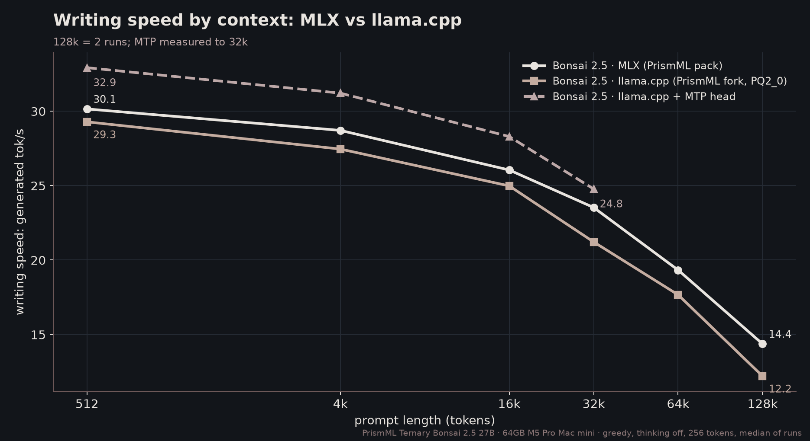
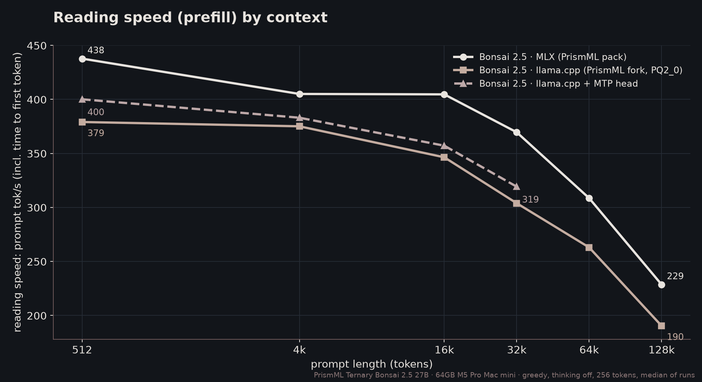
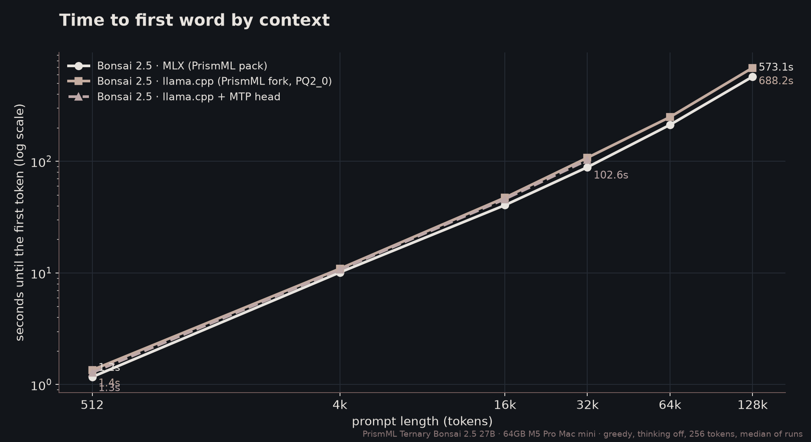
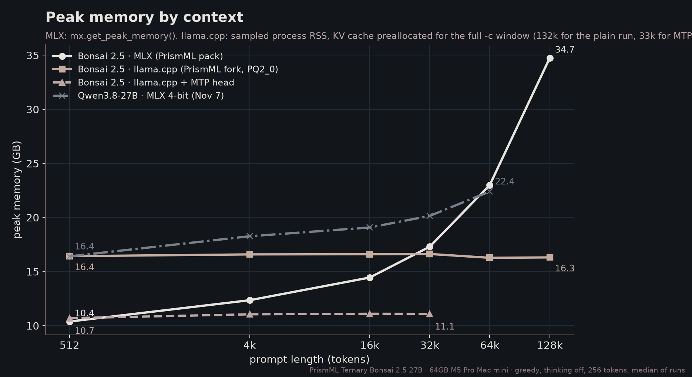
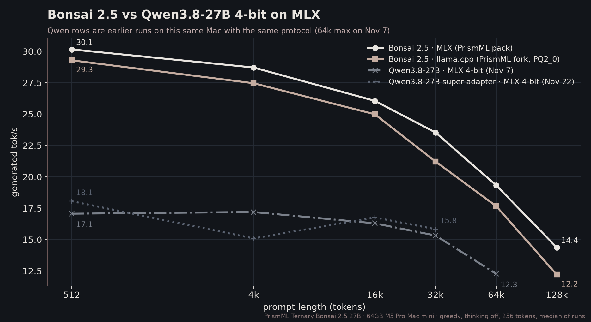
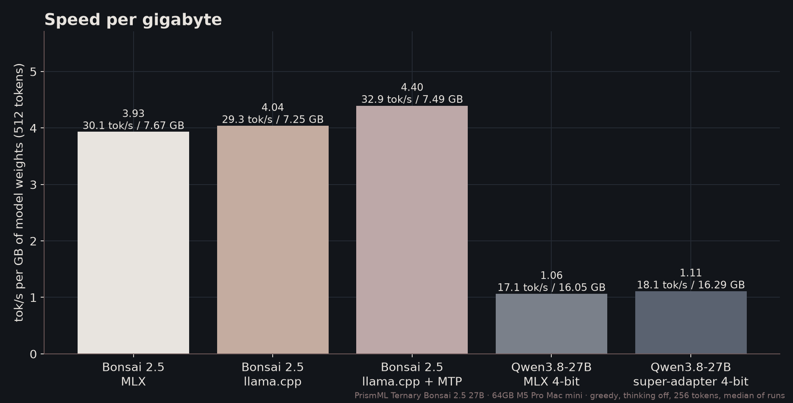
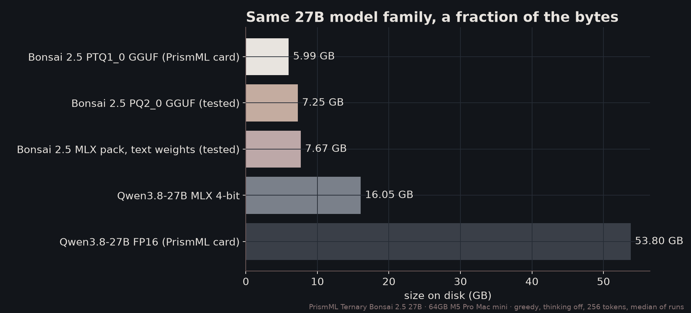
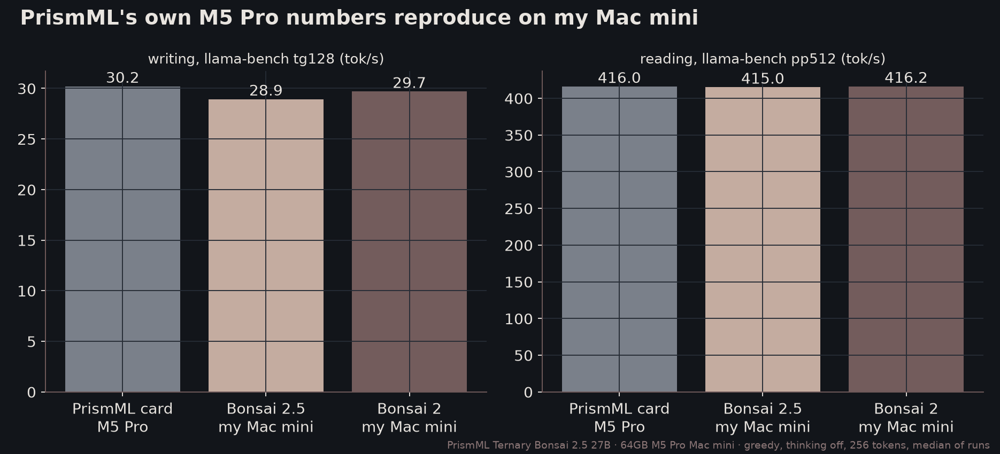
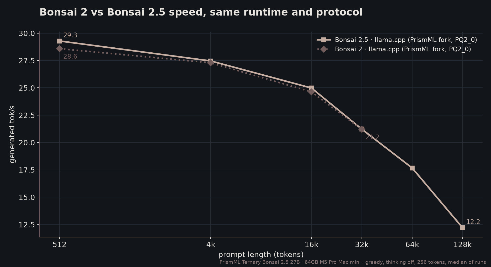

# PrismML Ternary Bonsai 2.5 27B on a 64GB M5 Pro Mac mini

Date: 2026-11-24 (America/Vancouver). Thinking off, greedy (temperature 0), 256 generated tokens, 1 discarded warmup + 3 timed runs at 512 to 32k, 3 timed runs at 64k and 2 at 128k on a warm model, medians. A background app was left running at Pratik's request.

These are speed results only. Agent coding and quality results will be added tomorrow.

Credit to the PrismML team for Ternary Bonsai 2.5 27B, the MLX pack with its bundled Hadamard loader, the llama.cpp fork, and the MTP draft head. Base model: Qwen3.8-27B.

## Headline

- Bonsai 2.5 writes at **30.15 tok/s on MLX** at 512 tokens, **23.53 at 32k** and **14.37 at 128k**.
- That is **1.77x** the Qwen3.8-27B MLX 4-bit build measured on this Mac (17.06 tok/s at 512) and **1.54x** at 32k (23.53 vs 15.32), from a 7.25 GB GGUF or 7.67 GB of MLX text weights instead of 16.05 GB.
- The MTP draft head on the PrismML llama.cpp fork lifts decode from **29.28 to 32.92 tok/s** at 512 and **21.22 to 24.77** at 32k (1.12x to 1.17x, 83% to 88% of drafted tokens accepted).
- PrismML's claims on the model card are 30.2 tok/s decode (tg128) and 416 tok/s prefill (pp512) for PQ2_0 on an M5 Pro. llama-bench here measured **28.94** and **415.0**.
- Bonsai 2.5 keeps Bonsai 2's speed on the same runtime (29.28 vs 28.57 tok/s at 512, 21.22 vs 21.20 at 32k), so the upgrade comes without a speed cost.

## Writing speed (generated tok/s, median)

| Context | Bonsai 2.5 MLX | Bonsai 2.5 llama.cpp | Bonsai 2.5 llama.cpp + MTP | Bonsai 2.5 MLX + MTP | Bonsai 2 llama.cpp | Qwen3.8-27B MLX 4-bit (Nov 7) |
|---|---:|---:|---:|---:|---:|---:|
| 512 | 30.15 | 29.28 | 32.92 | 29.26 | 28.57 | 17.06 |
| 4k | 28.71 | 27.45 | 31.21 | 28.53 | 27.29 | 17.19 |
| 16k | 26.05 | 24.98 | 28.30 | 23.82 | 24.63 | 16.29 |
| 32k | 23.53 | 21.22 | 24.77 | 21.48 | 21.20 | 15.32 |
| 64k | 19.33 | 17.66 | | | | 12.27 |
| 128k (2 runs) | 14.37 | 12.20 | | | | |

## Reading speed (prompt tok/s) and time to first token

| Context | MLX prompt tok/s | MLX TTFT s | llama.cpp prompt tok/s | llama.cpp TTFT s | llama.cpp + MTP TTFT s | Bonsai 2 llama.cpp TTFT s |
|---|---:|---:|---:|---:|---:|---:|
| 512 | 437.8 | 1.17 | 379.1 | 1.35 | 1.28 | 1.34 |
| 4k | 405.1 | 10.11 | 375.1 | 10.92 | 10.69 | 11.05 |
| 16k | 404.7 | 40.49 | 346.4 | 47.29 | 45.87 | 47.66 |
| 32k | 369.6 | 88.65 | 303.9 | 107.81 | 102.64 | 104.94 |
| 64k | 308.6 | 212.34 | 263.0 | 249.16 | | |
| 128k | 228.7 | 573.14 | 190.4 | 688.23 | | |

## Peak memory (GB)

| Context | MLX (mx.get_peak_memory) | llama.cpp (process RSS, -c 132k) | llama.cpp + MTP (RSS, -c 33k) | Qwen3.8-27B MLX 4-bit |
|---|---:|---:|---:|---:|
| 512 | 10.37 | 16.42 | 10.69 | 16.40 |
| 4k | 12.34 | 16.58 | 11.04 | 18.26 |
| 16k | 14.44 | 16.60 | 11.10 | 19.07 |
| 32k | 17.29 | 16.62 | 11.09 | 20.14 |
| 64k | 23.00 | 16.27 | | 22.40 |
| 128k | 34.75 | 16.30 | | |

llama-server allocates the KV cache for the whole `-c` window at load, so its RSS is flat across contexts and depends on `-c`. The MLX pack also loads its 0.92 GB FP16 vision tower.

## Builds and sizes

| Build | Revision | Size |
|---|---|---|
| prism-ml/Ternary-Bonsai-2.5-27B-mlx-2bit (2-bit slots, group 128, FP16 vision tower) | aa432fd0 | 8.60 GB on disk (7.67 GB text weights) |
| prism-ml/Ternary-Bonsai-2.5-27B-GGUF, PQ2_0 | 28a7093c | 7.25 GB |
| prism-ml/Ternary-Bonsai-2.5-27B-GGUF, PQ2_0-mtp | 28a7093c | 7.49 GB |
| prism-ml/Ternary-Bonsai-2-27B-gguf, PQ2_0 | 839bd570 | 7.21 GB |
| Reference: TensorFold/Qwen3.8-27B-MLX-4bit (affine 4-bit g64) | Nov 7 run | 16.05 GB |

PrismML's smallest packing (PTQ1_0, 5.99 GB, 1.76 bits per weight) was not timed here. PrismML recommends PQ2_0 on Apple Metal.

## Speed per gigabyte (512 tokens)

Bonsai 2.5 MLX 3.93 tok/s per GB of text weights, llama.cpp 4.04, llama.cpp + MTP 4.40, Qwen3.8-27B MLX 4-bit 1.06.

## Charts

## Still running (will be added tomorrow)

Fixed quality suite (math 20, code 10, instruction following 10, hard math 8, hard code 5, tool calling 5), needles at 32k/64k plain and with decoys plus 128k on MLX, and the 12-task x 2-seed coding-agent suite for Bonsai 2.5 and Bonsai 2 on the PrismML llama.cpp server.

## Caveats

- One Mac, one session, with a background app left running at Pratik's request. Run-to-run spread was under 10% at every point (largest 7.1%, llama.cpp 32k).
- The 128k rows are the median of 2 runs, and 64k/128k ran without a separate warmup on an already warm model.
- Peak memory scopes differ: MLX rows are `mx.get_peak_memory()`, llama.cpp rows are sampled process RSS.
- Qwen3.8-27B rows come from earlier runs on this Mac with the same protocol (Nov 7 base MLX 4-bit; a Nov 22 super-adapter 4-bit run measured 18.05 tok/s at 512 and 15.83 at 32k, 16.3 GB).
- MTP on MLX (mlx-vlm 0.6.3, `draft_block_size=2`) did not raise throughput in this run. PrismML's pack README says MLX MTP throughput hasn't been measured yet.
- PrismML's published accuracy benchmarks use thinking at `xhigh`. This run is thinking off, so the only direct overlap is llama-bench speed.

Exact commands, raw per-run JSON, and scripts are in the Hugging Face dataset.

## Licenses and credit

Measurements and this card: **CC BY 4.0**, attribution **Pratik Gandhi**. [License text](https://creativecommons.org/licenses/by/4.0/).

Credit to the PrismML team for Ternary Bonsai 2.5 27B, the MLX pack, the llama.cpp fork, and the MTP draft head. No model weights are redistributed in this dataset.

## Data

- Hugging Face benchmark data: [pratikgx/ternary-bonsai-2.5-27b-m5-pro-mac-mini-bench](https://huggingface.co/datasets/pratikgx/ternary-bonsai-2.5-27b-m5-pro-mac-mini-bench)
