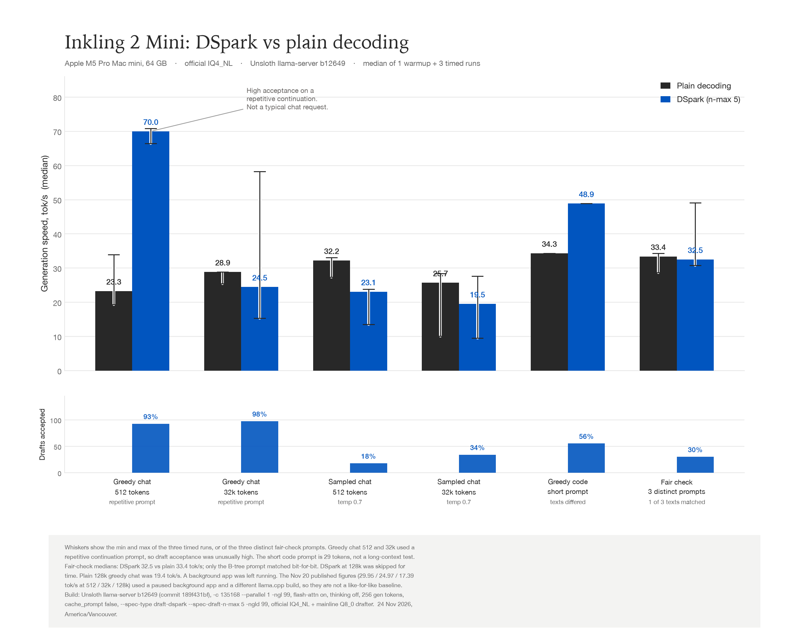
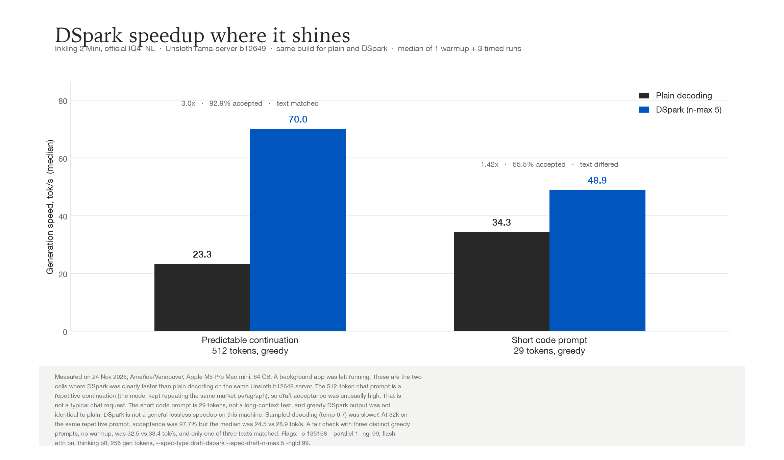
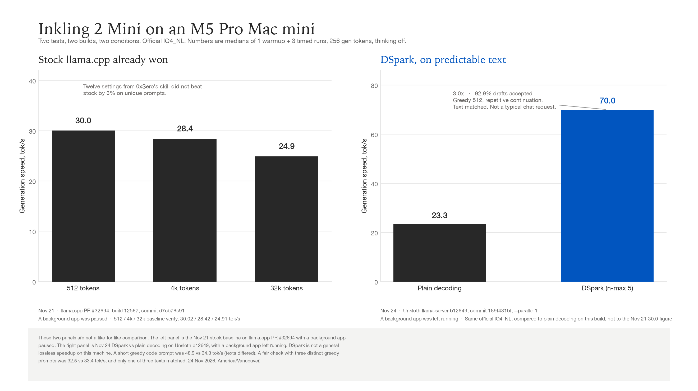
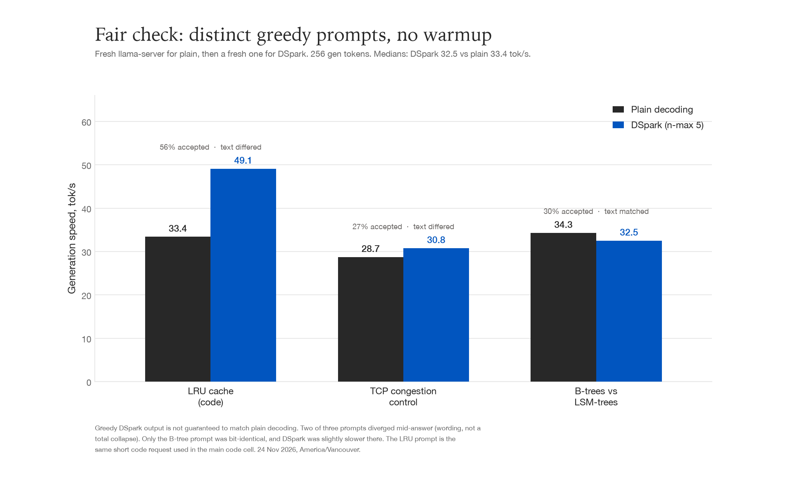

# Thinking Machines Inkling 2 Mini, DSpark (llama.cpp)

Date: 2026-11-24

I ran a labelled first test of Thinking Machines Lab's DSpark drafter on Inkling 2 Mini, official IQ4_NL, on my 64GB M5 Pro Mac mini. DSpark is not a general lossless speedup on this machine under these conditions. It was clearly faster on a repetitive continuation prompt (70.0 vs 23.3 tok/s, 3.0x, text matched) and on a short greedy code prompt (48.9 vs 34.3 tok/s), but the code outputs differed. A fair check with three distinct greedy prompts was 32.5 tok/s for DSpark vs 33.4 for plain, and only one of the three texts matched.

Thank you to the Thinking Machines team for releasing Inkling 2 Mini and DSpark, and to 0xSero for the [inference-optimisation skill](https://github.com/sybil-solutions/inference-optimisation-skill/tree/fda968e) that shaped the November 21 tune and the fair-check habit (fresh server, distinct prompts, no warmup) I also used here.

This follows the November 21 tune and the November 20 speed and quality bench. The public datasets are [pratikgx/inkling-2-mini-dspark-m5-pro-mac-mini-bench](https://huggingface.co/datasets/pratikgx/inkling-2-mini-dspark-m5-pro-mac-mini-bench), [pratikgx/inkling-2-mini-m5-pro-mac-mini-tuning](https://huggingface.co/datasets/pratikgx/inkling-2-mini-m5-pro-mac-mini-tuning), and [pratikgx/inkling-2-mini-m5-pro-mac-mini-bench](https://huggingface.co/datasets/pratikgx/inkling-2-mini-m5-pro-mac-mini-bench). The November 21 note is [2026-11-21-thinking-machines-inkling-2-mini-tuning.md](https://github.com/pratikgx/local-ai-field-notes/blob/main/notes/2026-11-21-thinking-machines-inkling-2-mini-tuning.md).

A background app was left running at Pratik's request.

Plain decoding and DSpark were measured back to back on the same Unsloth llama-server b12649 build (commit `189f431bf`). That is not the November 21 llama.cpp PR #32694 build. The November 20 published figures (29.95 / 24.97 / 17.39 tok/s at 512 / 32k / 128k) were measured with a background app paused, so they are not a like-for-like baseline for these DSpark numbers.

## The setup

- Mac mini, Apple M5 Pro, 64 GB unified memory, macOS 27.0.1, AC power.
- Weights: official [ggml-org/Inkling-2-Mini-GGUF](https://huggingface.co/ggml-org/Inkling-2-Mini-GGUF) `Inkling-2-Mini-IQ4_NL.gguf`, 17.63 GB. Source model: [thinkingmachines/Inkling-2-Mini](https://huggingface.co/thinkingmachines/Inkling-2-Mini) (Apache 2.0).
- Drafter: mainline [llama.cpp PR #32218](https://github.com/ggml-org/llama.cpp/pull/32218) format `dspark-Inkling-2-Mini-Q8_0.gguf`, 503,889,952 bytes, sha256 `3da00cf7c31bbe5662b3c0d373ecf782d74d32ef43990acc158ce60c2add72e0`.
- Runtime: Unsloth `llama-server` 1.0.0-dev, build 12649, commit `189f431bf`. Metal, `-c 135168 --parallel 1 -ngl 99`, flash-attn on, `--no-jinja --reasoning off`, port 18771.
- DSpark flags: `-md <drafter> --spec-type draft-dspark --spec-draft-n-max 5 -ngld 99`.
- Settings: thinking off, 256 generated tokens, seed 42, `cache_prompt` false. Greedy cells used temperature 0. Sampled cells used temperature 0.7.
- Protocol: 1 warmup + 3 timed runs, median reported. Fair check: a fresh `llama-server` for plain, then a fresh one for DSpark, three distinct greedy prompts, no warmup, 256 generated tokens, with output text compared to the paired plain run.
- The published run started at 3:18:42 AM PT and finished at 5:02:33 AM PT (America/Vancouver).

An earlier start used this build's default `--parallel auto`, which opened 4 slots of 135168. Plain 512 greedy was about 15.8 to 19.1 tok/s. That attempt was stopped. The numbers below are from the `--parallel 1` run only.

## Results (median gen tok/s)

| Cell | Plain | DSpark | Accept | Greedy text |
| --- | ---: | ---: | ---: | --- |
| Greedy chat, 512 tokens (repetitive prompt) | 23.28 | 70.02 | 92.9% | matched |
| Greedy chat, 32k tokens (repetitive prompt) | 28.87 | 24.48 | 97.7% | matched |
| Sampled chat, 512 tokens (temp 0.7) | 32.24 | 23.09 | 18.0% | not compared |
| Sampled chat, 32k tokens (temp 0.7) | 25.72 | 19.53 | 34.3% | not compared |
| Greedy code, short 29-token prompt | 34.34 | 48.89 | 55.5% | differed |
| Fair check, 3 distinct greedy prompts | 33.41 | 32.52 | 26.8% to 55.5% | 1 of 3 matched |
| Greedy chat, 128k tokens | 19.37 | skipped (time) |  |  |

The 512 / 32k chat prompt is a repetitive continuation (the model kept repeating the same market paragraph), so draft acceptance was unusually high. That is not a typical chat request. The 70.02 vs 23.28 result is 3.0x on that prompt, on this build. It is not a 3x on the November 21 stock baseline of 30.02 tok/s.

The short code prompt is 29 tokens, not a long-context test. Greedy DSpark output was not identical to plain decoding.

Individual timed runs, tok/s:

- Greedy chat 512, plain: 23.28, 19.35, 33.90. DSpark: 70.89, 70.02, 66.44.
- Greedy chat 32k, plain: 28.87, 25.48, 28.87. DSpark: 15.34, 58.28, 24.48. High spread on DSpark.
- Sampled chat 512, plain: 32.24, 27.31, 33.08. DSpark: 23.09, 13.55, 23.78.
- Sampled chat 32k, plain: 28.42, 25.72, 10.09. DSpark: 9.48, 19.53, 27.64.
- Greedy code, plain: 34.35, 34.34, 34.31. DSpark: 48.89, 48.90, 48.87.
- Greedy chat 128k, plain only: 19.36, 19.37, 19.38.

DSpark at 128k was skipped because 4701 seconds remained before a 6:20 AM PT cutoff, and the script required 5500 seconds of headroom for that cell.

Cells labelled 32k code in the raw log reused the same 29-token code prompt. They are not a 32k-context result. Medians were 34.32 plain and 46.93 DSpark, with one noisy DSpark run at 24.75 tok/s. They are omitted from the main table for that reason.







## Fair check (the number that matters on distinct prompts)

Fresh `llama-server` for plain, then a fresh one for DSpark. Three distinct greedy prompts, no warmup, 256 gen tokens, temperature 0, seed 42.

| Prompt | Plain | DSpark | Accept | Text |
| --- | ---: | ---: | ---: | --- |
| LRU cache (same short code request) | 33.41 | 49.11 | 55.5% | differed mid-answer |
| TCP congestion control | 28.73 | 30.78 | 26.8% | differed (small wording) |
| B-trees vs LSM-trees | 34.29 | 32.52 | 30.4% | matched |
| Median | 33.41 | 32.52 |  | 1 of 3 matched |

Medians: DSpark 32.52 vs plain 33.41 tok/s (32.5 vs 33.4 when rounded). Greedy DSpark output is not guaranteed to match plain decoding. The two mismatches were wording changes, not a total collapse. The LRU prompt is the same short code request used in the main code cell.



## Command

Plain:

```
llama-server \
  -m Inkling-2-Mini-IQ4_NL.gguf \
  --host 127.0.0.1 --port 18771 -c 135168 --parallel 1 -ngl 99 \
  --no-jinja --reasoning off --flash-attn on \
  --temp 0 --seed 42
```

DSpark, same build, plus:

```
  -md dspark-Inkling-2-Mini-Q8_0.gguf \
  --spec-type draft-dspark --spec-draft-n-max 5 -ngld 99
```

## Caveats

- These are measurements on one 64GB M5 Pro Mac mini, one official IQ4_NL GGUF, one Unsloth llama-server build, and one mainline Q8_0 DSpark drafter. Your numbers will differ.
- A background app was left running at Pratik's request. Do not treat this as the same condition as the November 20 or November 21 numbers, which were measured with a background app paused.
- The large 512-token greedy speedup used a repetitive continuation prompt. Only the fair-check numbers (fresh server, distinct prompts, no warmup) should be used to judge DSpark on typical unique requests.
- Greedy DSpark output is not guaranteed to match plain decoding. The short code cell and two of three fair-check prompts differed.
- DSpark at 128k was not run.
