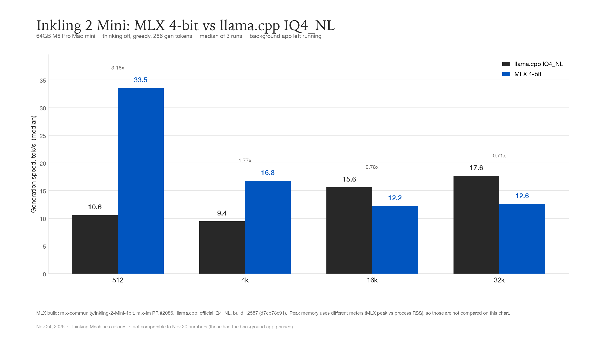
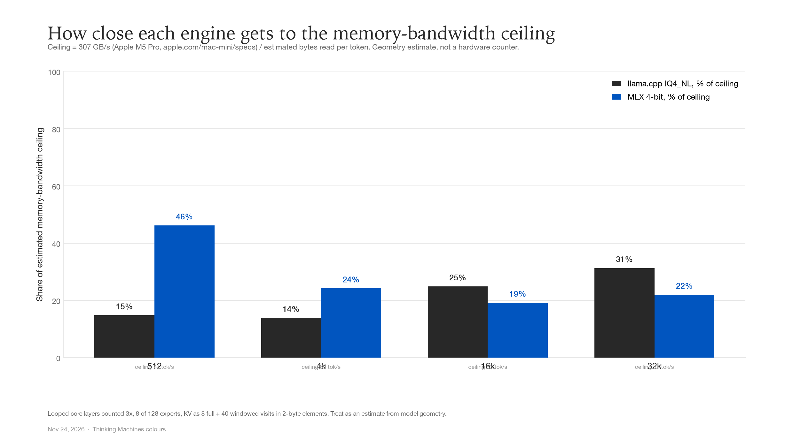
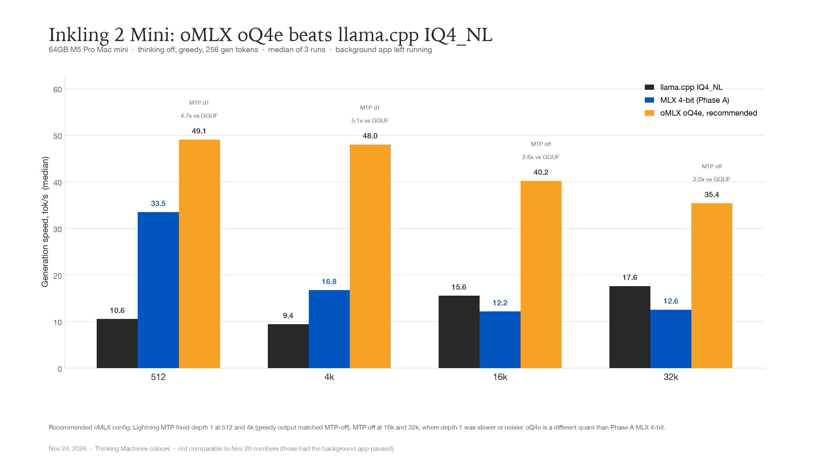
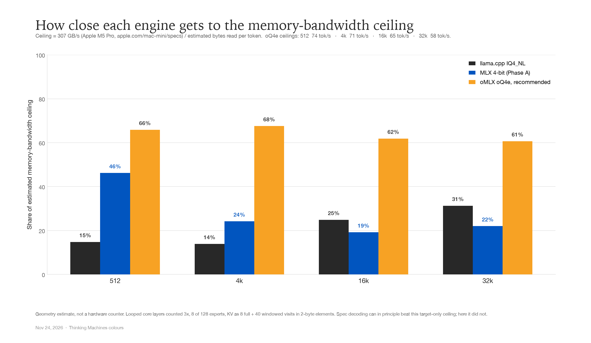
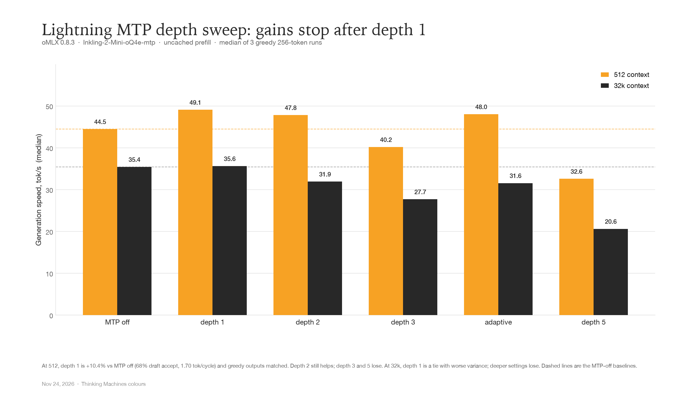
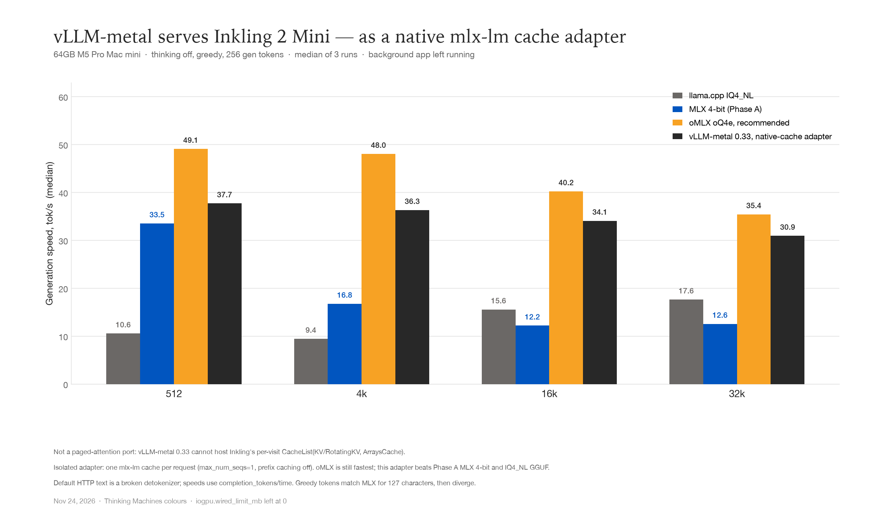

# Thinking Machines Inkling 2 Mini: MLX, oMLX, vLLM-metal, and llama.cpp on a 64GB M5 Pro Mac mini

Date: 2026-11-24 (America/Vancouver). Thinking off, greedy, 256 generated tokens, 1 warmup + 3 timed runs, median, same-run comparison unless noted.

A background app was left running at Pratik's request. The November 24 llama.cpp IQ4_NL figures are therefore not comparable to the November 20 GGUF run on this machine, which reached 29.95 tok/s at 512 tokens with a background app paused. The earlier DSpark GGUF test is in [pratikgx/inkling-2-mini-dspark-m5-pro-mac-mini-bench](https://huggingface.co/datasets/pratikgx/inkling-2-mini-dspark-m5-pro-mac-mini-bench).

Credit to @0xSero for the challenge that prompted this work, to Thinking Machines Lab for Inkling 2 Mini and DSpark, to mlx-community for the MLX 4-bit and oQ4e builds, and to oMLX for the Lightning MTP path.

## Headline

oMLX 0.8.3 serving [mlx-community/Inkling-2-Mini-oQ4e-mtp](https://huggingface.co/mlx-community/Inkling-2-Mini-oQ4e-mtp) is the fastest setup here. Lightning MTP at fixed depth 1 (bundled DSpark) reached 49.09 tok/s at 512 (65.9% of an estimated 74.49 tok/s ceiling) and 48.04 tok/s at 4k (67.6% of 71.02). That is about 66% of the estimated 307 GB/s ceiling, from model geometry, not a hardware counter. At 16k and 32k, depth 1 no longer helped, and MTP off was the stable winner: 40.23 and 35.44 tok/s.

On the same protocol, llama.cpp official IQ4_NL was 10.56 / 9.44 / 15.57 / 17.64 tok/s at 512 / 4k / 16k / 32k. MLX 4-bit was 33.53 / 16.76 / 12.20 / 12.57. A later vLLM-metal 0.33 path with a custom per-request mlx-lm cache adapter (not a paged port, and with no speculative decoding) was 37.71 / 36.32 / 34.08 / 30.94.

Quality on a 10-item slice of the fixed v1 suite: MLX 4-bit 10/10, oMLX oQ4e MTP off 10/10, llama.cpp 7/10 (all three instruction-following items failed because planning text leaked into the answer). The vLLM adapter quality suite was not rerun.

## Speed (generation tok/s, median)

| Context | llama.cpp IQ4_NL | MLX 4-bit | vLLM-metal adapter | oMLX oQ4e MTP off | oMLX + DSpark (Lightning MTP depth 1) |
| --- | ---: | ---: | ---: | ---: | ---: |
| 512 | 10.56 | 33.53 | 37.71 | 44.47 | 49.09 (recommended) |
| 4k | 9.44 | 16.76 | 36.32 | 42.56 | 48.04 (recommended) |
| 16k | 15.57 | 12.20 | 34.08 | 40.23 (recommended) | 30.18 (not recommended) |
| 32k | 17.64 | 12.57 | 30.94 | 35.44 (recommended) | 35.63 (not recommended) |

oMLX prefill stayed about 930-1160 tok/s. llama.cpp prefill stayed about 144-154 tok/s, so time to first token was 3.40 / 29.07 / 114.16 / 218.82 s on GGUF versus 0.55 / 3.54 / 15.05 / 32.85 s on the recommended oMLX settings. The vLLM adapter TTFT medians were 0.567 / 4.171 / 17.471 / 39.429 s.

At 16k, Lightning MTP depth 1 had a wide spread (28.87 / 30.18 / 41.20), so MTP off is the call. At 32k, depth 1 had a 26.11 outlier. Greedy MTP-off and depth 1 text were identical at 512.

## Builds

- Hardware: Apple M5 Pro, 64 GB unified memory, macOS 27.0.1 (26A434), AC power. Official peak bandwidth 307 GB/s, [Apple Mac mini Tech Specs](https://www.apple.com/mac-mini/specs/).
- Official model: [thinkingmachines/Inkling-2-Mini](https://huggingface.co/thinkingmachines/Inkling-2-Mini) (Apache 2.0). Official GGUF: [ggml-org/Inkling-2-Mini-GGUF](https://huggingface.co/ggml-org/Inkling-2-Mini-GGUF) `Inkling-2-Mini-IQ4_NL.gguf`, 17.63 GB.
- llama.cpp: build 12587, commit `d7cb78c91`, flash attention on, reasoning off, seed 42, `-c 36864`.
- MLX 4-bit: [mlx-community/Inkling-2-Mini-4bit](https://huggingface.co/mlx-community/Inkling-2-Mini-4bit), 17.31 GB, mlx 0.32.4, mlx-lm PR #2086 (`0.32.3.dev28+ge2b5bbd3b`). This 4-bit build keeps native NVFP4/MXFP8 experts, 4-bit affine attention, and a bfloat16 vision tower.
- oMLX 0.8.3 serving [mlx-community/Inkling-2-Mini-oQ4e-mtp](https://huggingface.co/mlx-community/Inkling-2-Mini-oQ4e-mtp), 16.85 GB, isolated server with `--no-cache`. Lightning MTP uses the bundled DSpark weights in `mtp.safetensors`.
- vLLM-metal 0.33: an out-of-tree, per-request mlx-lm cache adapter inside the isolated vllm-metal runner. It is not a paged-attention port of Inkling, and speculative decoding was not enabled. Default HTTP `text` is not trustworthy for this tokenizer; decode from token ids.

Peak memory meters differ (oMLX loaded-model actual, MLX allocator peak, llama.cpp process RSS) and must not be compared directly.

## Caveats

- A background app was left running at Pratik's request. The November 20 GGUF number of 29.95 tok/s at 512 had that app paused.
- The 307 GB/s ceiling share is an estimate from model geometry (looped core layers, 8 of 128 experts, KV visits), not a hardware counter.
- Run spreads were wide in places, especially MLX 4-bit at 4k and some long-context llama.cpp and MTP depth 1 cells. Medians are the headline.
- The vLLM figures are a single-sequence mlx-lm cache running behind the vLLM-metal API, not a paged-attention result.
- This is a local protocol, not Thinking Machines' published benches.

## Data

- Hugging Face benchmark data: [pratikgx/inkling-2-mini-mlx-vs-gguf-m5-pro-mac-mini-bench](https://huggingface.co/datasets/pratikgx/inkling-2-mini-mlx-vs-gguf-m5-pro-mac-mini-bench)
- Earlier DSpark GGUF test: [pratikgx/inkling-2-mini-dspark-m5-pro-mac-mini-bench](https://huggingface.co/datasets/pratikgx/inkling-2-mini-dspark-m5-pro-mac-mini-bench)
