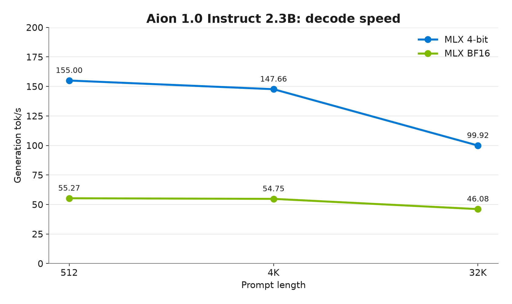
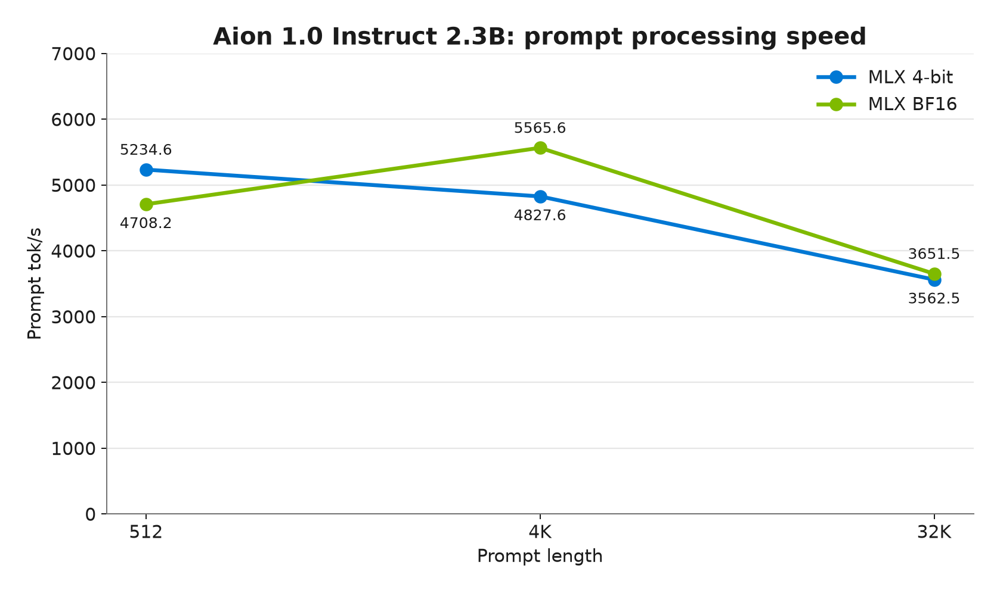
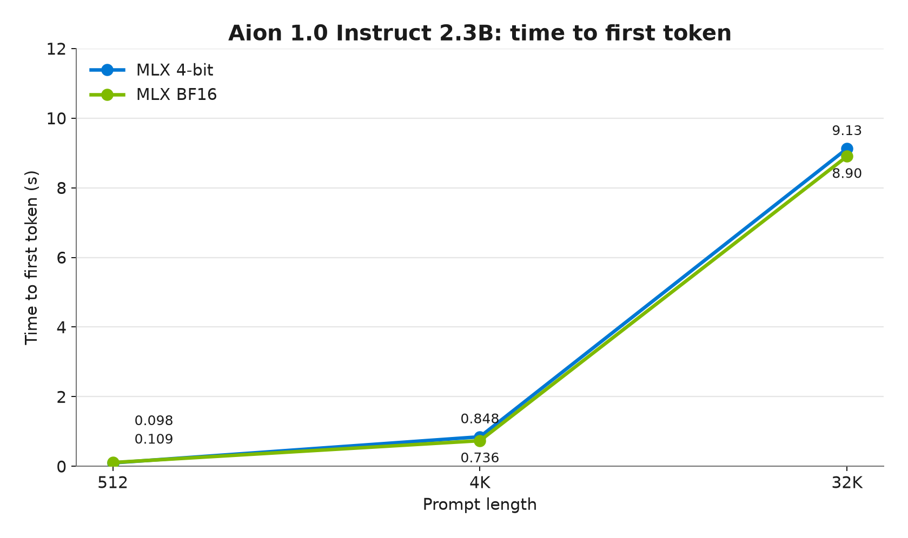
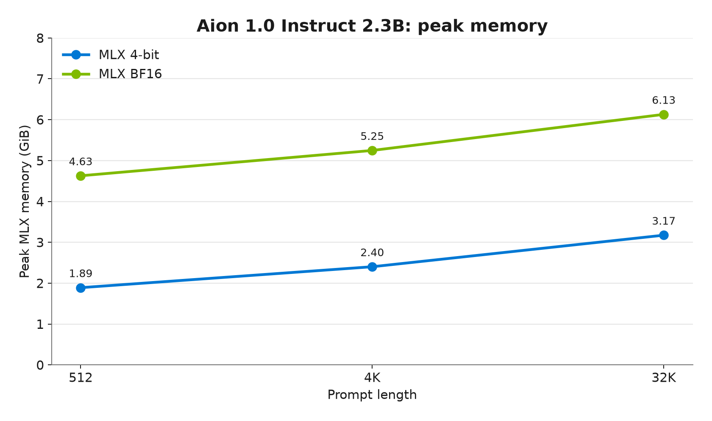
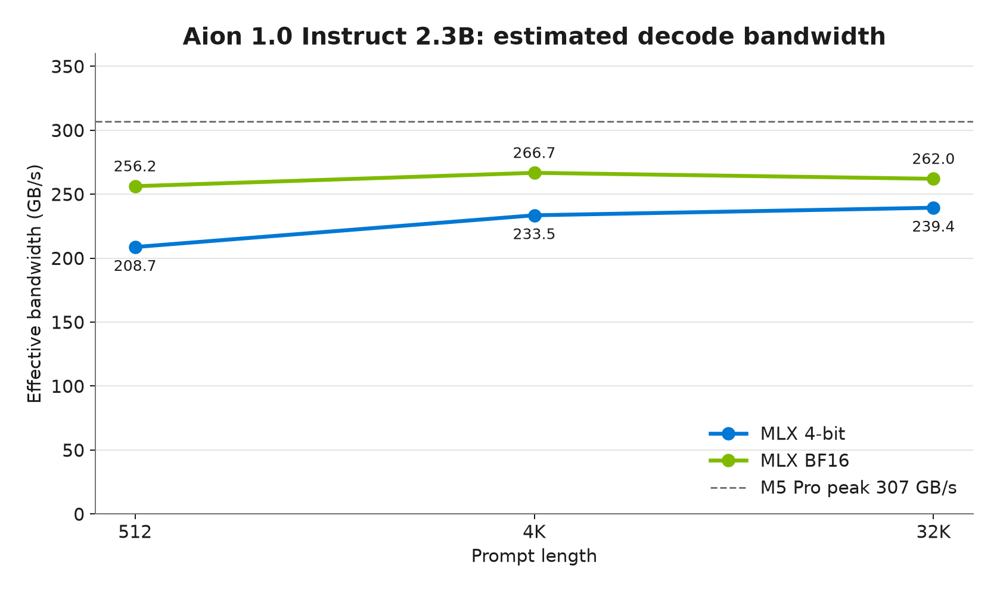
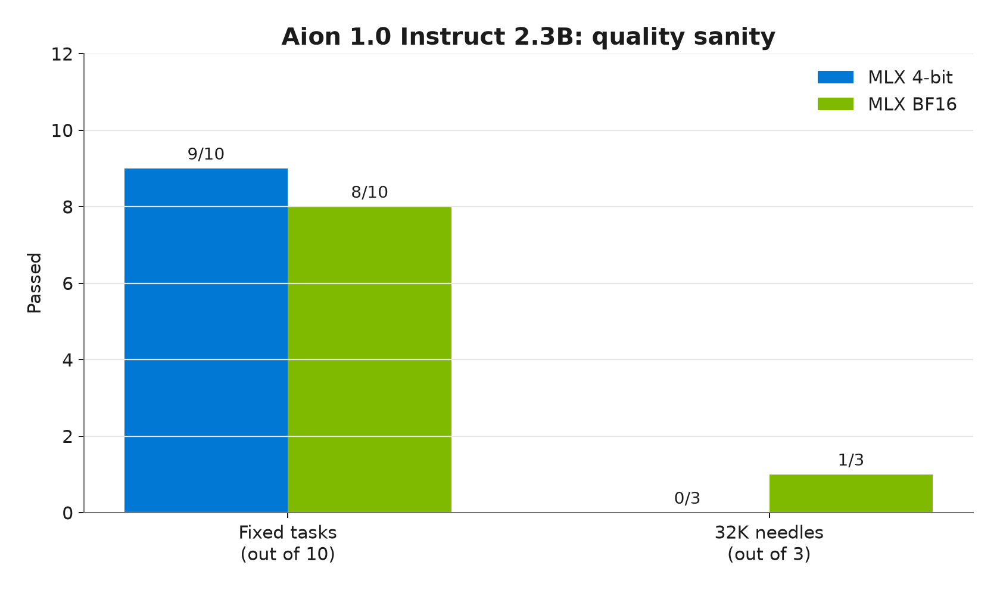

# Aion 1.0 Instruct 2.3B on a 64GB M5 Pro Mac mini

Date: 25 November 2026 (America/Vancouver)

Local benchmark of [microsoft/Aion-1.0-Instruct-2.3B](https://huggingface.co/microsoft/Aion-1.0-Instruct-2.3B) (MIT license, ~2.29B parameters, 32K context). Microsoft describes this as the foundational small language model for the Windows ecosystem. Microsoft also says a further optimized version, coupled with a content moderation model, is planned to become the Windows OS SLM by the end of January 2027, and that this Hugging Face repo is the unquantized preview. Microsoft's 19 November 2026 [Edge blog](https://blogs.windows.com/msedgedev/2026/11/19/hybrid-intelligence-on-the-web-introducing-aion-instruct-and-prompt-api-in-microsoft-edge/) presents Aion Instruct as generally available in Microsoft Edge, and coming to Windows later.

Hardware: Apple M5 Pro, 64GB unified memory, Mac mini, macOS 27.0.1. A background app was left running at Pratik's request and was not paused or stopped.

## Headline

On MLX 4-bit, the model decodes at 155.00 tok/s with a 512 token prompt, 147.66 tok/s at 4K, and 99.92 tok/s at 32K. Peak MLX memory is 1.89 GiB at 512 tokens and 3.17 GiB at 32K. Full precision (BF16) holds 55.27 tok/s at 512 tokens and 46.08 tok/s at 32K.

## Speed

Fixed settings: temperature 0, thinking off (this model has no thinking mode), 256 generated tokens, one discarded warmup, then the median of 3 timed runs. Prompt lengths were 512, 4096, and 32512 tokens (32512 plus 256 generated tokens fills the 32768 context). Early EOS was disabled on speed runs so every run produced a full 256 tokens.

Software: mlx 0.32.4, mlx-lm 0.32.2, a local MLX port of the Aion architecture (see Port below).

| Build | Prompt | Prompt tok/s | Generation tok/s | TTFT (s) | Peak memory (GiB) | Est. bandwidth (GB/s) | Util. of 307 GB/s |
| --- | ---: | ---: | ---: | ---: | ---: | ---: | ---: |
| MLX 4-bit (4.501 bpw, 1.20 GiB) | 512 | 5234.6 | 155.00 | 0.098 | 1.89 | 208.7 | 68.0% |
| MLX 4-bit | 4096 | 4827.6 | 147.66 | 0.848 | 2.40 | 233.5 | 76.1% |
| MLX 4-bit | 32512 | 3562.5 | 99.92 | 9.13 | 3.17 | 239.4 | 78.0% |
| MLX BF16 (16 bpw, 4.26 GiB) | 512 | 4708.2 | 55.27 | 0.109 | 4.63 | 256.2 | 83.5% |
| MLX BF16 | 4096 | 5565.6 | 54.75 | 0.736 | 5.25 | 266.7 | 86.9% |
| MLX BF16 | 32512 | 3651.5 | 46.08 | 8.90 | 6.13 | 262.0 | 85.4% |

Peak memory is MLX's reported peak, shown here in GiB (1024^3). Effective bandwidth is an estimate from model geometry (all dense weights plus the KV cache, with sliding-window layers capped at 2048 tokens), not a hardware counter. The 307 GB/s peak is from [Apple's M5 Pro Mac mini spec](https://www.apple.com/mac-mini/specs/).

BF16 decode sits near 83 to 87% of that peak, so the runtime is close to the chip limit for this build. 4-bit is lower at short context (68%) and rises to 78% at 32K as the KV cache grows. In other words, 4-bit still leaves a little speed on the table at short prompts, while BF16 is largely memory-bandwidth bound.

As a cross-check, `mlx_lm.benchmark` with random 512 token prompts and 256 generated tokens averaged 168.49 tok/s on the 4-bit build and 53.49 tok/s on BF16. Those prompts are not the same as the chat-wrapped suite prompts in the table.

## Quality

A small fixed set of 10 deterministic prompts (Q&A, math, instruction following, summarization) at temperature 0, plus a 32K needle test at 10%, 50%, and 90% depth. This is a sanity check, not an official benchmark. Microsoft's published MMLU, GSM8K, and IFEval scores do not overlap this set.

| Build | Fixed tasks | 32K needles |
| --- | ---: | ---: |
| MLX 4-bit | 9/10 | 0/3 |
| MLX BF16 | 8/10 | 1/3 |

Both builds missed a word problem (3 boxes of 12 apples, give away 8: answer 28). 4-bit said 24, BF16 said 32. BF16 also answered 102 for 2^10 (the 4-bit build correctly said 1024). Instruction following, short Q&A, and the lighthouse summarization all passed on both builds.

The needle sentence, "The secret codeword for the harbour lantern is AMBERFOX42.", was confirmed present in each 32512 token prompt. BF16 retrieved it only at 90% depth. 4-bit at 90% depth said "AMBER" and missed the 10% and 50% placements. That lines up with Microsoft's own note that a 2.3B model can miss fine details and has less memory for long context.

## Port

mlx-lm 0.32.2 does not include an `aion_instruct` model type, so a minimal MLX port was written for this run (`port/aion_instruct.py`). It follows Microsoft's published modeling code: RMSNorm, per-head QK RMSNorm, SwiGLU, tied embeddings, GQA 24/8, hybrid 21 sliding-window (2048) plus 7 full-attention layers, default RoPE (theta 32000) on sliding layers, and YaRN (factor 16, original length 2048) on full-attention layers.

Logits were compared with Microsoft's PyTorch reference on MPS, both in bfloat16, including a 2308 token prompt that is longer than the sliding window:

| Prompt tokens | Last-token cosine | Last-token top-1 match | All-token top-1 |
| ---: | ---: | --- | ---: |
| 49 | 0.99997 | yes | 98.0% |
| 53 | 0.99995 | yes | 96.2% |
| 2308 | 0.99988 | yes | 100% |

Mean absolute logit differences were about 0.02 to 0.03, which is normal for BF16 kernels.

The official repo uses `trust_remote_code` for its PyTorch files. Those two Python files were reviewed before use: weights are a single `model.safetensors` (4,577,698,688 bytes), and the Python is ordinary modeling code with no process, eval, or network calls. The MLX port is local and was loaded with `trust_remote_code` only so mlx-lm would import that local `model_file`.

## Other engines

Stock mlx-lm 0.32.2 cannot load `aion_instruct`, which is why this run used the small local port above. Community GGUF and MLX builds already exist, for example [Xylolabs/Aion-1.0-Instruct-2.3B-MLX-4bit](https://huggingface.co/Xylolabs/Aion-1.0-Instruct-2.3B-MLX-4bit) and [AtomicChat/Aion-1.0-Instruct-2.3B-GGUF](https://huggingface.co/AtomicChat/Aion-1.0-Instruct-2.3B-GGUF); they were not tested here. Stock llama.cpp `convert_hf_to_gguf.py` and the installed llama.cpp 0.7.0-dev (commit eb7818c) also do not know the architecture. Community patches exist but were not applied. Ollama 0.40.14 had no ready Aion tag.

## Microsoft's claims

Microsoft's claims on the model card include, among other harness scores, MMLU 55.15, GSM8K 74.91 (loose matching), MATH-500 48.00, and IFEval 83.90. This run does not repeat those tests, so there is no direct comparison.

## Files

- `results.csv`, `results.json`: headline numbers
- `raw/`: per-build speed and quality JSON
- `logs/`: security review, conversion, parity, official mlx_lm.benchmark cross-check
- `port/aion_instruct.py`: local MLX port
- `scripts/`: prepare, parity, bench, quality, and chart scripts
- `COMMANDS.md`: exact commands
- `charts/`: one chart per result, white background, Microsoft brand colors

## Licenses and credit

Measurements and this card: **CC BY 4.0**, attribution **Pratik Gandhi**. [License text](https://creativecommons.org/licenses/by/4.0/).

Aion 1.0 Instruct 2.3B is released by Microsoft under the [MIT License](https://huggingface.co/microsoft/Aion-1.0-Instruct-2.3B/blob/main/LICENSE). The local MLX port in `port/aion_instruct.py` follows Microsoft's published modeling code and is also under MIT, with layout adapted from mlx-lm (MIT, Copyright Apple Inc.). No model weights are redistributed in this dataset.

Credit to Microsoft for Aion 1.0 Instruct 2.3B.

## Data

- Hugging Face benchmark data: [pratikgx/aion-1.0-instruct-2.3b-m5-pro-mac-mini-bench](https://huggingface.co/datasets/pratikgx/aion-1.0-instruct-2.3b-m5-pro-mac-mini-bench)
- MLX 4-bit weights: [pratikgx/Aion-1.0-Instruct-2.3B-MLX-4bit](https://huggingface.co/pratikgx/Aion-1.0-Instruct-2.3B-MLX-4bit)
