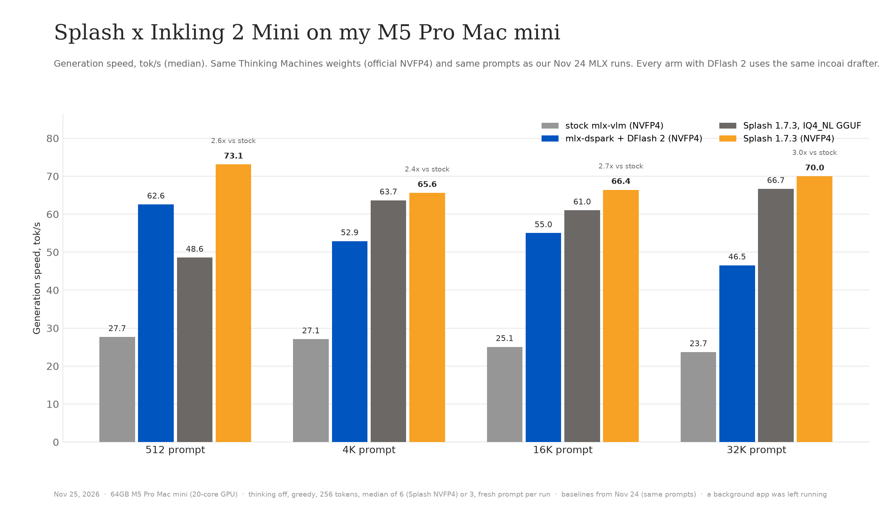
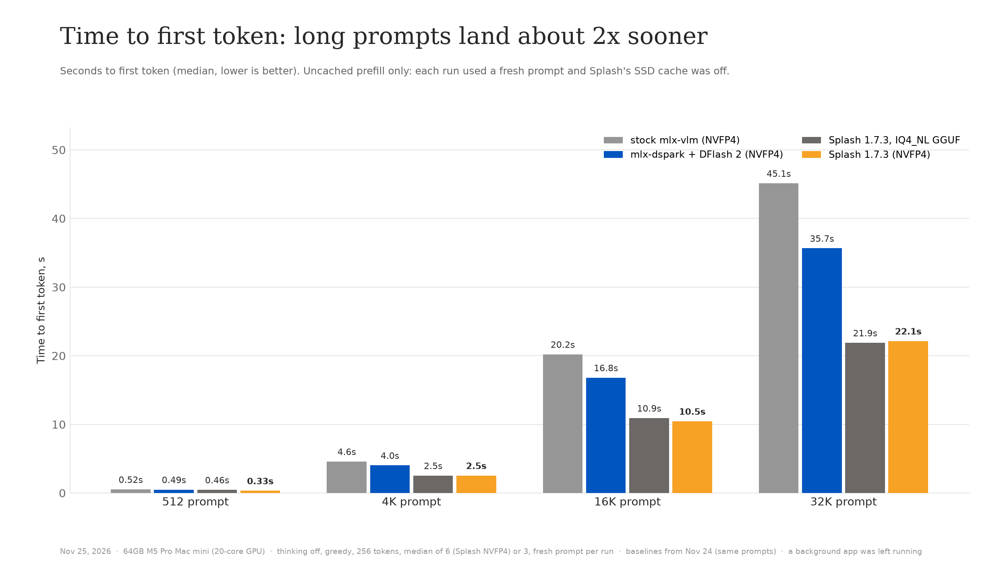

# Splash 1.7.3 with Inkling 2 Mini on a 64GB M5 Pro Mac mini

Run: Nov 25, 2026, 10:28 to 10:47 PM PT (UTC-7). Mac folder: ~/launch-benchmarks/splash-2026-11-25/
Security verdict: CLEAN (see SECURITY_REVIEW.md). Installed the hash-verified 1.7.3 release tarball into the bench folder. No brew, no sudo.

## Setup
- Engine: Splash 1.7.3 from [Inco AI](https://github.com/incoai/splash) ([@inco_ai](https://x.com/inco_ai), Apache 2.0), localhost only, DFlash 2 drafter `incoai/Inkling-2-Mini-DFlash2` (local copy), `--verify-rows auto`.
- Target A (headline, same weights as Nov 24 Phase B): official `thinkingmachines/Inkling-2-Mini` NVFP4 (19.53 GB, 4.625 bpw).
- Target B: ggml-org IQ4_NL GGUF (17.63 GB), the same file as our llama.cpp runs.
- Protocol: thinking off (pre-templated prompts with "Thinking effort level: 0", the same as Phase B), temp 0, seed 42, 256 tokens (ignore_eos), 1 warmup then 3 timed runs, median.
- Anti-fake-speedup: a unique random nonce at the start of every request, SSD cache off (`--max-cache-disk 0`), and `cache_n` = 0 checked on every timed run. A first attempt reused a nonce across lengths, which gave 512 to 4096 cached tokens. It was thrown out and kept only as raw/..._aborted (Mac).
- NVFP4 had big spreads (spec decoding varies by prompt), so I ran a second pass of 3 more fresh runs per length. The table shows the median of all 6.
- A background app was left running at Pratik's request (same as Nov 24 Phase B).

Exact command (A):
```
splash-1.7.3-arm64-macos26/python/bin/python3 -u splash-1.7.3-arm64-macos26/install/launcher.py serve \
  --model thinkingmachines/Inkling-2-Mini --model-dir ~/launch-benchmarks/inkling-2-mini-2026-11-20/models/Inkling-2-Mini \
  --draft-model ~/launch-benchmarks/inkling-mlx-dspark-2026-11-24/models/Inkling-2-Mini-DFlash2 \
  --language-only --port 18800 --no-webui --max-memory 40G --max-context 40K --idle-release off --max-cache-disk 0
```
(B is the same with `--model ggml-org/Inkling-2-Mini-GGUF:IQ4_NL --model-dir .../Inkling-2-Mini-IQ4_NL.gguf`). Requests: POST /v1/completions, timings taken from Splash's llama-server-style `timings` object.

## Results (gen tok/s median, prompt tok/s, TTFT, Metal peak)

| Context | Splash NVFP4 gen | run range | prompt tok/s | TTFT | peak | Splash IQ4_NL gen | prompt tok/s | TTFT | peak |
|---|---:|---|---:|---:|---:|---:|---:|---:|---:|
| 512 | **73.1** | 67.4 to 80.0 | 1609 | 0.33 s | 20.4 GB | 48.6 | 1139 | 0.46 s | 19.5 GB |
| 4K | **65.6** | 51.3 to 72.8 | 1613 | 2.55 s | 21.1 GB | 63.7 | 1622 | 2.53 s | 20.6 GB |
| 16K | **66.4** | 45.3 to 75.3 | 1569 | 10.45 s | 22.1 GB | 61.0 | 1503 | 10.91 s | 22.4 GB |
| 32K | **70.0** | 49.3 to 73.2 | 1480 | 22.14 s | 24.6 GB | 66.7 | 1499 | 21.88 s | 25.6 GB |

Peak = Splash /status `memory_actual.peak_bytes` (Metal allocations, not process RSS). The highest over the whole run including quality was 25.1 GB (NVFP4) and 25.9 GB (GGUF), well under the 45 GB cap. Draft acceptance was about 36 to 42% of proposed tokens, about 3 tokens per verify cycle.





## Versus earlier Mac numbers (same prompts, same NVFP4 weights, Nov 24 Phase B, background app also running)

| Context | stock mlx-vlm | mlx-dspark baseline | mlx-dspark + DFlash 2 | oMLX oQ4e rec. (diff quant) | Splash NVFP4 | Splash vs best prior |
|---|---:|---:|---:|---:|---:|---:|
| 512 | 27.67 | 40.90 | 62.59 | 49.09 | **73.1** | 1.17x |
| 4K | 27.08 | 39.09 | 52.92 | 48.04 | **65.6** | 1.24x |
| 16K | 25.06 | 35.01 | 55.03 | 40.23 | **66.4** | 1.21x |
| 32K | 23.69 | 33.05 | 46.54 | 35.44 | **70.0** | 1.50x |

TTFT vs stock mlx-vlm: 0.33 vs 0.52 s, 2.55 vs 4.59 s, 10.45 vs 20.20 s, 22.14 vs 45.12 s (about 2x at 16K and 32K). Prefill is about 1.5 to 1.6K tok/s, against 0.73 to 0.99K for stock and 0.92 to 1.04K for mlx-dspark.
The brief's "49.1/48.0/35.4" are the oMLX oQ4e recommended column (a different quant), not mlx-dspark. The best prior on the same weights was mlx-dspark + DFlash 2 (62.6/52.9/46.5).

GGUF context: IQ4_NL on llama.cpp (PR build, Nov 20/21) measured 30.0/28.4/24.9 tok/s at 512/4K/32K with prompt 492/359/198 tok/s. Those nights had different background conditions. Splash on the same file: 48.6/63.7/66.7. The Phase B GGUF column (10.6/9.4/15.6/17.6) came from a different llama.cpp build and isn't a fair baseline.

Natural prompts (the Nov 21 fair-check prompts: LRU cache / TCP / B-trees, chat API, reasoning_effort none, 256 tokens with ignore_eos):
- Splash NVFP4: 78.2 / 70.2 / 52.1 tok/s
- Splash IQ4_NL: 96.6 / 67.2 / 73.3 tok/s
- llama.cpp IQ4_NL baseline, fresh server: 29.73 / 30.17 / 30.19
Caveat: Inkling still writes a short reasoning block at effort none, and ignore_eos keeps it generating past its natural end, so treat these as speed only.

## Quality
- v1 10-item suite (math 4, code 3 with unit tests, instruction-following 3), 1024 tokens, thinking off: **10/10 on both NVFP4 and IQ4_NL**. That matches MLX 4-bit and oMLX (10/10). llama.cpp scored 7/10 because of a formatting leak.
- Output match: on the unmodified 512 prompt, Splash's greedy text shares its first 185 characters with mlx-dspark baseline/DFlash2/DSpark (those three share 185 to 372 with each other), and only 44 with stock mlx-vlm (stock vs mlx-dspark was 64). The text means the same thing but isn't bit-exact. Splash logs warn that `--verify-rows auto` greedy output can vary from run to run.

## Apples-to-oranges flags
- Inco AI / Splash's published claims of 100+ / 149 tok/s are for `unsloth/Inkling-2-Mini-GGUF:UD-Q4_K_M` on code prompts. We ran official NVFP4 and IQ4_NL (UD-Q4_K_M isn't on disk, 16.6 GB; disk has 46 GB free). We did not reproduce 100+. Our best single coding prompt was 96.6 tok/s (IQ4_NL, LRU cache).
- The filler prompts are word lists, so prompt-lookup drafting (on by default in Splash, off in mlx-dspark for MoE) can help copy words. That may be why 32K holds 70 tok/s.
- Spec-decoding spread is wide (up to 45% at 16K NVFP4, one 45 tok/s run). The medians are honest, but single runs swing.
- Splash defaults: INT8 KV cache and the Neural Engine for prefill. The MLX baselines used BF16 KV on the GPU only.
- A background app was left running at Pratik's request during all runs, as it was on Nov 24.

## Files
- img/2026-11-25-splash-inkling-2-mini-gen-speed.png, img/2026-11-25-splash-inkling-2-mini-ttft.png (Thinking Machines colors, white background)
- raw/splash_nvfp4.json, raw/splash_nvfp4_rerun.json, raw/splash_nvfp4_combined6.json, raw/splash_gguf.json, raw/ref_phase_b_dspark.json, raw/results_rows.csv
- scripts/bench_splash.py, scripts/charts.py
- SECURITY_REVIEW.md

## Licenses and credit

Measurements and this card: **CC BY 4.0**, attribution **Pratik Gandhi**. [License text](https://creativecommons.org/licenses/by/4.0/).

Credit to [Inco AI](https://github.com/incoai/splash) ([@inco_ai](https://x.com/inco_ai)) for Splash 1.7.3, released under Apache 2.0, and to Thinking Machines for Inkling 2 Mini. No model weights are redistributed in this dataset.

## Data

- Hugging Face benchmark data: [pratikgx/inkling-2-mini-splash-1.7.3-m5-pro-mac-mini-bench](https://huggingface.co/datasets/pratikgx/inkling-2-mini-splash-1.7.3-m5-pro-mac-mini-bench)
