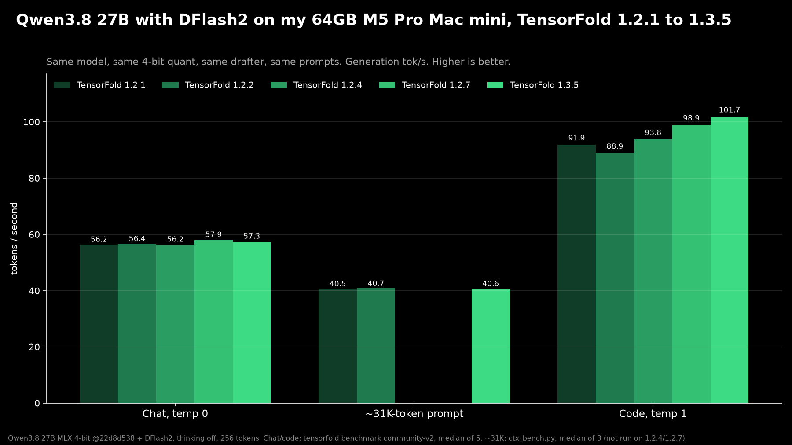
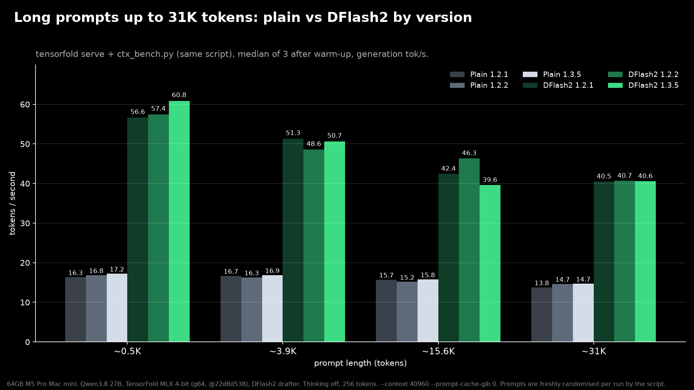
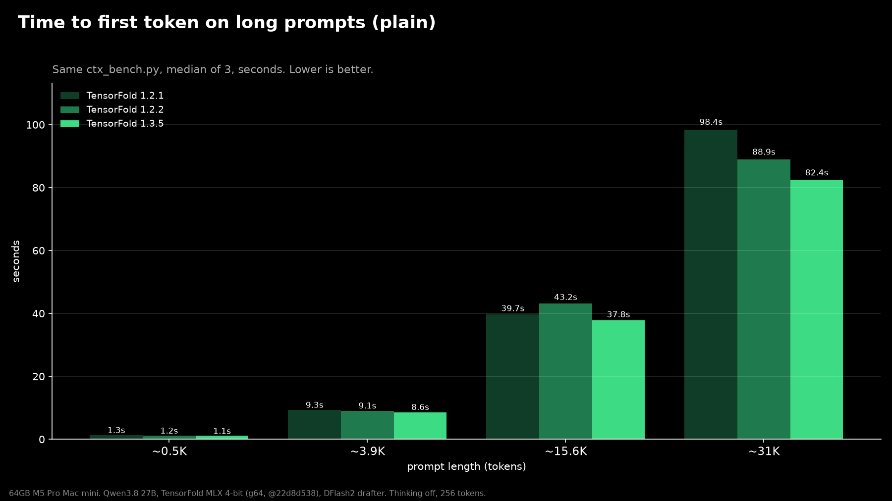
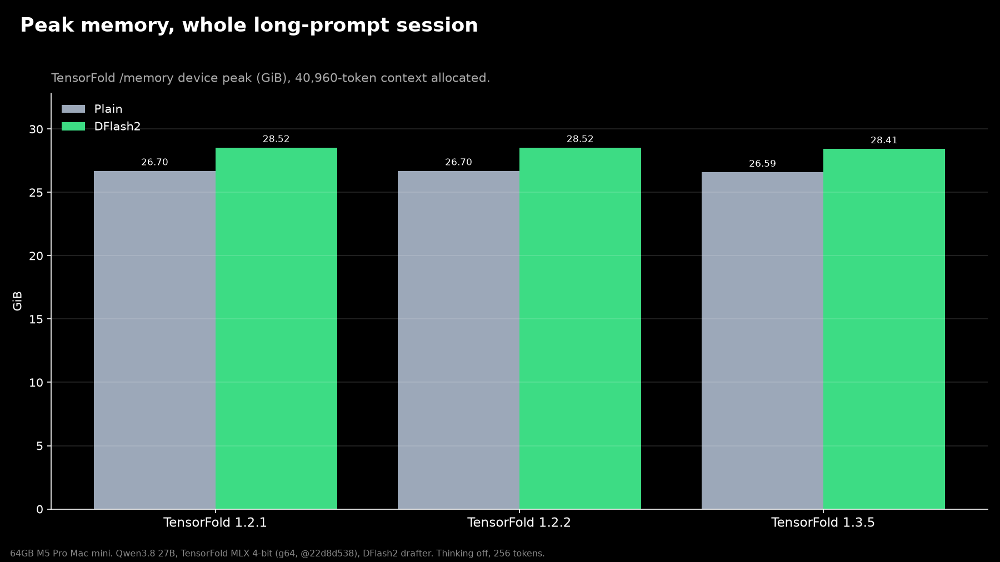
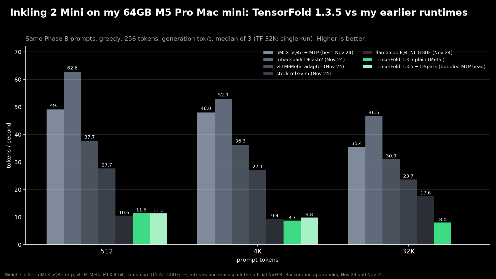

# Qwen3.8 27B and Inkling 2 Mini on TensorFold 1.3.5

Date: 2026-11-25 (America/Vancouver)

I reran Qwen3.8 27B on TensorFold after 1.3.5, on my 64GB M5 Pro Mac mini, then tried official Inkling 2 Mini NVFP4 on the same runtime. Decode for Qwen stayed in the same band as 1.2.7: official `tensorfold benchmark` (community-v2, median of 5 after warm-up) writes greedy chat at 17.24 tok/s plain and 57.27 tok/s with DFlash2 (3.32x). Greedy output is token-for-token identical to plain and to every earlier version I measured (1.2.1 through 1.2.7). Inkling 2 Mini now serves natively on Metal at 11.52 tok/s plain at 512 tokens. DSpark accepted 62% of drafts and matched plain output, but that is well behind my November 24 oMLX + MTP result of 49.09 tok/s on this machine.

A background inference app was left running at the owner's request and was never touched. On November 25 it was actively serving on the GPU. The first 1.3.5 plain community-v2 attempt and the first plain long-prompt pass were contended; the headline plain rows are reruns that waited for a quiet GPU first. 1.2.4 and 1.2.7 were measured on November 11 with that app paused, so those dates are not like for like on background load.

Disclosure: I am linked with Yukon, which makes TensorFold.

## The setup

Mac mini, Apple M5 Pro, 64 GB, macOS 27.0.1, AC power. TensorFold native 1.3.5 via the official Homebrew tap. The 1.2.2, 1.2.4 and 1.2.7 kegs were kept.

Model [TensorFold/Qwen3.8-27B-MLX-4bit](https://huggingface.co/TensorFold/Qwen3.8-27B-MLX-4bit), revision `22d8d538154e0e5b6f8dcb1fcc74a60a0798104c` (mlx-affine 4-bit g64, 14.98 GiB). Drafter [z-lab/Qwen3.8-27B-DFlash2](https://huggingface.co/z-lab/Qwen3.8-27B-DFlash2) @ `50307d4c`. Inkling weights: official [thinkingmachines/Inkling-2-Mini](https://huggingface.co/thinkingmachines/Inkling-2-Mini), modelopt NVFP4, 18.21 GiB, the same checkpoint used for the November 24 stock mlx-vlm and mlx-dspark runs.

community-v2 is TensorFold's own `tensorfold benchmark`, 256 tokens, thinking off, median of 5 after warm-up. Long prompts use the same `ctx_bench.py` as the November 3 runs (`--context 40960 --prompt-cache-gib 0`), median of 3 after warm-up.

## community-v2 decode (tok/s, stream delivery, median of 5)

| cell | plain 1.2.1 | plain 1.2.2 | plain 1.2.4 | plain 1.2.7 | plain 1.3.5 | DFlash2 1.2.1 | DFlash2 1.2.2 | DFlash2 1.2.4 | DFlash2 1.2.7 | DFlash2 1.3.5 | speedup 1.3.5 |
| --- | ---: | ---: | ---: | ---: | ---: | ---: | ---: | ---: | ---: | ---: | ---: |
| chat T0 | 17.23 | 16.85 | 17.06 | 17.39 | **17.24** | 56.19 | 56.43 | 56.22 | 57.90 | **57.27** | **3.32x** |
| code T0 | 17.08 | 16.97 | 17.01 | 17.39 | 17.24 | 41.33* | 79.57 | 80.76 | 82.43 | **81.34** | 4.72x |
| chat T1 | 17.27 | 16.69 | 17.17 | 17.49 | 17.32 | 44.74 | 43.49 | 47.51 | 51.41 | **52.15** | 3.01x |
| code T1 | 16.88 | 16.15 | 17.33 | 17.38 | 17.35 | 91.90 | 88.93 | 93.79 | 98.90 | **101.73** | 5.86x |

\*1.2.1 code T0 drafter was slowed by other apps.

Greedy T0 token SHA is `a06fab348fbe` for chat and `a10c9b848ed9` for code in every plain and DFlash2 run on all five versions.

One DFlash2 1.3.5 chat T0 rep was an outlier at 31.42 tok/s. The other four were 57.24, 57.27, 57.27 and 57.31, and the median is 57.27. Plain 1.3.5 spreads were under 1%. DFlash2 1.3.5 drafts: 4,106 of 15,451 drafted tokens accepted over 1,031 rounds (chat T0 accept 21.3%).

## Long prompts (ctx_bench.py, median of 3)

The 1.3.5 plain row is a gated rerun that waited for a quiet GPU before each request. The DFlash2 headline is pass 1 (no gate). There is no published 1.2.4 or 1.2.7 ~31K row, so that comparison is 1.2.1 / 1.2.2 / 1.3.5 only.

| prompt | plain gen 1.2.1 / 1.2.2 / 1.3.5 | DFlash2 gen 1.2.1 / 1.2.2 / 1.3.5 | speedup 1.3.5 | plain TTFT s 1.2.1 / 1.2.2 / 1.3.5 | plain prompt tok/s 1.2.1 / 1.2.2 / 1.3.5 |
| --- | --- | --- | ---: | --- | --- |
| ~0.5K | 16.32 / 16.84 / **17.20** | 56.62 / 57.42 / **60.82** | 3.54x | 1.34 / 1.16 / **1.07** | 391 / 442 / **476** |
| ~3.9K | 16.69 / 16.28 / **16.85** | 51.34 / 48.63 / **50.67** | 3.01x | 9.27 / 9.05 / **8.60** | 414 / 426 / **446** |
| ~15.6K | 15.72 / 15.16 / **15.78** | 42.44 / 46.32 / **39.61** | 2.51x | 39.70 / 43.22 / **37.79** | 392 / 360 / **412** |
| ~31K | 13.78 / 14.66 / **14.71** | 40.52 / 40.68 / **40.57** | 2.76x | 98.36 / 88.93 / **82.42** | 317 / 351 / **378** |

Peak memory (TensorFold `/memory` device peak, whole session): plain 26.59 GiB (26.70 on 1.2.1 / 1.2.2), DFlash2 28.41 GiB (28.52 before).

## Inkling 2 Mini

It runs. TensorFold 1.3.5 loads the official NVFP4 checkpoint natively on Metal (about 19-20 GiB peak footprint, so it fits easily in 64 GB) and the output is coherent. Prompts are the November 24 Phase B file, temp 0, 256 tokens, 1 warm-up + 3 timed, median, with a quiet-GPU wait before each request.

| prompt | TF 1.3.5 plain | TF 1.3.5 + DSpark | oMLX oQ4e + MTP (best, Nov 24) | mlx-dspark DFlash2 (Nov 24) | vLLM-Metal (Nov 24) | stock mlx-vlm (Nov 24) | llama.cpp IQ4_NL GGUF (Nov 24) |
| --- | ---: | ---: | ---: | ---: | ---: | ---: | ---: |
| 512 | 11.52 [8.99-12.37] | 11.34 [11.33-11.34] | 49.09 | 62.59 | 37.71 | 27.67 | 10.56 |
| 4K | 8.73 [6.81-11.02] | 9.84 [8.92-10.31] | 48.04 | 52.92 | 36.32 | 27.08 | 9.44 |
| 32K | 8.01 (single run) | not run | 35.44 | 46.54 | 30.94 | 23.69 | 17.64 |

TTFT (median, uncached): plain 21.82 s at 512 and 149.15 s at 4K; DSpark 16.87 s and 144.55 s. The 32K plain run (a single pass, not a median of 3) took 1,138.74 s to the first token, or about 19 minutes, at 28.8 tok/s prompt reading. Peak memory: 19.08 GiB plain, 19.97 GiB with DSpark, 19.95 GiB plain at 32K. DSpark acceptance was 61.8% at 512 and 63.4% at 4K, and greedy output was byte-identical to plain.

The incoai DFlash2 drafter is refused by TensorFold for Inkling, so the drafter arm is DSpark only. Flash Next TFQ3 (78.99 GiB) and GLM-5.3-Flash TFQ3 (139.55 GB) do not fit in 64 GB and were not run.

The November 24 comparison uses mixed quants, so it is not apples to apples. Those oMLX, vLLM-Metal, mlx-vlm, mlx-dspark and llama.cpp figures are from [pratikgx/inkling-2-mini-mlx-vs-gguf-m5-pro-mac-mini-bench](https://huggingface.co/datasets/pratikgx/inkling-2-mini-mlx-vs-gguf-m5-pro-mac-mini-bench).

## What I learned

On this Mac, 1.3.5 does not jump ahead of 1.2.7 on Qwen3.8-27B decode. The drafter is still the big win, and greedy output stayed identical. Plain long-prompt time to first token did improve versus the November 3 1.2.1 / 1.2.2 runs (82.42 s at ~31K, down from 98.36 s and 88.93 s). Inkling 2 Mini finally serves natively on Metal here, but at 11.52 tok/s on this M5 Pro the Ultra-class speedups have not landed.

## Caveats

- A background inference app was running on November 3 and November 25, and paused on November 11.
- The first 1.3.5 plain community-v2 attempt got HTTP 503 (critical memory pressure) on every request and is not in the headline table.
- The first 1.3.5 plain long-prompt pass was contended (6.84-15.80 tok/s) and is excluded; the headline is the gated rerun. Prior published runs had no gate.
- A gated DFlash2 long-prompt pass 2 was hit mid-request by background-app bursts; its 31K median fell to 28.89 tok/s and is not the headline.
- The November 11 long-prompt sweep for 1.2.4 and 1.2.7 was never published and is excluded (it ran at about 8 tok/s plain).
- One DFlash2 community-v2 chat T0 rep was an outlier at 31.42 tok/s.
- Ash Hart's 1.3.5 headline numbers are M5 Ultra on Flash Next TFQ3 and Inkling 2 Mini; they do not overlap this M5 Pro Qwen3.8-27B test.
- The Inkling 32K row is a single run. 16K and DSpark at 32K were not run for time.
- Peak memory is TensorFold's `/memory` meter, not an MLX allocator peak, and should not be compared to MLX rows in other notes.

Exact commands, receipts and the excluded runs are in the Hugging Face dataset below.

## Licenses and credit

Measurements and this note: **CC BY 4.0**, attribution **Pratik Gandhi**. [License text](https://creativecommons.org/licenses/by/4.0/).

No weights are redistributed.

Credit to the Qwen team for Qwen3.8-27B, to Thinking Machines Lab for Inkling 2 Mini, to z-lab for the Qwen DFlash2 drafter, and to TensorFold ([@tensorfold_dev](https://x.com/tensorfold_dev)) and Ash Hart ([@ashxhart](https://x.com/ashxhart)) for the 1.3.5 runtime.

## Data

- Hugging Face: [pratikgx/qwen3.8-27b-tensorfold-1.3.5-m5-pro-mac-mini-bench](https://huggingface.co/datasets/pratikgx/qwen3.8-27b-tensorfold-1.3.5-m5-pro-mac-mini-bench)
- Earlier TensorFold runs: [1.2.1](https://huggingface.co/datasets/pratikgx/qwen3.8-27b-tensorfold-1.2.1-m5-pro-mac-mini-bench), [1.2.2](https://huggingface.co/datasets/pratikgx/qwen3.8-27b-tensorfold-1.2.2-m5-pro-mac-mini-bench), [1.2.7](https://huggingface.co/datasets/pratikgx/qwen3.8-27b-tensorfold-1.2.7-m5-pro-mac-mini-bench)
- results/2026-11-25-tensorfold-1.3.5.csv / .json
